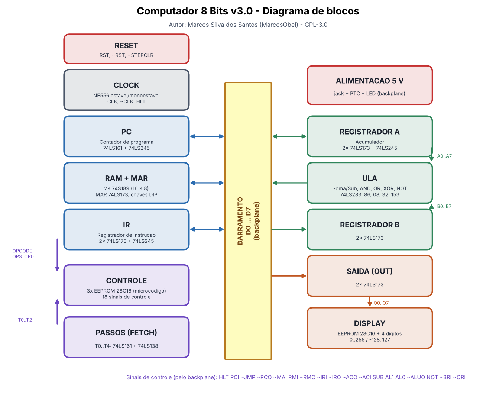
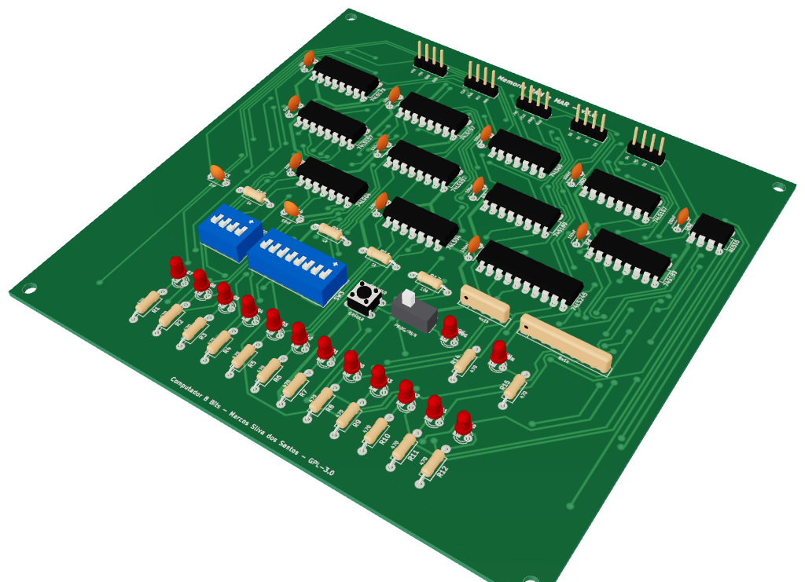
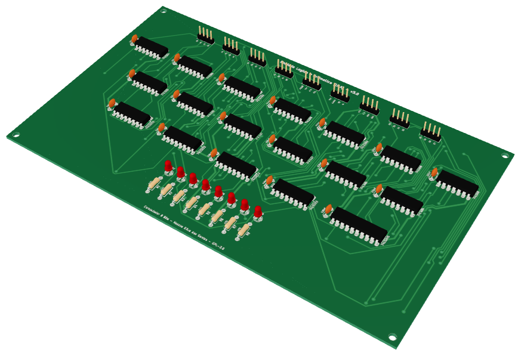
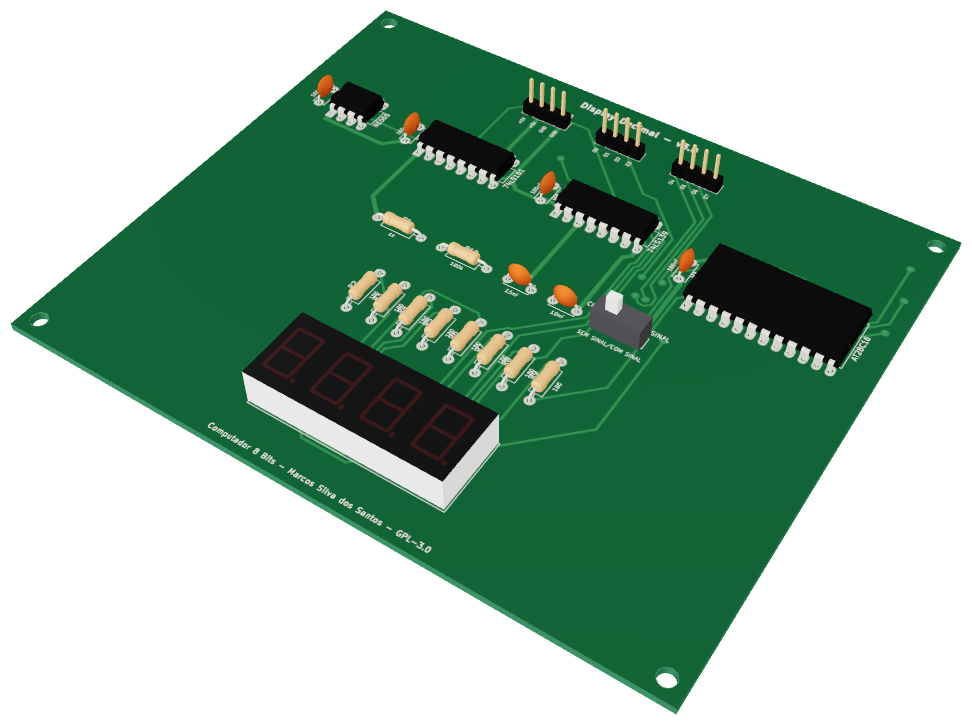
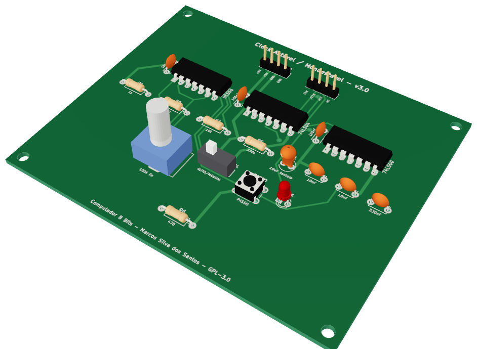
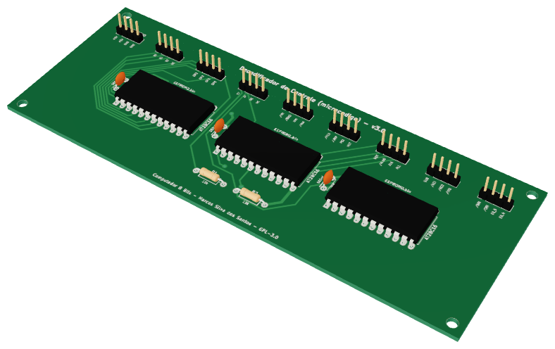
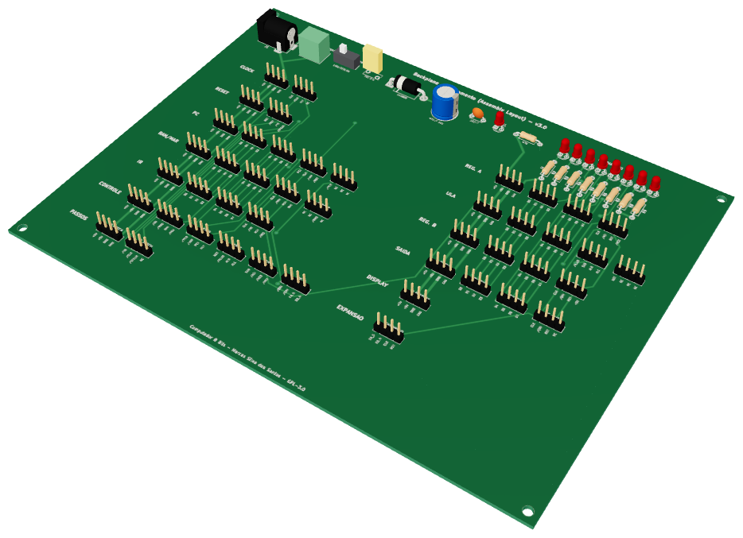
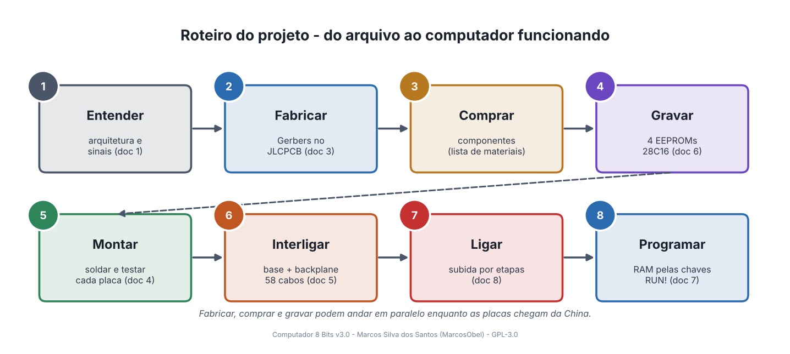

<h1 align="center">

<br>
</h1>

<h4 align="center">

Computador de 8 bits feito só com lógica TTL (série 74LS), EEPROMs e temporizadores 555 —
**sem microcontrolador, sem CPU pronta**, "como antigamente". Projeto educacional e hobby,
com esquemas, placas (PCB) e manual para fabricar e montar tudo em casa.

</h4>

<p align="center">


<a href="https://github.com/aragonxpd154/8-bits-computer/issues"></a>

</p>

<p align="center">
<a href="#-o-que-é">O que é</a> ·
<a href="#-status">Status</a> ·
<a href="#-as-placas-em-3d">Placas em 3D</a> ·
<a href="#-passo-a-passo-faça-você-mesmo">Faça você mesmo</a> ·
<a href="#-conteúdo-do-repositório">Conteúdo</a> ·
<a href="#-ferramentas">Ferramentas</a> ·
<a href="#-licença">Licença</a>
</p>

<p align="center">

</p>

## 🧠 O que é

Um computador completo de 8 bits dividido em **12 módulos** + **1 backplane** (placa-mãe de interligação):

| Módulo | Principais CIs | Função |
|---|---|---|
| [Clock](docs/placas/clock-astavel-monoestavel.md) | NE556, 74LS00, 74LS04 | clock automático (0,7–140 Hz) ou passo a passo, HLT |
| [Reset](docs/placas/reset-circuito.md) | 74LS132 | reset por botão e ao ligar |
| [Contador de Programa](docs/placas/pc-contador-programa.md) | 74LS161, 74LS245 | endereço da próxima instrução |
| [RAM e MAR](docs/placas/ram-mar-memoria.md) | 2× 74S189, 74LS173, 4× 74LS157 | 16 bytes, programação manual por chaves DIP |
| [Registrador de Instrução](docs/placas/ir-registrador-instrucao.md) | 2× 74LS173, 74LS245 | opcode + operando |
| [Decodificador de Controle](docs/placas/cd-decodificador-controle.md) | 3× EEPROM 28C16 | microcódigo: 18 sinais de controle |
| [Contador de Passos](docs/placas/fetch-contador-passos.md) | 74LS161, 74LS138 | passos T0…T4 |
| Registrador [A](docs/placas/acc-registrador-a.md) / [B](docs/placas/b-registrador-b.md) | 2× 74LS173 (+ 74LS245) | acumulador e segundo operando |
| [ULA](docs/placas/alu-unidade-logica-aritmetica.md) | 74LS283, 74LS86, 74LS08, 74LS32, 74LS153 | soma, subtração, AND, OR, XOR, NOT |
| [Registrador de Saída](docs/placas/out-registrador-saida.md) | 2× 74LS173 | valor do display |
| [Display Decimal](docs/placas/display-decimal.md) | 28C16, 555, 74LS161, 74LS139 | 0…255 ou −128…127 em 4 dígitos |
| [Backplane](docs/placas/backplane-barramento.md) | — | 5 V protegido, barramento D0…D7 com LEDs, todos os sinais |

**16 instruções:** `NOP LDA SUB STA ADD LDI JMP AND OR XOR NOT JC JZ OUT HLT` (JC/JZ prontos para uma futura placa de flags).
Detalhes em [docs/01-arquitetura.md](docs/01-arquitetura.md). Clique no nome de um módulo para ver a página dele.

## 🧊 As placas em 3D

Cada placa tem uma **página própria** explicando a função dela no computador, como o circuito funciona, o papel
de cada CI, o que cada LED mostra, o esquemático, a pinagem dos conectores, a lista de componentes e como testar —
além do **modelo 3D** (STL que o GitHub mostra girando no navegador, GLB com as cores reais e STEP para CAD).

➡️ **[Guia das 13 placas](docs/placas/README.md)** · 🧊 **[Visualizador 3D interativo](docs/3d/README.md)**

<table>
<tr>
<td align="center" width="33%"><a href="docs/placas/ram-mar-memoria.md"><br><b>RAM e MAR</b></a></td>
<td align="center" width="33%"><a href="docs/placas/alu-unidade-logica-aritmetica.md"><br><b>ULA</b></a></td>
<td align="center" width="33%"><a href="docs/placas/display-decimal.md"><br><b>Display Decimal</b></a></td>
</tr>
<tr>
<td align="center"><a href="docs/placas/clock-astavel-monoestavel.md"><br><b>Clock</b></a></td>
<td align="center"><a href="docs/placas/cd-decodificador-controle.md"><br><b>Decodificador de Controle</b></a></td>
<td align="center"><a href="docs/placas/backplane-barramento.md"><br><b>Backplane</b></a></td>
</tr>
</table>

## 💻 Status

**Versão 3.0 (novembro/2026)** — projeto completo em **KiCad** (abre no Zorin OS/Ubuntu/Windows):

- [x] Esquemáticos de todos os módulos, com bloco de título e autoria
- [x] PCBs roteadas de todas as 13 placas, **DRC sem erros** — prontas para fabricação profissional (JLCPCB/PCBWay) e com **serigrafia didática** (sinais nos conectores e LEDs, valores dos componentes)
- [x] PDFs 1:1 para transferência térmica, fotolitos, mapa de furação e Gerbers para fabricação industrial
- [x] Backplane (antiga pasta *ASSEMBLY LAYOUT*, que estava vazia) e placa de Reset (que não tinha PCB)
- [x] Microcódigo completo (Python e C), EEPROM do display, montador e emulador
- [x] Revisão de todos os circuitos — 9 erros corrigidos (veja [docs/02-revisao-e-correcoes.md](docs/02-revisao-e-correcoes.md))
- [x] Manual completo de fabricação, montagem, gravação e uso
- [x] Página detalhada de cada placa, com diagrama de funcionamento e **modelo 3D** (STL, GLB, STEP e visualizador)
- [ ] Testes em bancada de cada placa produzida (o Clock da versão 2.1 já foi testado)
- [ ] Placa de flags (carry/zero) para `JC`/`JZ`

## ☕ Passo a passo (faça você mesmo)

> 🖼️ **Comece pelo [Guia visual passo a passo](docs/GUIA-VISUAL-PASSO-A-PASSO.md)** — todo o caminho em diagramas,
> do arquivo ao computador funcionando. Também em PDF:
> 📕 [Guia visual (PDF)](docs/pdf/guia-visual-passo-a-passo.pdf) · 📘 [Manual completo (PDF)](docs/pdf/manual-completo.pdf) ·
> 📄 [Esquema elétrico completo (PDF)](hardware/esquema-eletrico-completo.pdf)

<p align="center"></p>

Manual detalhado, capítulo por capítulo — tudo em português:

1. [Arquitetura](docs/01-arquitetura.md) — entenda o computador
2. [Revisão e correções](docs/02-revisao-e-correcoes.md) — o que mudou desde a versão EasyEDA
3. [Fabricação das placas](docs/03-fabricacao-das-placas.md) — enviar os Gerbers para a China (JLCPCB/PCBWay)
4. [Montagem das placas](docs/04-montagem-das-placas.md) — componente por componente, com testes
5. [Interligação e backplane](docs/05-interligacao-e-backplane.md) — os 52 cabos e o arranjo na base
6. [Gravação das EEPROMs](docs/06-gravacao-das-eeproms.md) — microcódigo e display com `minipro`
7. [Programação e uso](docs/07-programacao-e-uso.md) — escrever, montar e rodar programas
8. [Testes e diagnóstico](docs/08-testes-e-diagnostico.md)

📄 **Esquema elétrico completo em um único PDF:** [hardware/esquema-eletrico-completo.pdf](hardware/esquema-eletrico-completo.pdf)
🧾 **Lista de materiais:** [docs/lista-de-materiais-completa.md](docs/lista-de-materiais-completa.md)
🧊 **Cada placa explicada, em 3D:** [docs/placas/README.md](docs/placas/README.md)
🛠️ **Placas (imagens, tamanhos, arquivos):** [hardware/README.md](hardware/README.md)

## 📁 Conteúdo do repositório

```
8-bits-computer/
├── README.md                     este arquivo (visão geral, passo a passo, conteúdo)
├── CHANGELOG.md                  histórico de versões
├── LICENSE                       GPL-3.0
├── docs/                         MANUAL COMPLETO (pt-BR)
│   ├── GUIA-VISUAL-PASSO-A-PASSO.md  o projeto inteiro em diagramas, etapa por etapa
│   ├── placas/                       UMA PÁGINA POR PLACA: função, funcionamento, 3D, esquema, conectores, teste
│   ├── 3d/                           visualizador 3D, modelos .glb, .stl e texturas das 13 placas
│   ├── pdf/                          guia visual e manual completo em PDF
│   ├── 01-arquitetura.md             blocos, instruções, tabela de todos os sinais
│   ├── 02-revisao-e-correcoes.md     erros corrigidos em relação à versão EasyEDA
│   ├── 03-fabricacao-das-placas.md   como pedir as PCBs no JLCPCB/PCBWay
│   ├── 04-montagem-das-placas.md     soldagem e teste de cada placa
│   ├── 05-interligacao-e-backplane.md os 52 cabos e o arranjo na base
│   ├── 06-gravacao-das-eeproms.md    gravação com minipro (Zorin/Ubuntu)
│   ├── 07-programacao-e-uso.md       painel, montador, emulador, exemplos
│   ├── 08-testes-e-diagnostico.md    subida do sistema e problemas comuns
│   ├── lista-de-materiais-completa.md
│   └── imagens/                      diagramas, imagens 2D/3D das placas, esquemas e diagramas de funcionamento
├── hardware/
│   ├── README.md                     tabela das 13 placas (tamanho, imagens, links)
│   ├── esquema-eletrico-completo.pdf capa + diagrama + interligação + 13 esquemáticos
│   ├── kicad/<placa>/                projeto KiCad (.kicad_pro / .kicad_sch / .kicad_pcb)
│   ├── kicad/bibliotecas/            símbolos e footprints do projeto
│   └── fabricacao/<placa>/           <placa>-gerber.zip (vai para a fábrica), esquemático PDF,
│                                     guia de montagem 1:1, mapa de furação, BOM, DRC, modelo 3D .step
├── firmware/
│   ├── microcodigo/                  EEPROM0/1/2.bin + gerador (Python e C)
│   ├── display/                      DISPLAY.bin + gerador
│   ├── programas/                    6 programas de exemplo (.asm)
│   └── ferramentas/                  montador.py e emulador.py
└── tools/                            geradores: hardware (KiCad), 3D, documentação, diagramas, PDFs
```

### As 13 placas

| # | Placa (clique para a página) | Pasta |
|---|---|---|
| 1 | [Backplane / Barramento](docs/placas/backplane-barramento.md) | `backplane-barramento` |
| 2 | [Clock](docs/placas/clock-astavel-monoestavel.md) | `clock-astavel-monoestavel` |
| 3 | [Reset](docs/placas/reset-circuito.md) | `reset-circuito` |
| 4 | [Contador de Programa](docs/placas/pc-contador-programa.md) | `pc-contador-programa` |
| 5 | [RAM e MAR](docs/placas/ram-mar-memoria.md) | `ram-mar-memoria` |
| 6 | [Registrador de Instrução](docs/placas/ir-registrador-instrucao.md) | `ir-registrador-instrucao` |
| 7 | [Decodificador de Controle](docs/placas/cd-decodificador-controle.md) | `cd-decodificador-controle` |
| 8 | [Contador de Passos](docs/placas/fetch-contador-passos.md) | `fetch-contador-passos` |
| 9 | [Registrador A](docs/placas/acc-registrador-a.md) | `acc-registrador-a` |
| 10 | [Registrador B](docs/placas/b-registrador-b.md) | `b-registrador-b` |
| 11 | [ULA](docs/placas/alu-unidade-logica-aritmetica.md) | `alu-unidade-logica-aritmetica` |
| 12 | [Registrador de Saída](docs/placas/out-registrador-saida.md) | `out-registrador-saida` |
| 13 | [Display Decimal](docs/placas/display-decimal.md) | `display-decimal` |

> As versões antigas em EasyEDA (1.0V–3.0V, 2021) ficam preservadas no histórico do Git, na tag
> [`v2-easyeda`](https://github.com/aragonxpd154/8-bits-computer/tree/v2-easyeda).

## 🚀 Ferramentas

- [KiCad](https://www.kicad.org/) 7 ou superior — esquemáticos e PCBs
- [Freerouting](https://github.com/freerouting/freerouting) — autorroteamento
- [three.js](https://threejs.org/), trimesh e cascadio — modelos e visualizador 3D
- Python 3 — microcódigo, montador, emulador e geradores
- `minipro` + TL866II Plus/T48 — gravação das EEPROMs
- Histórico: EasyEDA, LTspice, MultisimLive, Hexplorer, Code::Blocks

Para regerar todo o hardware a partir da descrição em Python, veja [tools/gerador-kicad/README.md](tools/gerador-kicad/README.md).

## 📝 Licença

Este projeto está sob a licença GPL v3.0. Veja o arquivo [LICENSE](LICENSE).

---

Projeto e autoria: **Marcos Silva dos Santos (MarcosObel)** ♥ — [LinkedIn](https://www.linkedin.com/in/marcosobel) · [GitHub](https://github.com/aragonxpd154)

<sub>English summary: an 8-bit TTL computer (SAP-1 style, no microcontroller) by Marcos Silva dos Santos. Version 3.0 contains complete KiCad schematics and home-fabrication-friendly PCBs for all 13 boards, corrected microcode, EEPROM images, an assembler/emulator, a page per board with 3D models (STL/GLB/STEP and an interactive viewer), and a full build manual (in Portuguese) under `docs/`.</sub>
