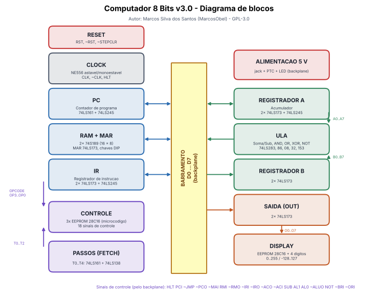

# 1. Arquitetura do Computador 8 Bits

> Projeto de **Marcos Silva dos Santos** (MarcosObel) — GPL-3.0.

> 🧊 Cada bloco tem uma página própria, com diagrama de funcionamento e a placa em 3D: [guia das placas](placas/README.md).

Um computador de 8 bits construído só com lógica TTL da série 74LS, memórias EEPROM 28C16 e
temporizadores 555 — **sem microcontrolador e sem CPU pronta**. A arquitetura segue a família
"SAP-1" (*Simple As Possible*), com algumas extensões (operações lógicas na ULA, saltos condicionais
preparados, display decimal com sinal).

| Característica | Valor |
|---|---|
| Largura de dados / barramento | 8 bits (D0…D7) |
| Endereçamento | 4 bits → 16 bytes de RAM (74S189 ×2) |
| Registradores | A (acumulador), B, IR, OUT, MAR, PC |
| Instruções | 16 opcodes (14 em uso + 2 reservados) |
| Microinstruções | até 5 passos por instrução (T0…T4), 18 sinais de controle |
| Clock | 0,7 Hz a ~140 Hz (automático) ou passo a passo (manual) |
| Saída | display de 4 dígitos, 0…255 ou −128…127 |
| Alimentação | 5 V, ~1,2 A típico (fonte de 2 A ou mais) |
| Placas | 13 módulos (1 opcional: Palavra de Controle) + 1 backplane |

## 1.1 Os módulos

| Módulo | Pasta KiCad | Função |
|---|---|---|
| Clock | `clock-astavel-monoestavel` | Gera CLK e /CLK; automático (555 astável) ou manual (555 monoestável, sem repique); entrada HLT para parar |
| Reset | `reset-circuito` | Gera RST/​/RST (botão + reset ao ligar) e o sinal que zera o contador de passos |
| Contador de Programa (PC) | `pc-contador-programa` | Endereço da próxima instrução (0…15); incrementa (PCI), carrega (JMP), coloca no barramento (/PCO) |
| RAM e MAR | `ram-mar-memoria` | 16 bytes de memória; MAR guarda o endereço; programação manual por chaves DIP |
| Registrador de Instrução (IR) | `ir-registrador-instrucao` | Guarda a instrução atual: 4 bits de opcode + 4 bits de operando |
| Decodificador de Controle | `cd-decodificador-controle` | Microcódigo em 3 EEPROMs: transforma (opcode, passo) em 18 sinais de controle |
| Contador de Passos | `fetch-contador-passos` | Conta os passos T0…T4 de cada instrução |
| Registrador A | `acc-registrador-a` | Acumulador: operando e resultado da ULA |
| Registrador B | `b-registrador-b` | Segundo operando da ULA |
| ULA | `alu-unidade-logica-aritmetica` | Soma, subtração, AND, OR, XOR e NOT de 8 bits |
| Registrador de Saída (OUT) | `out-registrador-saida` | Guarda o valor que vai para o display |
| Display Decimal | `display-decimal` | Mostra o OUT em decimal (EEPROM de conversão + varredura de 4 dígitos) |
| Backplane | `backplane-barramento` | Alimentação, barramento D0…D7 com LEDs e distribuição de todos os sinais de controle |

## 1.2 Como uma instrução é executada

Todo ciclo de clock tem duas bordas:
- **Borda de subida de CLK:** os registradores selecionados copiam o que está no barramento.
- **Borda de descida de CLK** (subida de /CLK): o contador de passos avança e o microcódigo muda os sinais de controle para o próximo passo — assim os sinais estão estáveis antes da próxima borda de subida.

Os dois primeiros passos são iguais para todas as instruções (**busca**):

| Passo | Sinais | O que acontece |
|---|---|---|
| T0 | `PCO MAI` | o endereço do PC vai para o MAR |
| T1 | `RMO IRI PCI` | a instrução lida da RAM vai para o IR; o PC é incrementado |
| T2…T4 | dependem do opcode | **execução** |

Exemplo — `ADD 15` (soma o conteúdo do endereço 15 ao A):

| Passo | Sinais | O que acontece |
|---|---|---|
| T2 | `IRO MAI` | o operando (15) vai do IR para o MAR |
| T3 | `RMO BRI` | o valor da RAM[15] vai para o registrador B |
| T4 | `ALU ACI` | o resultado A+B vai da ULA para o A |

Depois de T4, o sinal /Y5 do 74LS138 zera o contador de passos (via placa de Reset) e a próxima
instrução começa em T0.

## 1.3 Conjunto de instruções

| Opcode | Binário | Mnemônico | Operando | Operação | Passos T2…T4 |
|---|---|---|---|---|---|
| 0 | 0000 | NOP | — | não faz nada | — |
| 1 | 0001 | LDA end | endereço | A ← RAM[end] | IRO MAI / RMO ACI |
| 2 | 0010 | LDI n | valor 0…15 | A ← n | IRO ACI |
| 3 | 0011 | STA end | endereço | RAM[end] ← A | IRO MAI / ACO RMI |
| 4 | 0100 | ADD end | endereço | A ← A + RAM[end] | IRO MAI / RMO BRI / ALU ACI |
| 5 | 0101 | SUB end | endereço | A ← A − RAM[end] | IRO MAI / RMO BRI / ALU SUB ACI |
| 6 | 0110 | AND end | endereço | A ← A AND RAM[end] | IRO MAI / RMO BRI / ALU AL0 ACI |
| 7 | 0111 | OR end (ou ORL) | endereço | A ← A OR RAM[end] | IRO MAI / RMO BRI / ALU AL1 ACI |
| 8 | 1000 | XOR end | endereço | A ← A XOR RAM[end] | IRO MAI / RMO BRI / ALU AL1 AL0 ACI |
| 9 | 1001 | NOT | — | A ← NOT A | ALU AL1 AL0 NOT ACI |
| A | 1010 | JMP end | endereço | PC ← end | IRO JMP |
| B | 1011 | JC end | endereço | se carry: PC ← end | IRO JMP (só com CF = 1) |
| C | 1100 | JZ end | endereço | se zero: PC ← end | IRO JMP (só com ZF = 1) |
| D | 1101 | — | — | reservado (NOP) | — |
| E | 1110 | OUT | — | OUT ← A (display) | ACO ORI |
| F | 1111 | HLT | — | para o clock | HLT |

Cada instrução tem um programa de teste em `firmware/programas/testes/`, conferido por
`firmware/ferramentas/testar.py`. O montador aceita também `ORL`, `.org`, `.end` e números como `0Eh`.

`JC` e `JZ` ocupam os opcodes B e C. Enquanto não existir a placa de *flags*,
as linhas CF/ZF ficam em 0 (resistores de pull-down no Decodificador) e as duas instruções se comportam como NOP.

## 1.4 Sinais de controle

O microcódigo é gravado em **lógica positiva** e os sinais que são **ativos em nível baixo** no
hardware (entradas /OE do 74LS245, /G do 74LS173 e /LOAD do 74LS161) são invertidos na geração dos
binários. Na tabela, a barra (`/`) indica nível ativo baixo.

| EEPROM (chip) | IO7 | IO6 | IO5 | IO4 | IO3 | IO2 | IO1 | IO0 |
|---|---|---|---|---|---|---|---|---|
| EEPROM2 (U1) | HLT | PCI | /JMP | /PCO | /MAI | RMI | /RMO | /IRI |
| EEPROM1 (U2) | /IRO | /ACO | /ACI | SUB | AL1 | AL0 | /ALUO | NOT |
| EEPROM0 (U3) | /BRI | /ORI | livre (E0_5) | livre (E0_4) | — | — | — | — |

Endereço das EEPROMs do microcódigo: `A8 = ZF, A7 = CF, A6…A3 = opcode, A2…A0 = passo`.

### Tabela completa: quem gera e quem usa cada sinal

<!-- tabela gerada por tools/gerar_docs.py -->
| Sinal | Nivel ativo | Funcao | Origem | Destinos (placa: CI pino) |
|---|---|---|---|---|
| `CLK` | alto | clock do sistema | CLOCK: U3.8 (4Y) | PC: U1.2 (CLK) RAM: U6.7 (CLK) RAM: U11.4 (2A) RAM: U11.5 (2B) RAM: U11.9 (3A) RAM: U11.10 (3B) IR: U1.7 (CLK) IR: U2.7 (CLK) ACC: U1.7 (CLK) ACC: U2.7 (CLK) B: U1.7 (CLK) B: U2.7 (CLK) OUT: U1.7 (CLK) OUT: U2.7 (CLK) |
| `/CLK` | baixo | clock invertido (contador de passos) | CLOCK: U2.8 (3Y) | CLOCK: U3.9 (4A) FETCH: U1.2 (CLK) |
| `HLT` | alto | para o clock | CD: EEPROM2 IO7 (U1 pino 17) | CLOCK: U3.5 (3A) |
| `RST` | alto | reset (ativo alto, 74LS173) | RESET: U1.11 (4Y) | RESET: U1.9 (3A) RESET: U1.10 (3B) RAM: U6.15 (CLR) IR: U1.15 (CLR) IR: U2.15 (CLR) ACC: U1.15 (CLR) ACC: U2.15 (CLR) B: U1.15 (CLR) B: U2.15 (CLR) OUT: U1.15 (CLR) OUT: U2.15 (CLR) |
| `/RST` | baixo | reset (ativo baixo, 74LS161 do PC) | RESET: U1.8 (3Y) | RESET: U1.1 (1A) PC: U1.1 (/CLR) |
| `/Y5` | baixo | passo T5 alcancado | FETCH: U2.10 (/Y5) | RESET: U1.2 (1B) |
| `/STEPCLR` | baixo | zera o contador de passos | RESET: U1.6 (2Y) | FETCH: U1.1 (/CLR) |
| `PCI` | alto | incrementa o PC | CD: EEPROM2 IO6 (U1 pino 16) | PC: U1.7 (ENP) PC: U1.10 (ENT) |
| `/JMP` | baixo | carrega o PC (salto) | CD: EEPROM2 IO5 (U1 pino 15) | PC: U1.9 (/LOAD) |
| `/PCO` | baixo | PC -> barramento | CD: EEPROM2 IO4 (U1 pino 14) | PC: U2.19 (/OE) |
| `/MAI` | baixo | barramento -> MAR | CD: EEPROM2 IO3 (U1 pino 13) | RAM: U6.9 (/G1) RAM: U6.10 (/G2) |
| `RMI` | alto | barramento -> RAM (escrita) | CD: EEPROM2 IO2 (U1 pino 11) | RAM: U11.2 (1B) |
| `/RMO` | baixo | RAM -> barramento | CD: EEPROM2 IO1 (U1 pino 10) | RAM: U5.19 (/OE) |
| `/IRI` | baixo | barramento -> IR | CD: EEPROM2 IO0 (U1 pino 9) | IR: U1.9 (/G1) IR: U1.10 (/G2) IR: U2.9 (/G1) IR: U2.10 (/G2) |
| `/IRO` | baixo | operando do IR -> barramento | CD: EEPROM1 IO7 (U2 pino 17) | IR: U3.19 (/OE) |
| `/ACI` | baixo | barramento -> A | CD: EEPROM1 IO5 (U2 pino 15) | ACC: U1.9 (/G1) ACC: U1.10 (/G2) ACC: U2.9 (/G1) ACC: U2.10 (/G2) |
| `/ACO` | baixo | A -> barramento | CD: EEPROM1 IO6 (U2 pino 16) | ACC: U3.19 (/OE) |
| `SUB` | alto | subtracao na ULA | CD: EEPROM1 IO4 (U2 pino 14) | ALU: U18.1 (1A) |
| `AL0` | alto | selecao da ULA (bit 0) | CD: EEPROM1 IO2 (U2 pino 11) | ALU: U13.14 (A) ALU: U14.14 (A) ALU: U15.14 (A) ALU: U16.14 (A) |
| `AL1` | alto | selecao da ULA (bit 1) | CD: EEPROM1 IO3 (U2 pino 13) | ALU: U13.2 (B) ALU: U14.2 (B) ALU: U15.2 (B) ALU: U16.2 (B) |
| `/ALUO` | baixo | resultado da ULA -> barramento | CD: EEPROM1 IO1 (U2 pino 10) | ALU: U17.19 (/OE) |
| `NOT` | alto | inverte A (com AL=11) | CD: EEPROM1 IO0 (U2 pino 9) | ALU: U18.5 (3A) |
| `/BRI` | baixo | barramento -> B | CD: EEPROM0 IO7 (U3 pino 17) | B: U1.9 (/G1) B: U1.10 (/G2) B: U2.9 (/G1) B: U2.10 (/G2) |
| `/ORI` | baixo | barramento -> OUT | CD: EEPROM0 IO6 (U3 pino 16) | OUT: U1.9 (/G1) OUT: U1.10 (/G2) OUT: U2.9 (/G1) OUT: U2.10 (/G2) |

## 1.5 Barramento e ligações diretas

- **Barramento D0…D7** (no backplane): PC, RAM, IR, A e ULA escrevem; MAR, RAM, IR, A, B e OUT leem.
  Só um módulo pode escrever por vez — o microcódigo garante isso (e o emulador em
  `firmware/ferramentas/emulador.py` verifica).
- **Ligações diretas** (cabo de 4 vias módulo a módulo, sem passar pelo backplane):
  A → ULA (A0…A7), B → ULA (B0…B7), OUT → Display (O0…O7), IR → Controle (opcode),
  Contador de Passos → Controle (T0…T2).

---
Próximo: [2. Revisão e correções](02-revisao-e-correcoes.md)
