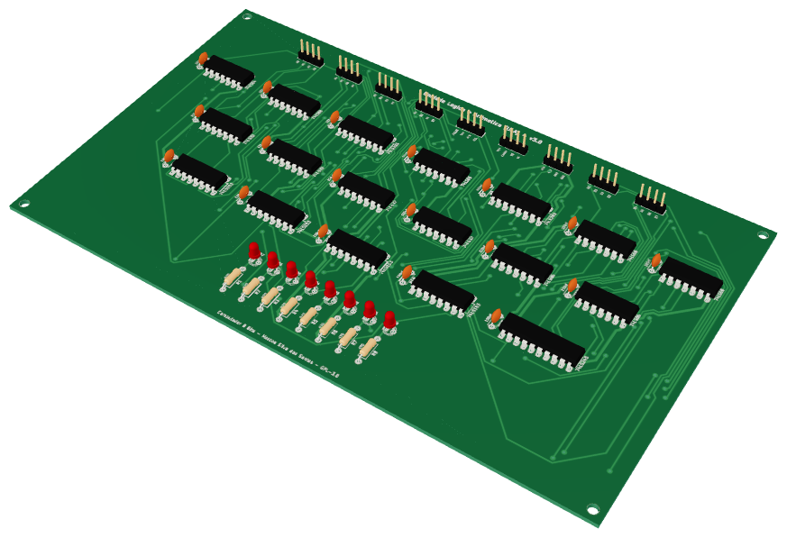

# Placas em 3D — Computador 8 Bits v3.0

> Modelos 3D das 13 placas — projeto de **Marcos Silva dos Santos** (MarcosObel) — GPL-3.0.

<p align="center"></p>

| Pasta / arquivo | O que é | Como abrir |
|---|---|---|
| [`visualizador.html`](visualizador.html) | visualizador interativo das 13 placas, com a função de cada uma, LEDs e pinagem dos conectores | veja abaixo |
| [`stl/<placa>.stl`](stl/) | malha 3D (sem cores), em milímetros | **o GitHub mostra em 3D** — é só clicar no arquivo |
| [`modelos/<placa>.glb`](modelos/) | modelo com cores e as camadas reais da placa (cobre, máscara verde, serigrafia, furos) | visualizador, Blender, [gltf-viewer.donmccurdy.com](https://gltf-viewer.donmccurdy.com/), Windows "Visualizador 3D" |
| [`texturas/`](texturas/) | imagem da face de cima e de baixo de cada placa, como sai da fábrica | qualquer visualizador de imagens |
| `../../hardware/fabricacao/<placa>/<placa>.step` | modelo mecânico (para projetar a caixa/base) | FreeCAD, Fusion 360, SolidWorks, KiCad |
| [`placas3d.json`](placas3d.json) | medidas, furos e posição de cada componente | — |

## Abrir o visualizador

O navegador não deixa uma página aberta direto do disco (`file://`) carregar os modelos `.glb`. Use um servidor local
(o Python já vem no Zorin OS/Ubuntu):

```bash
cd 8-bits-computer/docs/3d
python3 -m http.server 8000
# abra http://localhost:8000/visualizador.html
```

Também funciona publicado no **GitHub Pages** (Settings → Pages → branch `main`, pasta `/root`), em
`https://aragonxpd154.github.io/8-bits-computer/docs/3d/visualizador.html`.

Arraste para girar, role para aproximar, botão direito para mover. Botões **Topo/Fundo** mostram cada face;
**Componentes** liga/desliga as peças para ver as trilhas. O endereço aceita `#nome-da-placa`
(ex.: `visualizador.html#ram-mar-memoria`).

## Regerar os modelos

```bash
sudo apt install kicad kicad-packages3d librsvg2-bin
pip install trimesh cascadio pillow numpy playwright && python3 -m playwright install chromium
python3 tools/render3d.py              # STEP + GLB + STL + texturas (todas as placas)
python3 tools/gerar_visualizador.py    # docs/3d/visualizador.html
python3 tools/render_imagens3d.py      # imagens docs/imagens/3d/*.png
python3 tools/gerar_placas.py          # páginas docs/placas/*.md
```

Peças sem modelo na biblioteca do KiCad (display de 7 segmentos, chave deslizante, potenciômetro, PTC e borne)
recebem um modelo simplificado gerado pelo `render3d.py`.

Detalhes de cada placa: [docs/placas](../placas/README.md).
