# Guia visual passo a passo — Computador 8 Bits v3.0

> Projeto, placas e manual de **Marcos Silva dos Santos** (MarcosObel) — GPL-3.0.
> Versão em PDF deste guia: [`pdf/guia-visual-passo-a-passo.pdf`](pdf/guia-visual-passo-a-passo.pdf) ·
> Manual completo em PDF: [`pdf/manual-completo.pdf`](pdf/manual-completo.pdf)

Este guia mostra **em imagens** todo o caminho: dos arquivos do repositório até o computador rodando
um programa. Cada etapa aponta para o capítulo do manual com os detalhes.

## Sumário

| Etapa | O que fazer | Tempo típico |
|---|---|---|
| [0](#etapa-0--o-que-você-vai-construir) | Conhecer o computador | 30 min |
| [1](#etapa-1--entender-como-uma-instrução-funciona) | Entender como uma instrução funciona | 30 min |
| [2](#etapa-2--mandar-fabricar-as-13-placas) | Mandar fabricar as 13 placas | 1 h (+ prazo da fábrica) |
| [3](#etapa-3--comprar-os-componentes) | Comprar os componentes | 1 h (+ entrega) |
| [4](#etapa-4--gravar-as-4-eeproms) | Gravar as 4 EEPROMs | 30 min |
| [5](#etapa-5--montar-e-testar-cada-placa) | Montar e testar cada placa | 1–3 h por placa |
| [6](#etapa-6--montar-na-base-e-ligar-os-cabos) | Montar na base e ligar os 52 cabos | 2 h |
| [7](#etapa-7--ligar-por-etapas) | Ligar por etapas | 1–2 h |
| [8](#etapa-8--programar-e-rodar) | Programar e rodar | 15 min por programa |

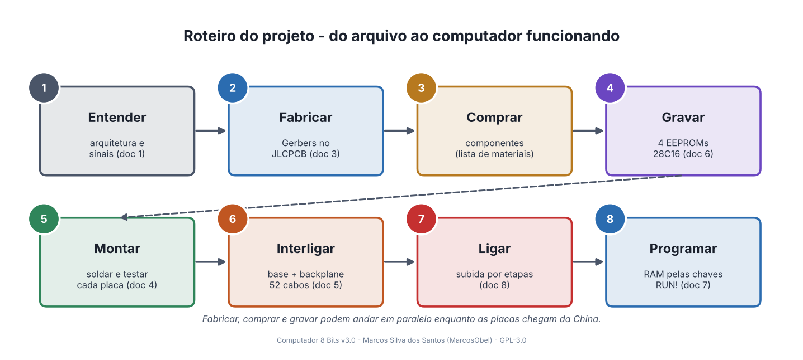

---

## Etapa 0 — O que você vai construir

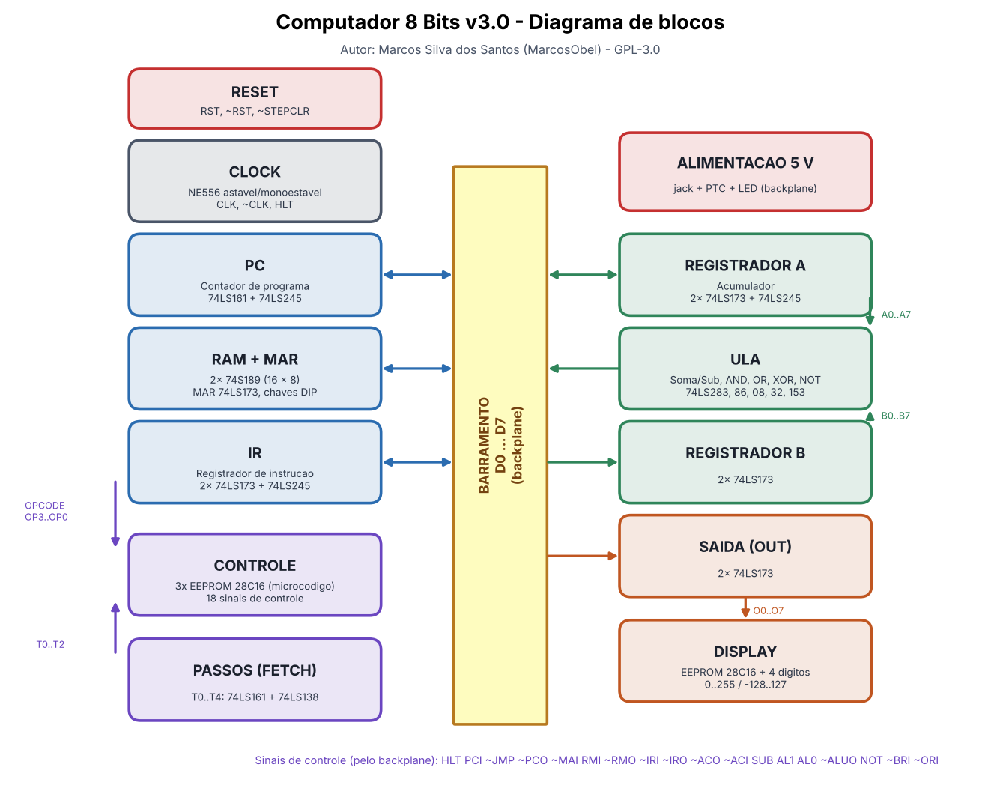

- **12 módulos + 1 backplane**, todos só com CIs TTL 74LS, EEPROMs 28C16 e 555 — **sem microcontrolador**.
- **Barramento de 8 bits** (D0…D7) no backplane, com LEDs para ver os dados passando.
- **16 bytes de RAM**, programados por chaves DIP.
- **16 instruções**: `NOP LDA SUB STA ADD LDI JMP AND OR XOR NOT JC JZ OUT HLT`.
- **Display decimal** de 4 dígitos (0…255 ou −128…127).

📖 Detalhes: [01-arquitetura.md](01-arquitetura.md) · 📄 [Esquema elétrico completo (PDF)](../hardware/esquema-eletrico-completo.pdf)

---

## Etapa 1 — Entender como uma instrução funciona

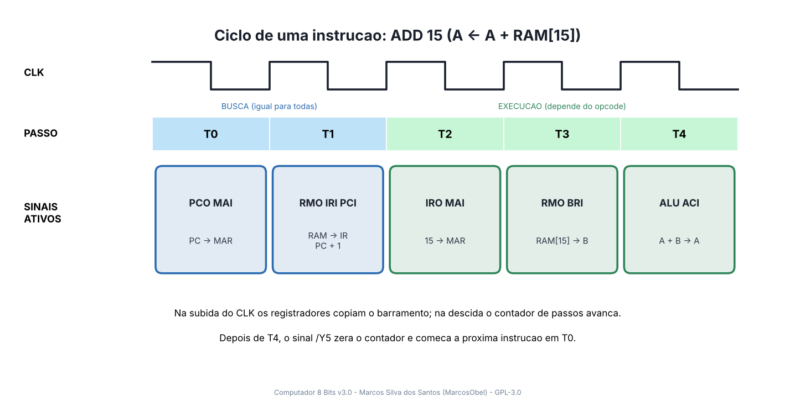

- **T0 e T1 (busca):** toda instrução começa igual — o PC aponta a RAM, a instrução vai para o IR e o PC soma 1.
- **T2…T4 (execução):** o microcódigo das EEPROMs liga os sinais certos para cada opcode.
- Para ver isso acontecendo sem hardware nenhum:

```bash
cd firmware
python3 ferramentas/emulador.py programas/01-soma.asm --passos
```

📖 Detalhes: [01-arquitetura.md](01-arquitetura.md#12-como-uma-instrução-é-executada)

---

## Etapa 2 — Mandar fabricar as 13 placas

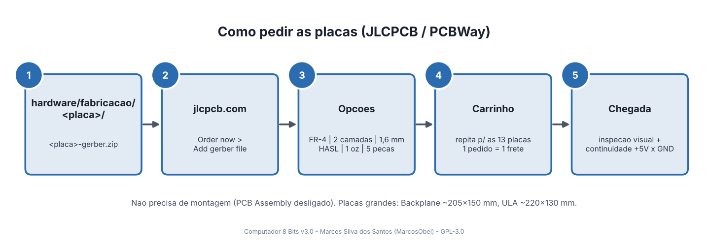

Cada placa tem um arquivo pronto para a fábrica em `hardware/fabricacao/<placa>/<placa>-gerber.zip`:

| # | Placa | Tamanho (mm) | Arquivo para a fábrica |
|---|---|---|---|
| 1 | Backplane / Barramento | 204 × 153 | `backplane-barramento-gerber.zip` |
| 2 | Clock | 105 × 86 | `clock-astavel-monoestavel-gerber.zip` |
| 3 | Reset | 67 × 58 | `reset-circuito-gerber.zip` |
| 4 | Contador de Programa | 92 × 69 | `pc-contador-programa-gerber.zip` |
| 5 | RAM e MAR | 145 × 139 | `ram-mar-memoria-gerber.zip` |
| 6 | Registrador de Instrução | 102 × 69 | `ir-registrador-instrucao-gerber.zip` |
| 7 | Decodificador de Controle | 161 × 61 | `cd-decodificador-controle-gerber.zip` |
| 8 | Contador de Passos | 70 × 69 | `fetch-contador-passos-gerber.zip` |
| 9 | Registrador A | 110 × 69 | `acc-registrador-a-gerber.zip` |
| 10 | Registrador B | 110 × 69 | `b-registrador-b-gerber.zip` |
| 11 | ULA | 218 × 128 | `alu-unidade-logica-aritmetica-gerber.zip` |
| 12 | Registrador de Saída | 110 × 69 | `out-registrador-saida-gerber.zip` |
| 13 | Display Decimal | 134 × 112 | `display-decimal-gerber.zip` |

✅ **Checklist do pedido**
- [ ] 13 arquivos enviados, cada um com **2 camadas, FR-4, 1,6 mm, 1 oz, HASL**
- [ ] *PCB Assembly* desligado
- [ ] Tudo num único pedido (um frete só)

📖 Detalhes: [03-fabricacao-das-placas.md](03-fabricacao-das-placas.md)

---

## Etapa 3 — Comprar os componentes

Resumo (lista completa e por placa em [lista-de-materiais-completa.md](lista-de-materiais-completa.md)):

| Item | Quantidade |
|---|---|
| Circuitos integrados (74LS, 74S189, 28C16, 555/556) | 56 (+ reservas) |
| Soquetes de CI (use em **todos**) | 56 |
| Resistores 1/4 W | 99 |
| Capacitores | 67 |
| LEDs 3 mm | 77 |
| Barras de pinos 1×4 | 106 |
| Cabos jumper fêmea-fêmea de 4 vias, 20 cm | 52 |
| Fonte 5 V / 2 a 3 A (plugue P4, centro +) | 1 |
| Display 4 dígitos 0,4" **cátodo comum** | 1 |

✅ **Checklist da compra**
- [ ] 10 % a mais de passivos e LEDs, 1 CI reserva de cada tipo mais usado
- [ ] 4 EEPROMs **28C16** (AT28C16 ou CAT28C16A)
- [ ] Display **cátodo comum** (ex.: 5641AS)

---

## Etapa 4 — Gravar as 4 EEPROMs

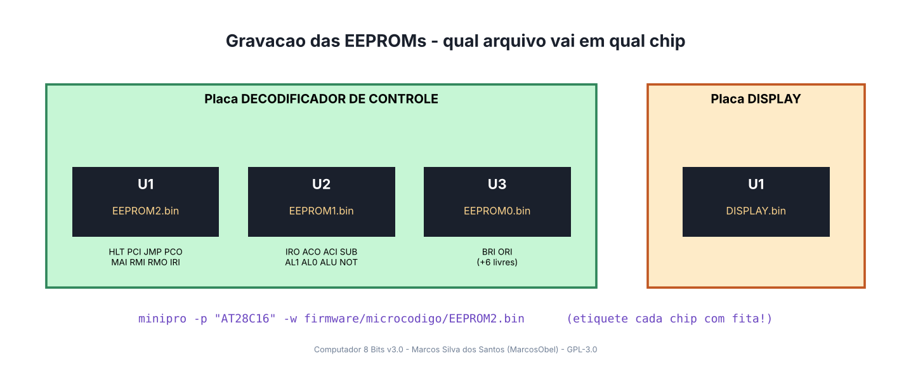

```bash
# no Zorin OS / Ubuntu, com o gravador TL866II Plus ou T48 ligado
sudo apt install minipro
minipro -p "AT28C16" -w firmware/microcodigo/EEPROM2.bin     # -> Controle U1
minipro -p "AT28C16" -w firmware/microcodigo/EEPROM1.bin     # -> Controle U2
minipro -p "AT28C16" -w firmware/microcodigo/EEPROM0.bin     # -> Controle U3
minipro -p "AT28C16" -w firmware/display/DISPLAY.bin         # -> Display U1
```

✅ **Checklist** — [ ] cada chip etiquetado ("CD-U1 EEPROM2" …) · [ ] gravação conferida sem erro

📖 Detalhes: [06-gravacao-das-eeproms.md](06-gravacao-das-eeproms.md)

---

## Etapa 5 — Montar e testar cada placa

### 5.1 Antes de soldar: polaridade

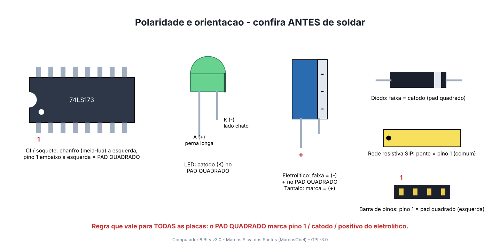

### 5.2 Ordem de soldagem

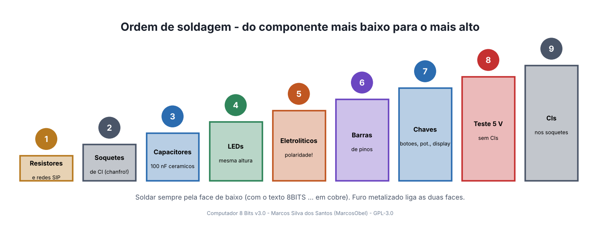

### 5.3 Teste de alimentação (toda placa, antes dos CIs)

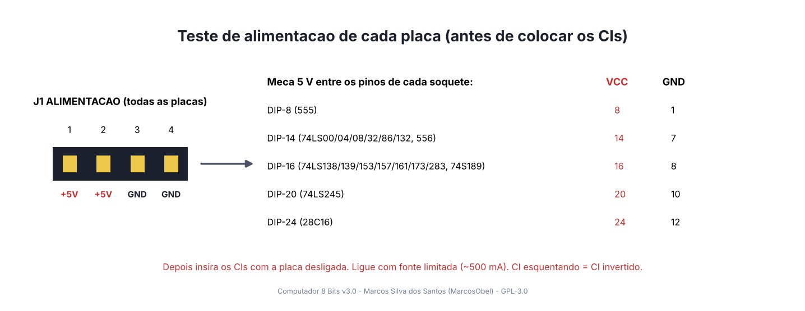

### 5.4 As placas, uma a uma

Monte nesta ordem; cada placa é testada antes de seguir. Na serigrafia de cada placa estão o nome de
cada sinal nos conectores, o part number de cada CI, o valor de cada componente e o bit que cada LED mostra.
Cores das imagens: **vermelho** = cobre de cima, **azul** = cobre de baixo, **amarelo** = serigrafia.

#### ① Backplane / Barramento
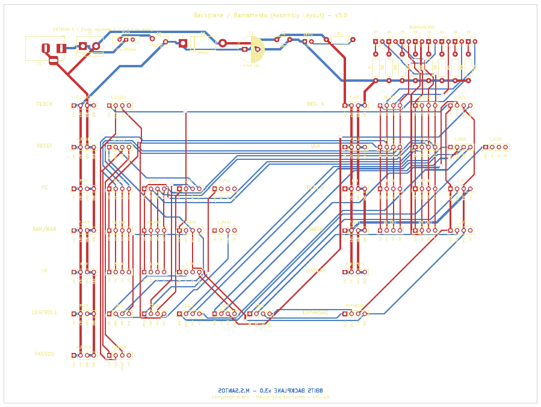
- **Tem:** entrada 5 V protegida (jack, PTC, diodo), LED de energia, 8 LEDs do barramento, 45 conectores agrupados por módulo.
- **Teste:** LED de energia acende; 5 V em todos os conectores `P_xxx`.

#### ② Clock
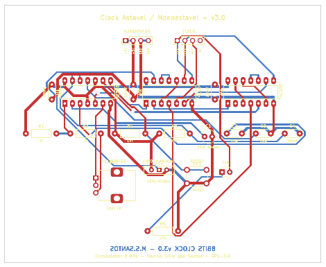
- **CIs:** NE556, 74LS00, 74LS04 · **Atenção:** C1 é tântalo (marca = +).
- **Teste:** HLT (J2 pino 3) no GND → LED pisca; potenciômetro muda a velocidade; MANUAL + botão PASSO = 1 pulso.

#### ③ Reset
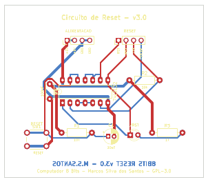
- **CI:** 74LS132 (ou 74LS00) · **Teste:** ao ligar o LED pisca; botão RESET → RST = 5 V, /RST = 0 V.

#### ④ Contador de Passos
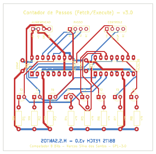
- **CIs:** 74LS161, 74LS138 · **Teste:** pulsos em /CLK fazem os LEDs T0…T4 andarem.

#### ⑤ Contador de Programa (PC)
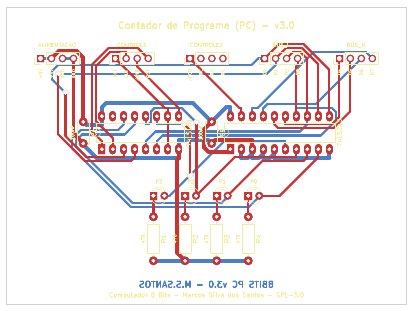
- **CIs:** 74LS161, 74LS245 · **Teste:** PCI = 1 e pulsos em CLK → LEDs contam 0…15.

#### ⑥ RAM e MAR
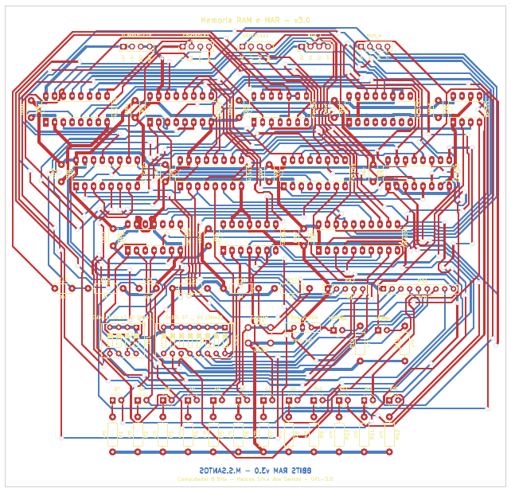
- **CIs:** 2× 74S189, 2× 74LS04, 74LS245, 74LS173, 4× 74LS157, 74LS00, NE555.
- **Atenção:** redes resistivas RN1/RN2 com o pino 1 (comum) no pad quadrado; chave DIP **ligada = 1**.
- **Teste:** em PROG, grave um valor e confira nos LEDs verdes.

#### ⑦ Registrador de Instrução (IR)
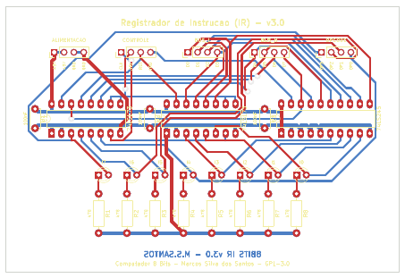
- **CIs:** 2× 74LS173, 74LS245 · **Teste:** carrega com /IRI + CLK; /IRO devolve só o nibble baixo.

#### ⑧ Decodificador de Controle
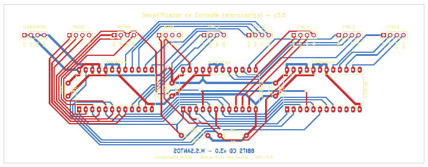
- **CIs:** 3× 28C16 já gravadas (U1 = EEPROM2, U2 = EEPROM1, U3 = EEPROM0), soquetes **largos** de 24 pinos.
- **Teste:** passo e opcode em 0 → só /PCO e /MAI em nível baixo.

#### ⑨ Registrador A e ⑩ Registrador B
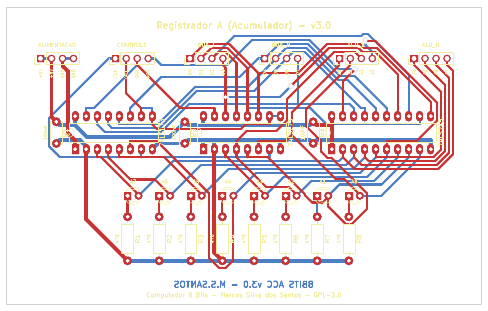
- **CIs:** 2× 74LS173, 74LS245 (as duas placas são iguais) · **Teste:** carrega com /ACI (/BRI) + CLK; RST apaga.

#### ⑪ ULA
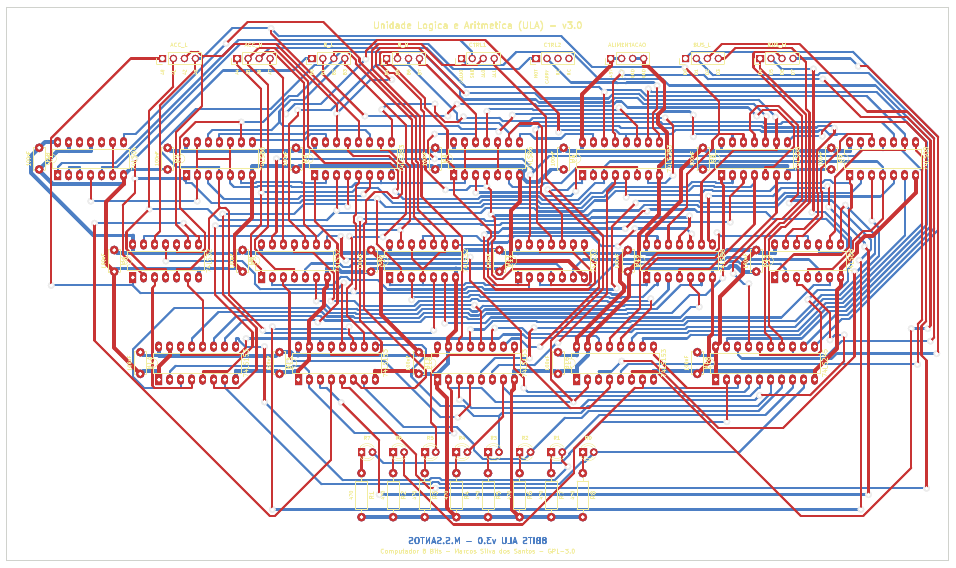
- **CIs:** 18 (74LS283, 86, 08, 32, 153, 245, 04) · **Atenção:** 74LS08/32/86 têm a mesma pinagem — confira duas vezes.
- **Teste:** AL1 AL0 = 00 soma, 01 AND, 10 OR, 11 XOR; SUB = 1 subtrai; NOT = 1 (com AL = 11) inverte A.

#### ⑫ Registrador de Saída
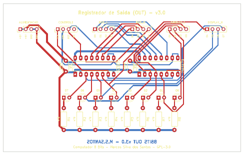
- **CIs:** 2× 74LS173 · **Teste:** carrega com /ORI + CLK.

#### ⑬ Display Decimal
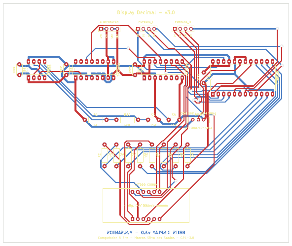
- **CIs:** 28C16 (DISPLAY.bin), NE555, 74LS161, 74LS139 · display **cátodo comum**.
- **Teste:** entradas em 0 → mostra `0`; entradas soltas → `255` (sem sinal) ou `-1` (com sinal).

📖 Detalhes de cada placa: [04-montagem-das-placas.md](04-montagem-das-placas.md)

---

## Etapa 6 — Montar na base e ligar os cabos

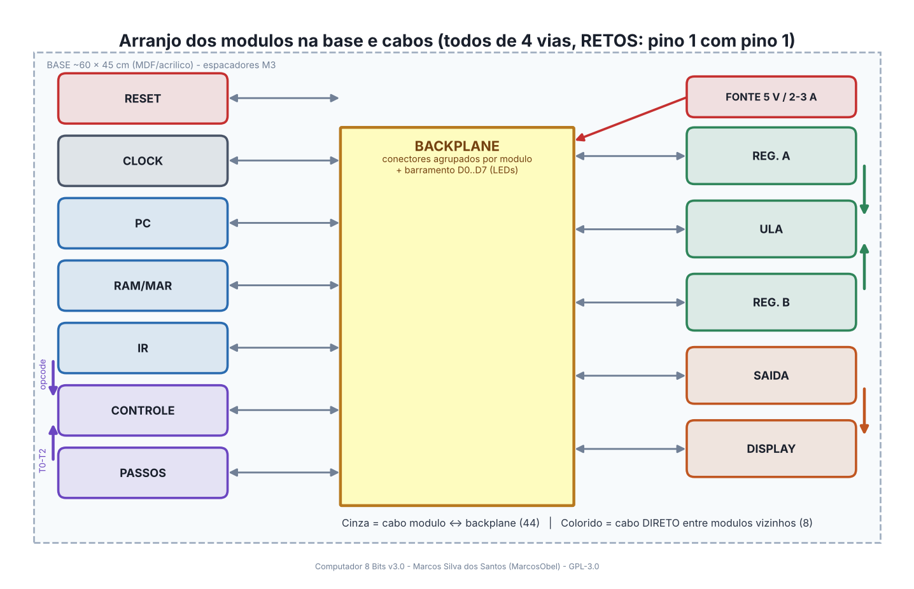

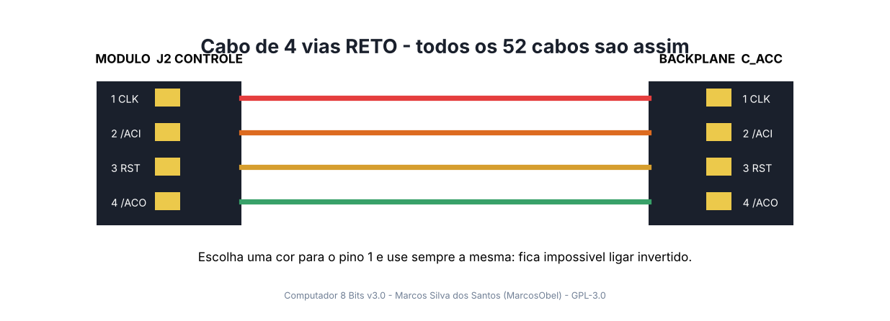

✅ **Checklist**
- [ ] Módulos na base no arranjo acima, com espaçadores M3
- [ ] 44 cabos módulo ↔ backplane (cada conector do backplane tem o nome do módulo e dos sinais)
- [ ] 8 cabos diretos: A→ULA (2), B→ULA (2), Saída→Display (2), IR→Controle (opcode), Passos→Controle (T0–T2)
- [ ] Pino 1 sempre com o fio da mesma cor

📖 Tabela dos 52 cabos: [05-interligacao-e-backplane.md](05-interligacao-e-backplane.md#54-tabela-de-cabos)

---

## Etapa 7 — Ligar por etapas

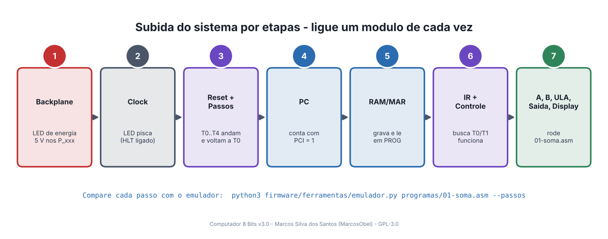

Ligue um módulo de cada vez, nesta ordem, e só avance quando o anterior estiver certo.
Se algo não bater, use a tabela de problemas comuns em [08-testes-e-diagnostico.md](08-testes-e-diagnostico.md).

---

## Etapa 8 — Programar e rodar

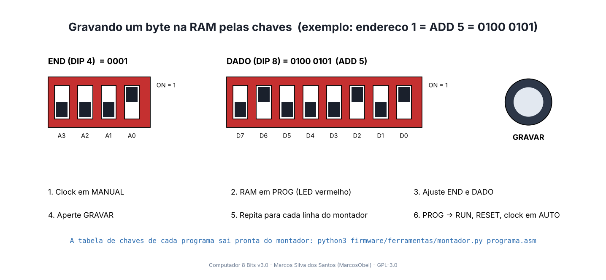

1. Escreva (ou escolha) um programa em `firmware/programas/`. Exemplo `01-soma.asm`:

   ```asm
           LDA x       ; A <- 28
           ADD y       ; A <- A + 14
           OUT         ; display = 42
           HLT
   x:      DB 28
   y:      DB 14
   ```

2. Gere a tabela das chaves:

   ```bash
   python3 firmware/ferramentas/montador.py firmware/programas/01-soma.asm
   ```

   | End | Chaves END (4 3 2 1) | Chaves DADO (8 … 1) | Instrução |
   |---|---|---|---|
   | 0 | `····` | `···█·█··` | LDA x |
   | 1 | `···█` | `·█···█·█` | ADD y |
   | 2 | `··█·` | `███·····` | OUT |
   | 3 | `··██` | `████····` | HLT |
   | 4 | `·█··` | `···███··` | DB 28 |
   | 5 | `·█·█` | `····███·` | DB 14 |

   █ = chave ligada (1) · = desligada (0)

3. Grave cada linha na RAM (PROG → END → DADO → GRAVAR), passe para RUN, aperte RESET e coloque o clock em AUTO.
4. O display mostra **42**. 🎉

📖 Detalhes e mais programas: [07-programacao-e-uso.md](07-programacao-e-uso.md)

---

### Checklist final

- [ ] 13 placas montadas e testadas individualmente
- [ ] 4 EEPROMs gravadas e nos lugares certos
- [ ] 52 cabos ligados (pino 1 com pino 1)
- [ ] Fonte de 5 V (não 9 V/12 V!)
- [ ] `01-soma.asm` mostrando 42 no display

*Computador 8 Bits v3.0 — Marcos Silva dos Santos (MarcosObel) — github.com/aragonxpd154/8-bits-computer — GPL-3.0*
