# As 13 placas — guia detalhado

> **Computador 8 Bits v3.0** — projeto de **Marcos Silva dos Santos** (MarcosObel) — GPL-3.0.

Cada placa tem uma página com: a função dela no computador, como o circuito funciona, o papel de cada CI, o significado dos LEDs, o esquemático, a placa em 3D, a pinagem dos conectores, a lista de componentes e como testar.

🧊 **[3D Viewer](https://aragonxpd154.github.io/8-bits-computer/docs/3d/visualizador.html)** — gire, aproxime e veja a placa por cima e por baixo (instruções em [docs/3d](../3d/README.md)). Os arquivos `.stl` também abrem em 3D direto no GitHub.

| # | Placa | Função | Tamanho | 3D |
|---:|---|---|---|---|
| 1 | **[Backplane / Barramento](backplane-barramento.md)** | Placa-mãe: entrada de 5 V protegida, barramento D0…D7 com LEDs e todos os sinais entre os módulos. | 204 × 153 mm | [STL](../3d/stl/backplane-barramento.stl) |
| 2 | **[Clock](clock-astavel-monoestavel.md)** | Gera o "batimento" do computador: automático (0,7–140 Hz) ou passo a passo, e para no HLT. | 105 × 86 mm | [STL](../3d/stl/clock-astavel-monoestavel.stl) |
| 3 | **[Reset](reset-circuito.md)** | Reinicia o computador pelo botão ou ao ligar, e reinicia o contador de passos a cada instrução. | 67 × 58 mm | [STL](../3d/stl/reset-circuito.stl) |
| 4 | **[Contador de Programa (PC)](pc-contador-programa.md)** | Guarda o endereço da próxima instrução (0…15), conta +1 a cada busca e salta no JMP. | 92 × 69 mm | [STL](../3d/stl/pc-contador-programa.stl) |
| 5 | **[RAM e MAR](ram-mar-memoria.md)** | 16 bytes de memória, o registrador de endereço (MAR) e a programação manual por chaves DIP. | 145 × 139 mm | [STL](../3d/stl/ram-mar-memoria.stl) |
| 6 | **[Registrador de Instrução (IR)](ir-registrador-instrucao.md)** | Guarda a instrução atual: o opcode vai para o Controle, o operando volta ao barramento. | 102 × 69 mm | [STL](../3d/stl/ir-registrador-instrucao.stl) |
| 7 | **[Decodificador de Controle](cd-decodificador-controle.md)** | O "cérebro": 3 EEPROMs com o microcódigo ligam os 18 sinais certos em cada passo de cada instrução. | 161 × 61 mm | [STL](../3d/stl/cd-decodificador-controle.stl) |
| 8 | **[Contador de Passos](fetch-contador-passos.md)** | Conta os passos T0…T4 de cada instrução e avisa (/Y5) quando a instrução terminou. | 70 × 69 mm | [STL](../3d/stl/fetch-contador-passos.stl) |
| 9 | **[Registrador A (Acumulador)](acc-registrador-a.md)** | Registrador principal de 8 bits: guarda o resultado das contas e alimenta a ULA. | 110 × 69 mm | [STL](../3d/stl/acc-registrador-a.stl) |
| 10 | **[Registrador B](b-registrador-b.md)** | Segundo operando da ULA: recebe o valor da RAM nas contas ADD, SUB, AND, OR e XOR. | 110 × 69 mm | [STL](../3d/stl/b-registrador-b.stl) |
| 11 | **[ULA (Unidade Lógica e Aritmética)](alu-unidade-logica-aritmetica.md)** | Faz soma, subtração, AND, OR, XOR e NOT entre A e B; resultado vai ao barramento. | 218 × 128 mm | [STL](../3d/stl/alu-unidade-logica-aritmetica.stl) |
| 12 | **[Registrador de Saída](out-registrador-saida.md)** | Guarda o valor que aparece no display (instrução OUT). | 110 × 69 mm | [STL](../3d/stl/out-registrador-saida.stl) |
| 13 | **[Display Decimal](display-decimal.md)** | Mostra o valor do registrador de saída em decimal, 0…255 ou −128…127, em 4 dígitos. | 134 × 112 mm | [STL](../3d/stl/display-decimal.stl) |

## Galeria

<table>
<tr>
<td align="center" width="33%"><a href="backplane-barramento.md">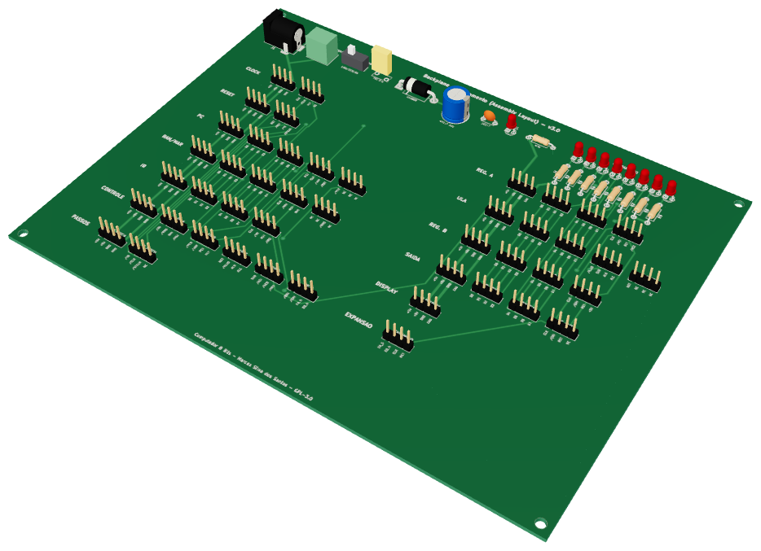 <b>Backplane / Barramento</b></a></td>
<td align="center" width="33%"><a href="clock-astavel-monoestavel.md">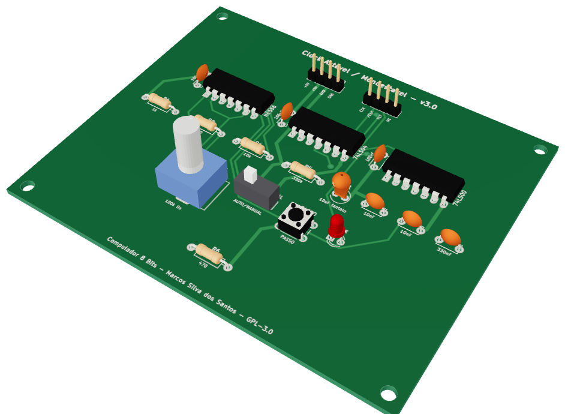 <b>Clock</b></a></td>
<td align="center" width="33%"><a href="reset-circuito.md">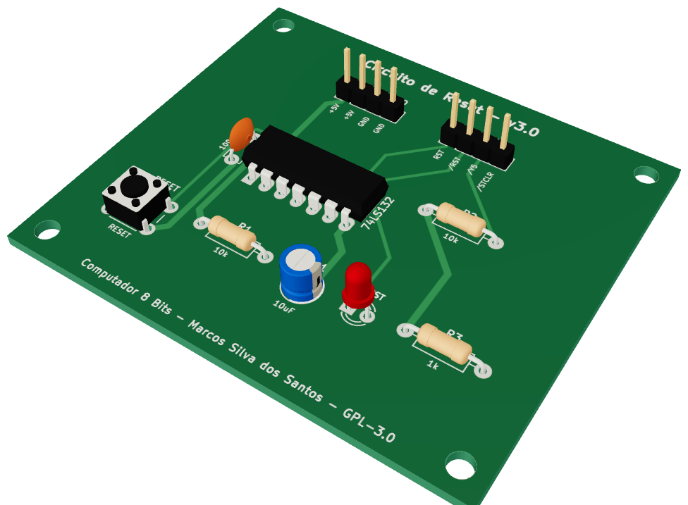 <b>Reset</b></a></td>
</tr>
<tr>
<td align="center" width="33%"><a href="pc-contador-programa.md">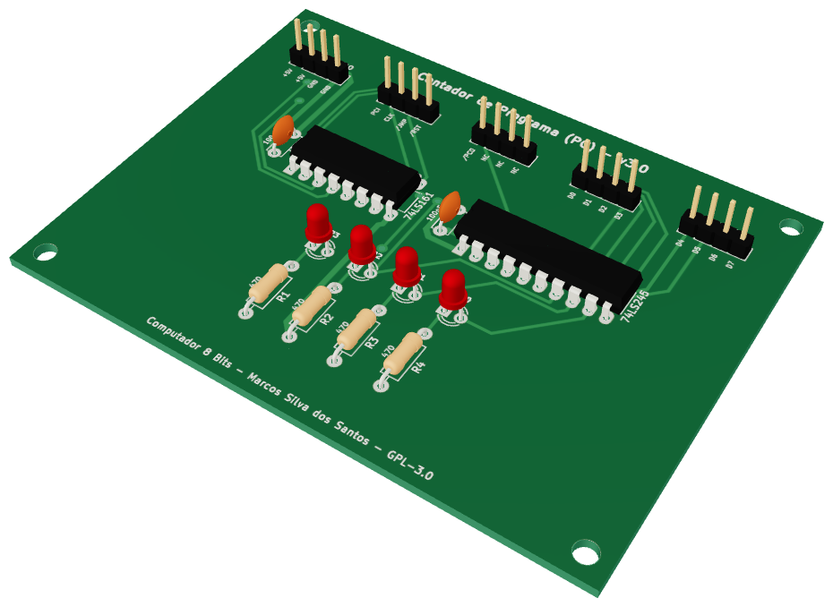 <b>Contador de Programa (PC)</b></a></td>
<td align="center" width="33%"><a href="ram-mar-memoria.md">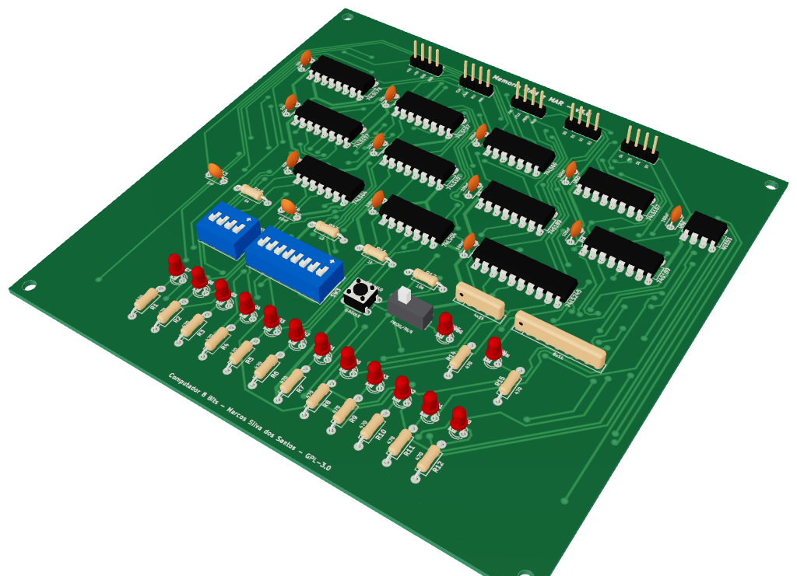 <b>RAM e MAR</b></a></td>
<td align="center" width="33%"><a href="ir-registrador-instrucao.md">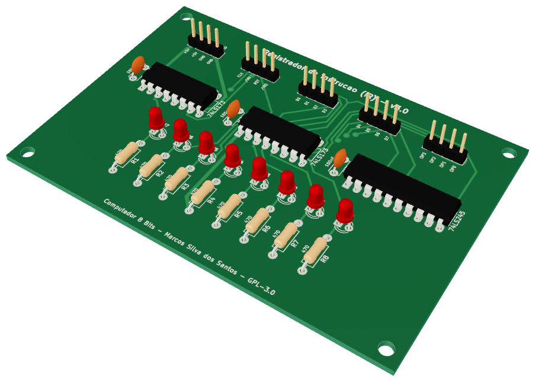 <b>Registrador de Instrução (IR)</b></a></td>
</tr>
<tr>
<td align="center" width="33%"><a href="cd-decodificador-controle.md">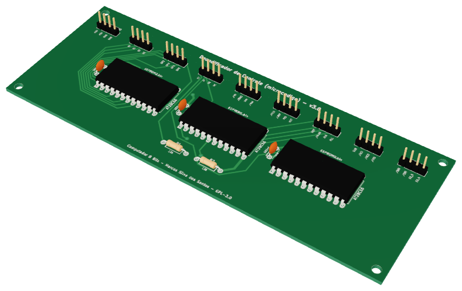 <b>Decodificador de Controle</b></a></td>
<td align="center" width="33%"><a href="fetch-contador-passos.md">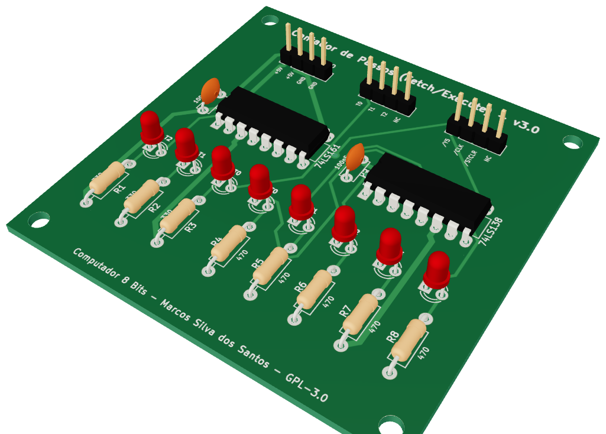 <b>Contador de Passos</b></a></td>
<td align="center" width="33%"><a href="acc-registrador-a.md"> <b>Registrador A (Acumulador)</b></a></td>
</tr>
<tr>
<td align="center" width="33%"><a href="b-registrador-b.md">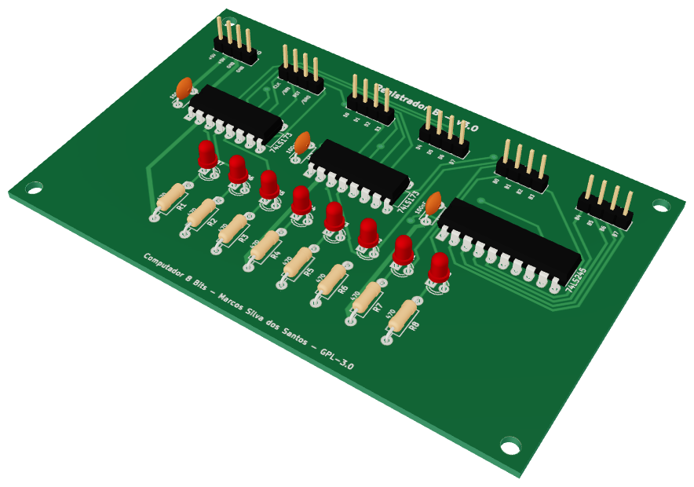 <b>Registrador B</b></a></td>
<td align="center" width="33%"><a href="alu-unidade-logica-aritmetica.md">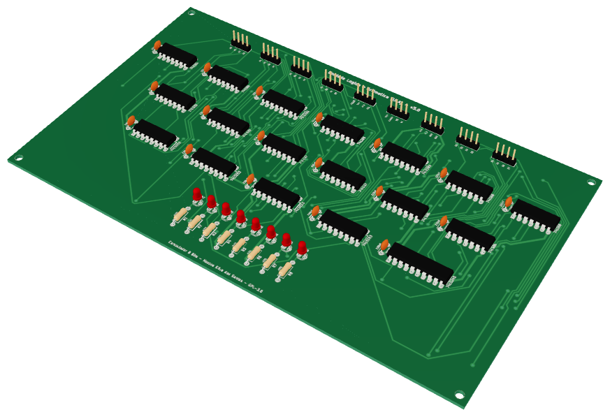 <b>ULA (Unidade Lógica e Aritmética)</b></a></td>
<td align="center" width="33%"><a href="out-registrador-saida.md">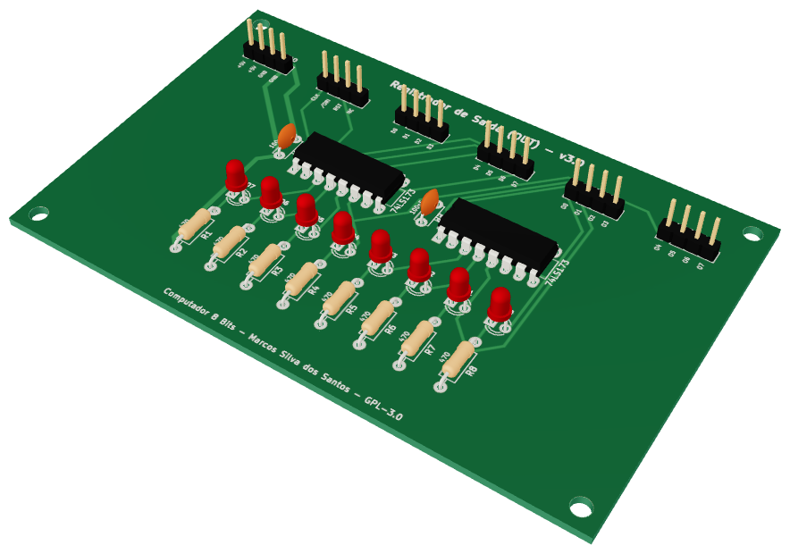 <b>Registrador de Saída</b></a></td>
</tr>
<tr>
<td align="center" width="33%"><a href="display-decimal.md">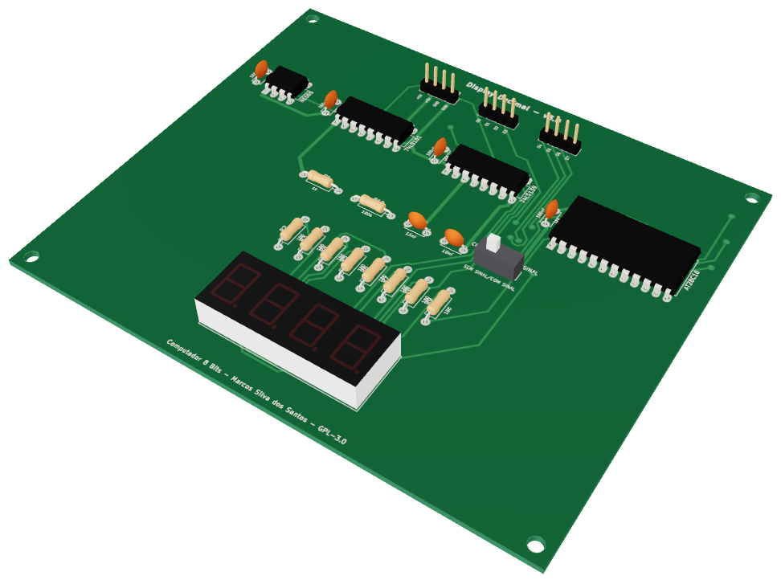 <b>Display Decimal</b></a></td>
</tr>
</table>

---
Voltar para a [documentação](../README.md)
