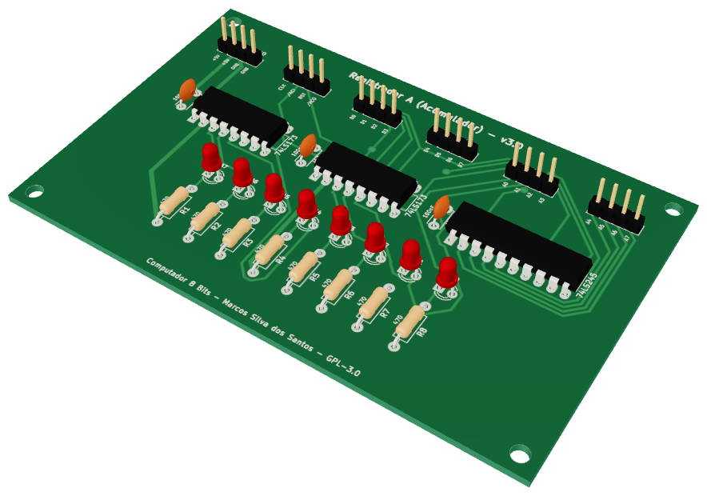
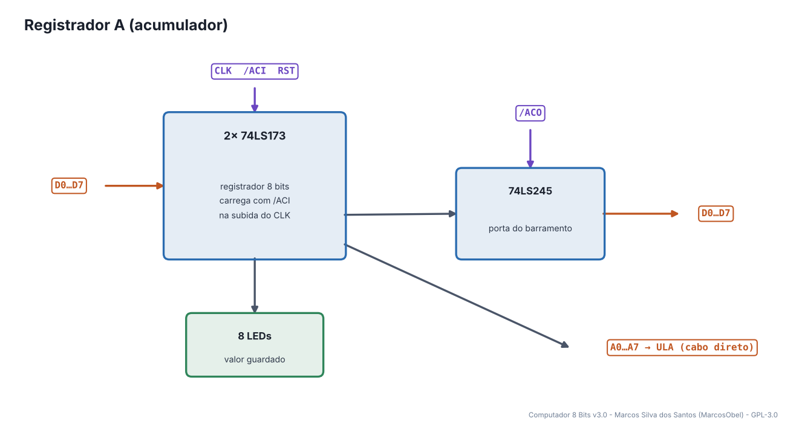
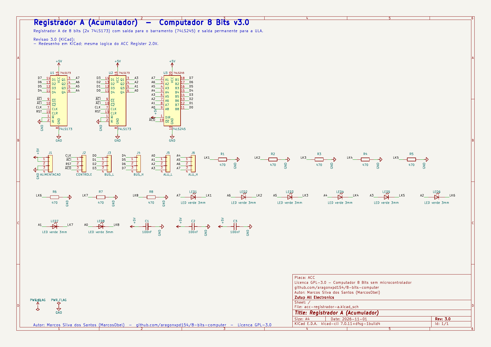
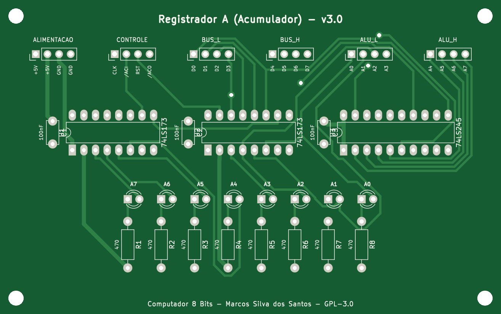
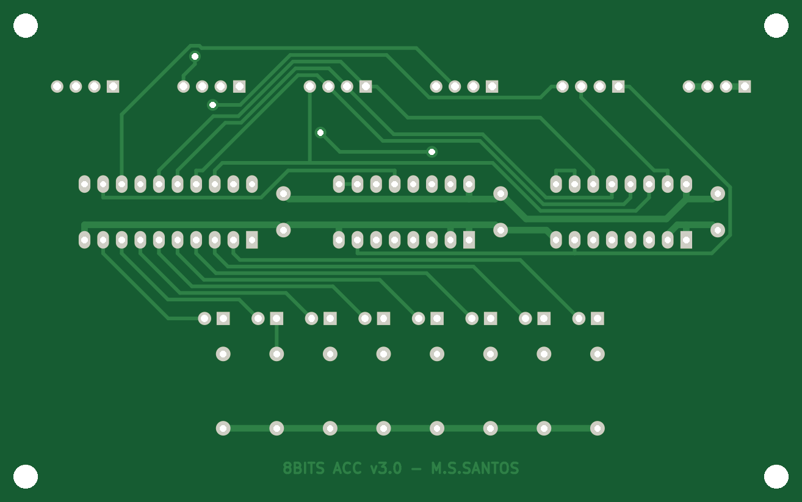
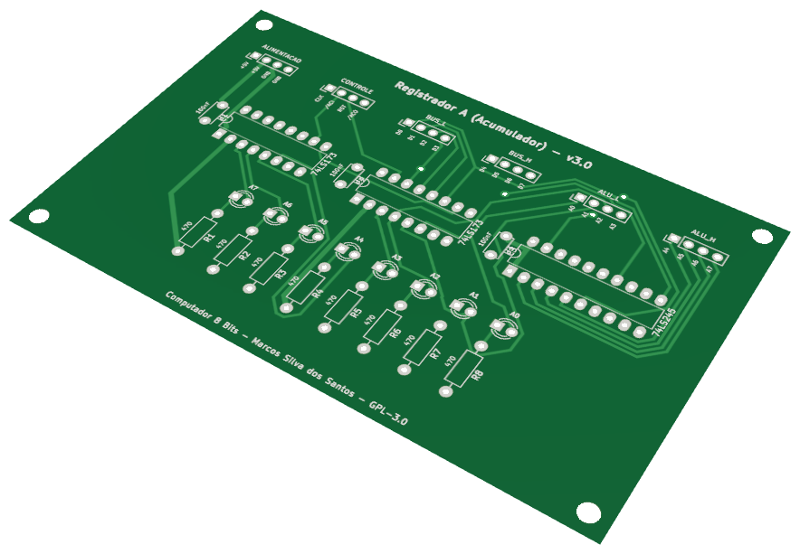

# 09 · Registrador A (Acumulador)

> Placa do **Computador 8 Bits v3.0** — projeto de **Marcos Silva dos Santos** (MarcosObel) — GPL-3.0.

**Registrador principal de 8 bits: guarda o resultado das contas e alimenta a ULA.**

| | |
|---|---|
| Tamanho | **109,5 × 68,61 mm**, 2 camadas, furo metalizado |
| Componentes | 28 (3 CIs) |
| Furos / vias | 122 / 4 |
| Projeto KiCad | [`hardware/kicad/acc-registrador-a/`](../../hardware/kicad/acc-registrador-a/) |
| Para a fábrica | [`acc-registrador-a-gerber.zip`](../../hardware/fabricacao/acc-registrador-a/acc-registrador-a-gerber.zip) · [lista de materiais (CSV)](../../hardware/fabricacao/acc-registrador-a/lista-de-materiais.csv) · [relatório DRC](../../hardware/fabricacao/acc-registrador-a/relatorio-drc.txt) |
| Esquemático | [PDF](../../hardware/fabricacao/acc-registrador-a/0-esquematico.pdf) · [imagem](../imagens/esquemas/acc-registrador-a.png) |
| Modelo 3D | [**3D Viewer** (abre no navegador)](https://aragonxpd154.github.io/8-bits-computer/docs/3d/visualizador.html#acc-registrador-a) · [STL (abre em 3D no GitHub)](../3d/stl/acc-registrador-a.stl) · [GLB](../3d/modelos/acc-registrador-a.glb) · [STEP (FreeCAD/Fusion)](../../hardware/fabricacao/acc-registrador-a/acc-registrador-a.step) |

## Função

O **acumulador** guarda o operando principal e o resultado das operações. Sua saída está sempre ligada à entrada A da ULA (conectores ALU_L e ALU_H) e pode ser colocada no barramento para gravar na RAM (`STA`) ou mostrar no display (`OUT`).

Liga-se diretamente (cabo próprio) a: [ULA (Unidade Lógica e Aritmética)](alu-unidade-logica-aritmetica.md). Todo o resto passa pelo [backplane](backplane-barramento.md).

## Diagrama de funcionamento

Laranja = barramento/dados · roxo = sinais de controle do microcódigo · verde = clock e reset · cinza = sinais internos da placa.

## Como funciona

**Dois 74LS173** (4 bits cada) formam 8 bits. Carregam o barramento na subida do CLK quando /ACI = 0. RST zera.

**74LS245** coloca o valor no barramento quando /ACO = 0.

**Saída permanente:** A0…A7 saem pelos conectores J5/J6 direto para a ULA (cabos diretos, sem passar pelo backplane).

## O que cada parte faz

| Componente | Papel no circuito |
|---|---|
| **U1, U2 74LS173** | registrador de 8 bits |
| **U3 74LS245** | saída para o barramento (/ACO) |

## O que os LEDs mostram

| LED | Significado |
|---|---|
| **LED1…LED8** | valor de A, bit 7 à esquerda |

## Esquemático

Clique para abrir o PDF em alta resolução. Sinais com barra (ex.: /RST) são ativos em nível baixo.

## A placa como sai da fábrica

| Face de cima (componentes) | Face de baixo (solda) |
|---|---|
|  |  |

Imagens geradas das camadas reais (cobre, máscara verde, serigrafia branca e furos). A face de baixo aparece como você a vê com a placa virada.

## Conectores

Todos os conectores são barras de pinos de 2,54 mm. Os nomes dos sinais estão impressos na serigrafia, embaixo de cada pino. Cabos de 4 vias **retos** (pino 1 com pino 1).

| Conector | Nome | Pino 1 | Pino 2 | Pino 3 | Pino 4 | Liga em |
|---|---|---|---|---|---|---|
| **J1** | ALIMENTACAO | `+5V` | `+5V` | `GND` | `GND` | backplane J3 (P_ACC) |
| **J2** | CONTROLE | `CLK` | `/ACI` | `RST` | `/ACO` | backplane J29 (C_ACC) |
| **J3** | BUS_L | `D0` | `D1` | `D2` | `D3` | backplane J15 (BL_ACC) |
| **J4** | BUS_H | `D4` | `D5` | `D6` | `D7` | backplane J22 (BH_ACC) |
| **J5** | ALU_L | `A0` | `A1` | `A2` | `A3` | cabo direto → ULA (Unidade Lógica e Aritmética) J4 |
| **J6** | ALU_H | `A4` | `A5` | `A6` | `A7` | cabo direto → ULA (Unidade Lógica e Aritmética) J5 |

## Lista de componentes

| Tipo | Valor / peça | Qtd. | Referências |
|---|---|---:|---|
| Circuitos integrados | 74LS173 | 2 | U1, U2 |
| Circuitos integrados | 74LS245 | 1 | U3 |
| Resistores | 470 | 8 | R1, R2, R3, R4, R5, R6, R7, R8 |
| Capacitores | 100nF | 3 | C1, C2, C3 |
| LEDs | LED verde 3mm | 8 | LED1, LED2, LED3, LED4, LED5, LED6, LED7, LED8 |
| Conectores | Barra de pinos 1×4, 2,54 mm (macho, 90° ou reta) | 6 | J1, J2, J3, J4, J5, J6 |

## Como testar

1. Coloque um valor no barramento, /ACI = 0 e um pulso de clock: os LEDs copiam.
2. Com /ACO = 0 o valor aparece nos LEDs do barramento.
3. RESET zera.

## Atenção

- Placa idêntica ao Registrador B e ao IR — confira o nome na serigrafia antes de soldar os conectores.

## O que mudou na v3.0

- Redesenho em KiCad; mesma logica do ACC Register 2.0V.

---
← [Contador de Passos](fetch-contador-passos.md) · [todas as placas](README.md) · [Registrador B](b-registrador-b.md) →
