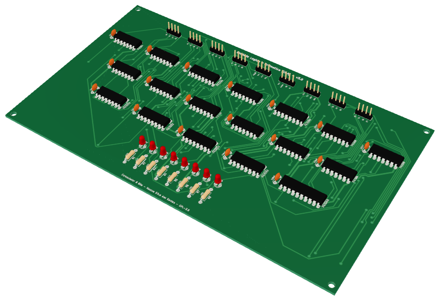
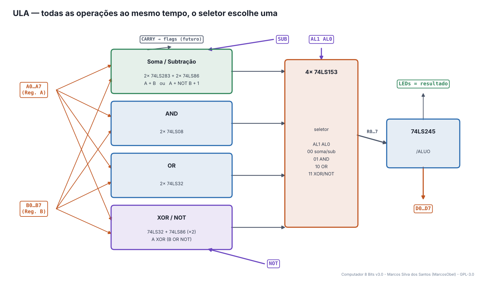
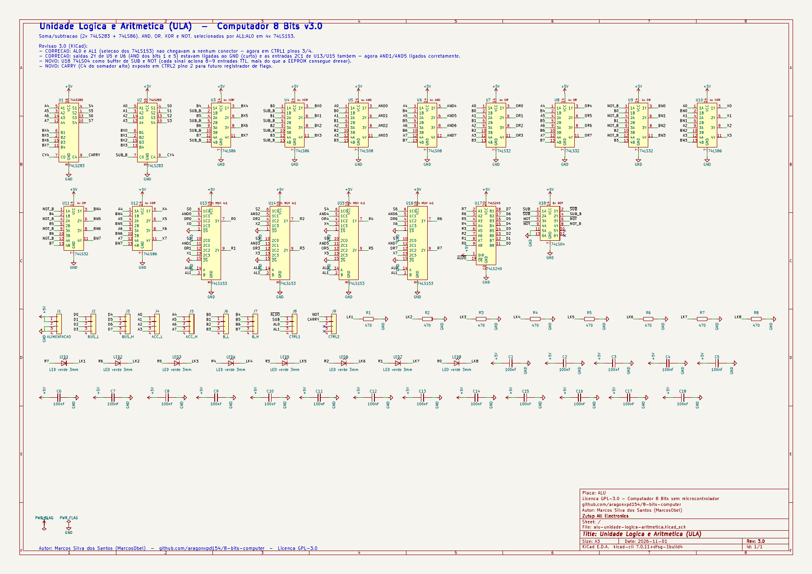
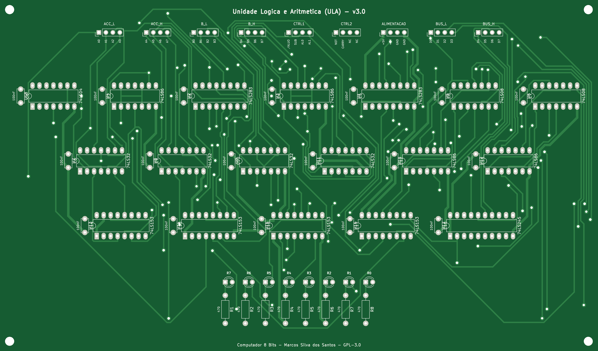
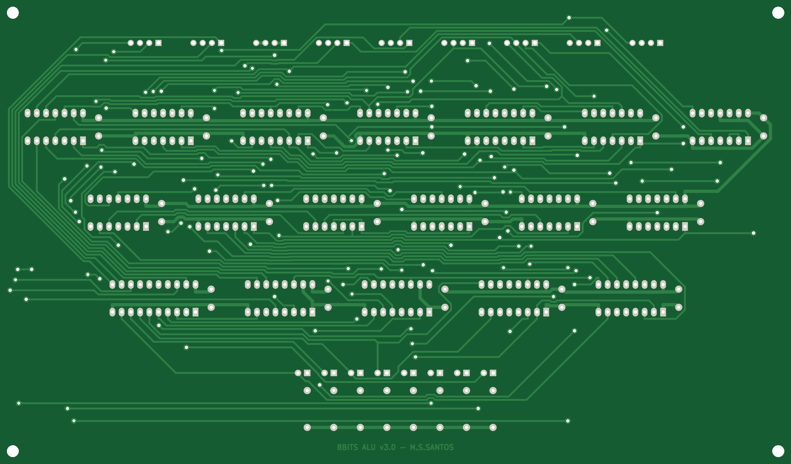
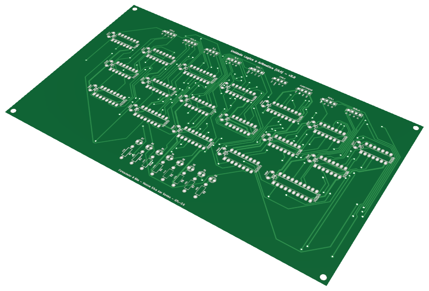

# 12 · ULA (Unidade Lógica e Aritmética)

> Placa do **Computador 8 Bits v3.0** — projeto de **Marcos Silva dos Santos** (MarcosObel) — GPL-3.0.

**Faz soma, subtração, AND, OR, XOR e NOT entre A e B; resultado vai ao barramento.**

| | |
|---|---|
| Tamanho | **217,55 × 127,81 mm**, 2 camadas, furo metalizado |
| Componentes | 61 (18 CIs) |
| Furos / vias | 523 / 145 |
| Projeto KiCad | [`hardware/kicad/alu-unidade-logica-aritmetica/`](../../hardware/kicad/alu-unidade-logica-aritmetica/) |
| Para a fábrica | [`alu-unidade-logica-aritmetica-gerber.zip`](../../hardware/fabricacao/alu-unidade-logica-aritmetica/alu-unidade-logica-aritmetica-gerber.zip) · [lista de materiais (CSV)](../../hardware/fabricacao/alu-unidade-logica-aritmetica/lista-de-materiais.csv) · [relatório DRC](../../hardware/fabricacao/alu-unidade-logica-aritmetica/relatorio-drc.txt) |
| Esquemático | [PDF](../../hardware/fabricacao/alu-unidade-logica-aritmetica/0-esquematico.pdf) · [imagem](../imagens/esquemas/alu-unidade-logica-aritmetica.png) |
| Modelo 3D | [**3D Viewer** (abre no navegador)](https://aragonxpd154.github.io/8-bits-computer/docs/3d/visualizador.html#alu-unidade-logica-aritmetica) · [STL (abre em 3D no GitHub)](../3d/stl/alu-unidade-logica-aritmetica.stl) · [GLB](../3d/modelos/alu-unidade-logica-aritmetica.glb) · [STEP (FreeCAD/Fusion)](../../hardware/fabricacao/alu-unidade-logica-aritmetica/alu-unidade-logica-aritmetica.step) |

## Função

Calcula, **o tempo todo**, o resultado da operação escolhida entre o registrador A e o registrador B. O resultado só vai para o barramento quando o microcódigo liga /ALUO, e então é guardado de volta em A.

Liga-se diretamente (cabo próprio) a: [Registrador A (Acumulador)](acc-registrador-a.md), [Registrador B](b-registrador-b.md). Todo o resto passa pelo [backplane](backplane-barramento.md).

## Diagrama de funcionamento

Laranja = barramento/dados · roxo = sinais de controle do microcódigo · verde = clock e reset · cinza = sinais internos da placa.

## Como funciona

**Soma e subtração (U1, U2 74LS283 + U3, U4 74LS86).** Dois somadores de 4 bits em cascata formam 8 bits. Para subtrair, os XOR invertem todos os bits de B e o carry de entrada recebe 1: A + (NOT B) + 1 = **A − B** (complemento de 2).

**AND (U5, U6 74LS08)** e **OR (U7, U8 74LS32)** bit a bit.

**XOR e NOT (U9…U12).** X = A XOR (B OR NOT). Com NOT = 0 é o XOR normal; com NOT = 1 o lado B vira tudo 1 e o resultado é **NOT A**.

**Seletor (U13…U16 74LS153).** Quatro multiplexadores 4→1 duplos escolhem, bit a bit, qual resultado sai: AL1 AL0 = **00 soma/sub · 01 AND · 10 OR · 11 XOR/NOT**.

**Saída (U17 74LS245)** coloca o resultado no barramento com /ALUO = 0.

**Buffer (U18 74LS04).** SUB e NOT acionam 8–9 entradas TTL cada, mais do que a EEPROM aguenta; duas inversões em série reforçam esses sinais.

**CARRY** (vai-um do bit 7) sai no conector CTRL2 para a futura placa de flags.

## O que cada parte faz

| Componente | Papel no circuito |
|---|---|
| **U1, U2 74LS283** | somador de 8 bits |
| **U3, U4 74LS86** | inversor controlado de B (subtração) |
| **U5, U6 74LS08** | A AND B |
| **U7, U8 74LS32** | A OR B |
| **U9, U11 74LS32** | B OR NOT (prepara o NOT) |
| **U10, U12 74LS86** | A XOR (B OR NOT) |
| **U13…U16 74LS153** | seletor da operação (AL1, AL0) |
| **U17 74LS245** | saída para o barramento |
| **U18 74LS04** | buffer de SUB e NOT |

## O que os LEDs mostram

| LED | Significado |
|---|---|
| **LED1…LED8** | resultado da operação selecionada, bit 7 à esquerda |

## Esquemático

Clique para abrir o PDF em alta resolução. Sinais com barra (ex.: /RST) são ativos em nível baixo.

## A placa como sai da fábrica

| Face de cima (componentes) | Face de baixo (solda) |
|---|---|
|  |  |

Imagens geradas das camadas reais (cobre, máscara verde, serigrafia branca e furos). A face de baixo aparece como você a vê com a placa virada.

## Conectores

Todos os conectores são barras de pinos de 2,54 mm. Os nomes dos sinais estão impressos na serigrafia, embaixo de cada pino. Cabos de 4 vias **retos** (pino 1 com pino 1).

| Conector | Nome | Pino 1 | Pino 2 | Pino 3 | Pino 4 | Liga em |
|---|---|---|---|---|---|---|
| **J1** | ALIMENTACAO | `+5V` | `+5V` | `GND` | `GND` | backplane J5 (P_ALU) |
| **J2** | BUS_L | `D0` | `D1` | `D2` | `D3` | backplane J17 (BL_ALU) |
| **J3** | BUS_H | `D4` | `D5` | `D6` | `D7` | backplane J24 (BH_ALU) |
| **J4** | ACC_L | `A0` | `A1` | `A2` | `A3` | cabo direto → Registrador A (Acumulador) J5 |
| **J5** | ACC_H | `A4` | `A5` | `A6` | `A7` | cabo direto → Registrador A (Acumulador) J6 |
| **J6** | B_L | `B0` | `B1` | `B2` | `B3` | cabo direto → Registrador B J5 |
| **J7** | B_H | `B4` | `B5` | `B6` | `B7` | cabo direto → Registrador B J6 |
| **J8** | CTRL1 | `/ALUO` | `SUB` | `AL0` | `AL1` | backplane J37 (C_ALU1) |
| **J9** | CTRL2 | `NOT` | `CARRY` | `NC` | `NC` | backplane J38 (C_ALU2) |

## Lista de componentes

| Tipo | Valor / peça | Qtd. | Referências |
|---|---|---:|---|
| Circuitos integrados | 74LS283 | 2 | U1, U2 |
| Circuitos integrados | 74LS86 | 4 | U3, U4, U10, U12 |
| Circuitos integrados | 74LS08 | 2 | U5, U6 |
| Circuitos integrados | 74LS32 | 4 | U7, U8, U9, U11 |
| Circuitos integrados | 74LS153 | 4 | U13, U14, U15, U16 |
| Circuitos integrados | 74LS245 | 1 | U17 |
| Circuitos integrados | 74LS04 | 1 | U18 |
| Resistores | 470 | 8 | R1, R2, R3, R4, R5, R6, R7, R8 |
| Capacitores | 100nF | 18 | C1, C2, C3, C4, C5, C6, C7, C8, C9, C10, C11, C12, C13, C14, C15, C16, C17, C18 |
| LEDs | LED verde 3mm | 8 | LED1, LED2, LED3, LED4, LED5, LED6, LED7, LED8 |
| Conectores | Barra de pinos 1×4, 2,54 mm (macho, 90° ou reta) | 9 | J1, J2, J3, J4, J5, J6, J7, J8, J9 |

## Como testar

1. Ligue A, B e a ULA. Com AL1 AL0 = 00 e SUB = 0: coloque A = 5 e B = 3 → LEDs da ULA = 0000 1000 (8).
2. SUB = 1 → 0000 0010 (2). AL = 01 → AND = 0000 0001. AL = 10 → OR = 0000 0111. AL = 11 → XOR = 0000 0110.
3. AL = 11 e NOT = 1 → 1111 1010 (NOT 5).
4. Com /ALUO = 0 o resultado aparece no barramento.

## Atenção

- É a placa com mais CIs (18). Use soquetes e confira o pino 1 de cada um — a serigrafia mostra o tipo de cada CI.
- Na v3.0 foram corrigidos dois erros do projeto antigo (AL0/AL1 sem conector e saídas AND em curto com o GND).

## O que mudou na v3.0

- CORRECAO: AL0 e AL1 (selecao dos 74LS153) nao chegavam a nenhum conector - agora em CTRL1 pinos 3/4.
- CORRECAO: saidas 2Y de U5 e U6 (AND dos bits 1 e 5) estavam ligadas ao GND (curto) e as entradas 2C1 de U13/U15 tambem - agora AND1/AND5 ligados corretamente.
- NOVO: U18 74LS04 como buffer de SUB e NOT (cada sinal aciona 8-9 entradas TTL, mais do que a EEPROM consegue drenar).
- NOVO: CARRY (C4 do somador alto) exposto em CTRL2 pino 2 para futuro registrador de flags.

---
← [Registrador B](b-registrador-b.md) · [todas as placas](README.md) · [Registrador de Saída](out-registrador-saida.md) →
