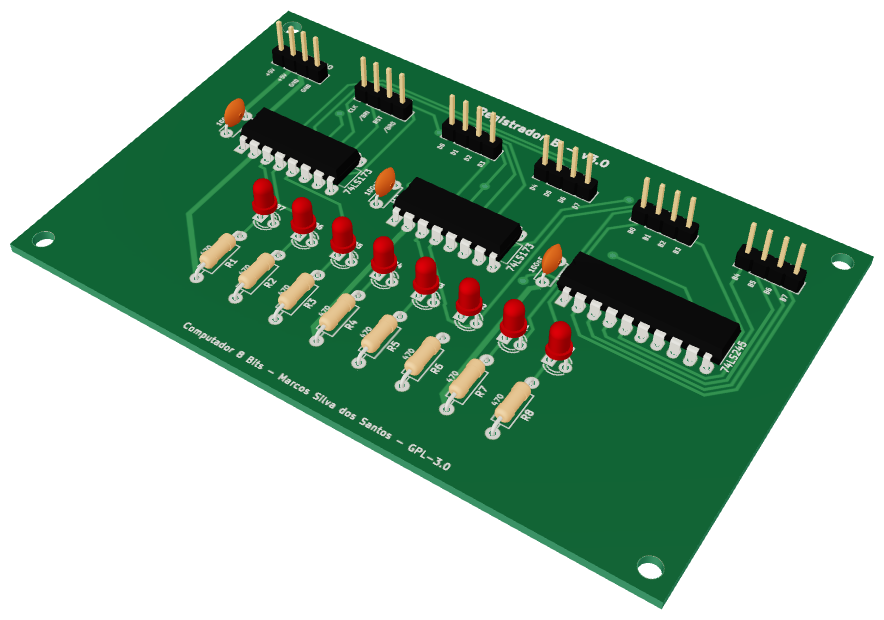
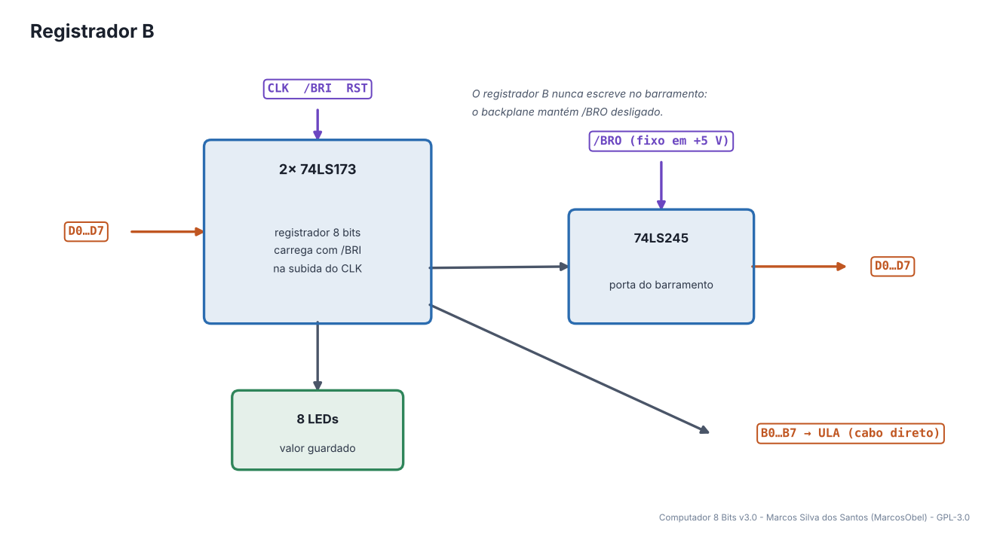
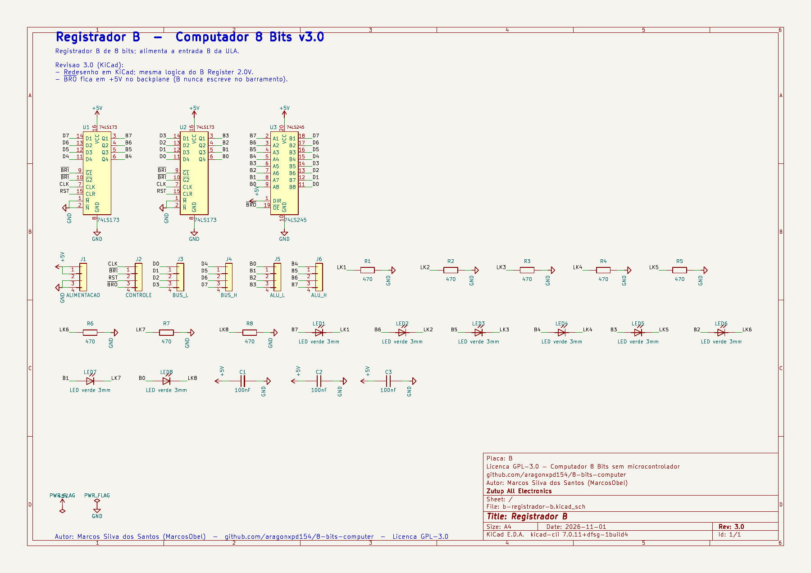
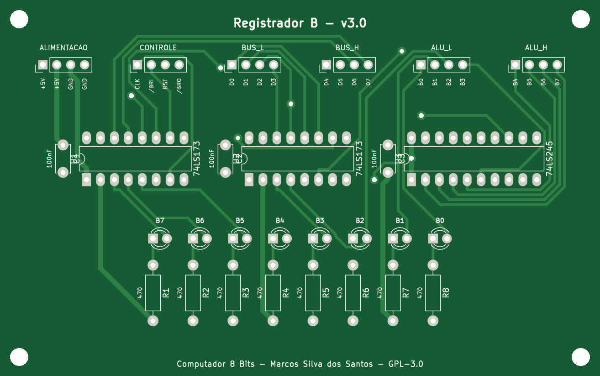
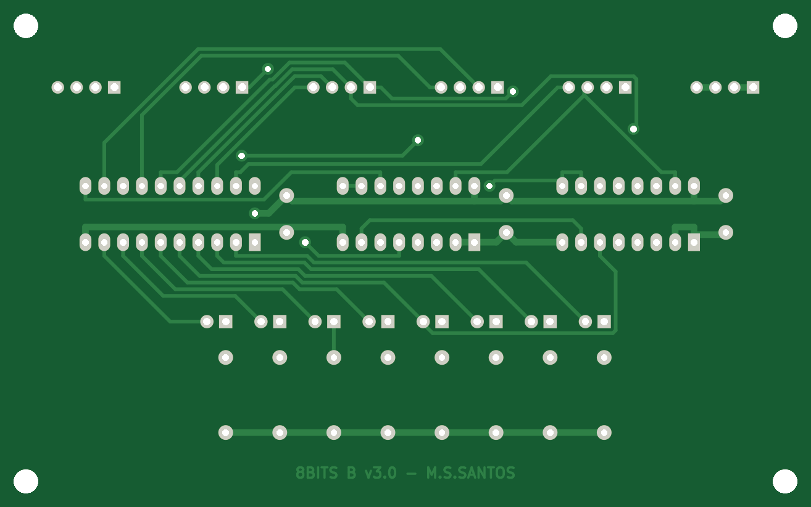
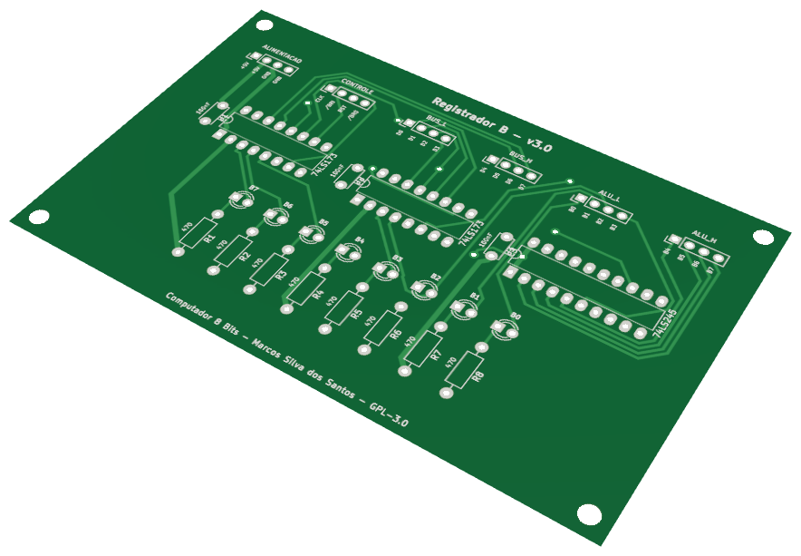

# 10 · Registrador B

> Placa do **Computador 8 Bits v3.0** — projeto de **Marcos Silva dos Santos** (MarcosObel) — GPL-3.0.

**Segundo operando da ULA: recebe o valor da RAM nas contas ADD, SUB, AND, OR e XOR.**

| | |
|---|---|
| Tamanho | **109,5 × 68,61 mm**, 2 camadas, furo metalizado |
| Componentes | 28 (3 CIs) |
| Furos / vias | 126 / 8 |
| Projeto KiCad | [`hardware/kicad/b-registrador-b/`](../../hardware/kicad/b-registrador-b/) |
| Para a fábrica | [`b-registrador-b-gerber.zip`](../../hardware/fabricacao/b-registrador-b/b-registrador-b-gerber.zip) · [lista de materiais (CSV)](../../hardware/fabricacao/b-registrador-b/lista-de-materiais.csv) · [relatório DRC](../../hardware/fabricacao/b-registrador-b/relatorio-drc.txt) |
| Esquemático | [PDF](../../hardware/fabricacao/b-registrador-b/0-esquematico.pdf) · [imagem](../imagens/esquemas/b-registrador-b.png) |
| Modelo 3D | [**3D Viewer** (abre no navegador)](https://aragonxpd154.github.io/8-bits-computer/docs/3d/visualizador.html#b-registrador-b) · [STL (abre em 3D no GitHub)](../3d/stl/b-registrador-b.stl) · [GLB](../3d/modelos/b-registrador-b.glb) · [STEP (FreeCAD/Fusion)](../../hardware/fabricacao/b-registrador-b/b-registrador-b.step) |

## Função

Guarda o **segundo operando** das operações. O valor vem da RAM (passo T3 de ADD/SUB/AND/OR/XOR) e fica ligado permanentemente à entrada B da ULA.

Liga-se diretamente (cabo próprio) a: [ULA (Unidade Lógica e Aritmética)](alu-unidade-logica-aritmetica.md). Todo o resto passa pelo [backplane](backplane-barramento.md).

## Diagrama de funcionamento

Laranja = barramento/dados · roxo = sinais de controle do microcódigo · verde = clock e reset · cinza = sinais internos da placa.

## Como funciona

Mesma placa do Registrador A: dois 74LS173 carregam o barramento quando /BRI = 0, e saem para a ULA por J5/J6.

O 74LS245 está na placa, mas no backplane **/BRO fica fixo em +5 V**: o registrador B nunca escreve no barramento (nenhuma instrução precisa disso). Fica disponível para expansões.

## O que cada parte faz

| Componente | Papel no circuito |
|---|---|
| **U1, U2 74LS173** | registrador de 8 bits |
| **U3 74LS245** | saída para o barramento (desabilitada no backplane) |

## O que os LEDs mostram

| LED | Significado |
|---|---|
| **LED1…LED8** | valor de B, bit 7 à esquerda |

## Esquemático

Clique para abrir o PDF em alta resolução. Sinais com barra (ex.: /RST) são ativos em nível baixo.

## A placa como sai da fábrica

| Face de cima (componentes) | Face de baixo (solda) |
|---|---|
|  |  |

Imagens geradas das camadas reais (cobre, máscara verde, serigrafia branca e furos). A face de baixo aparece como você a vê com a placa virada.

## Conectores

Todos os conectores são barras de pinos de 2,54 mm. Os nomes dos sinais estão impressos na serigrafia, embaixo de cada pino. Cabos de 4 vias **retos** (pino 1 com pino 1).

| Conector | Nome | Pino 1 | Pino 2 | Pino 3 | Pino 4 | Liga em |
|---|---|---|---|---|---|---|
| **J1** | ALIMENTACAO | `+5V` | `+5V` | `GND` | `GND` | backplane J4 (P_B) |
| **J2** | CONTROLE | `CLK` | `/BRI` | `RST` | `/BRO` | backplane J30 (C_B) |
| **J3** | BUS_L | `D0` | `D1` | `D2` | `D3` | backplane J16 (BL_B) |
| **J4** | BUS_H | `D4` | `D5` | `D6` | `D7` | backplane J23 (BH_B) |
| **J5** | ALU_L | `B0` | `B1` | `B2` | `B3` | cabo direto → ULA (Unidade Lógica e Aritmética) J6 |
| **J6** | ALU_H | `B4` | `B5` | `B6` | `B7` | cabo direto → ULA (Unidade Lógica e Aritmética) J7 |

## Lista de componentes

| Tipo | Valor / peça | Qtd. | Referências |
|---|---|---:|---|
| Circuitos integrados | 74LS173 | 2 | U1, U2 |
| Circuitos integrados | 74LS245 | 1 | U3 |
| Resistores | 470 | 8 | R1, R2, R3, R4, R5, R6, R7, R8 |
| Capacitores | 100nF | 3 | C1, C2, C3 |
| LEDs | LED verde 3mm | 8 | LED1, LED2, LED3, LED4, LED5, LED6, LED7, LED8 |
| Conectores | Barra de pinos 1×4, 2,54 mm (macho, 90° ou reta) | 6 | J1, J2, J3, J4, J5, J6 |

## Como testar

1. Coloque um valor no barramento, /BRI = 0 e um pulso de clock: os LEDs copiam.
2. RESET zera.

## O que mudou na v3.0

- Redesenho em KiCad; mesma logica do B Register 2.0V.
- ~{BRO} fica em +5V no backplane (B nunca escreve no barramento).

---
← [Registrador A (Acumulador)](acc-registrador-a.md) · [todas as placas](README.md) · [ULA (Unidade Lógica e Aritmética)](alu-unidade-logica-aritmetica.md) →
