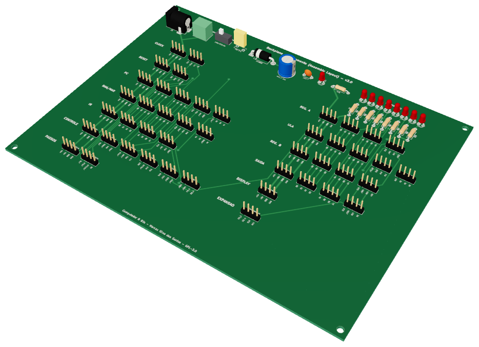
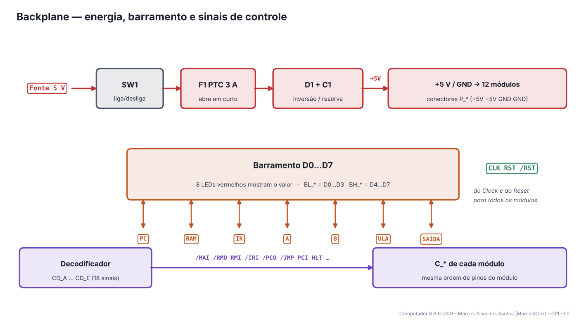
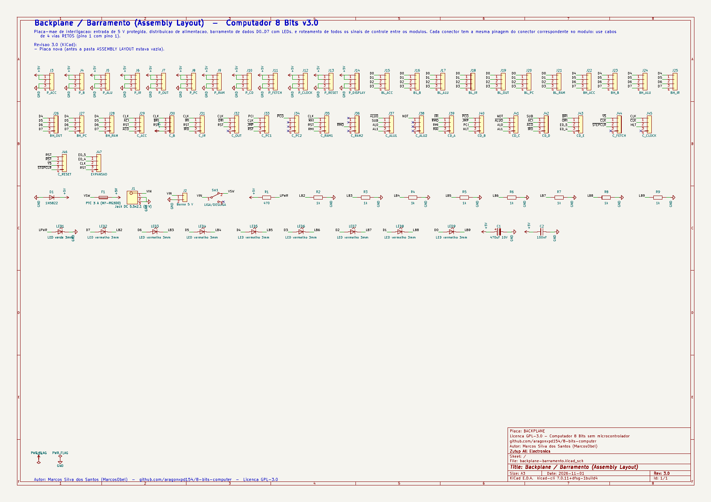
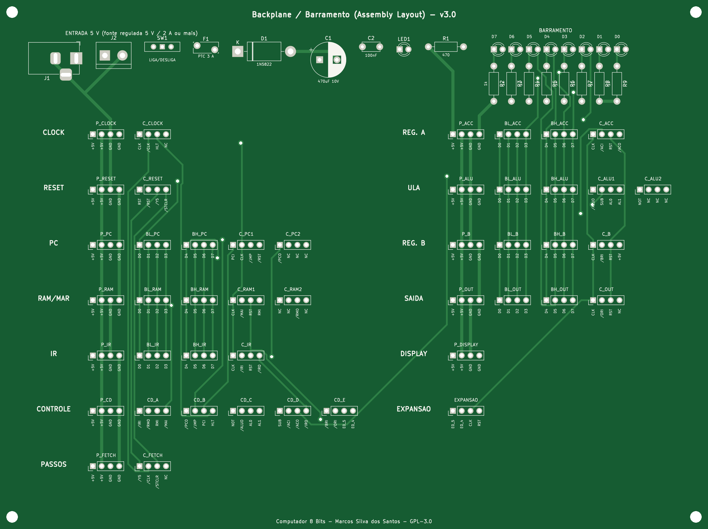
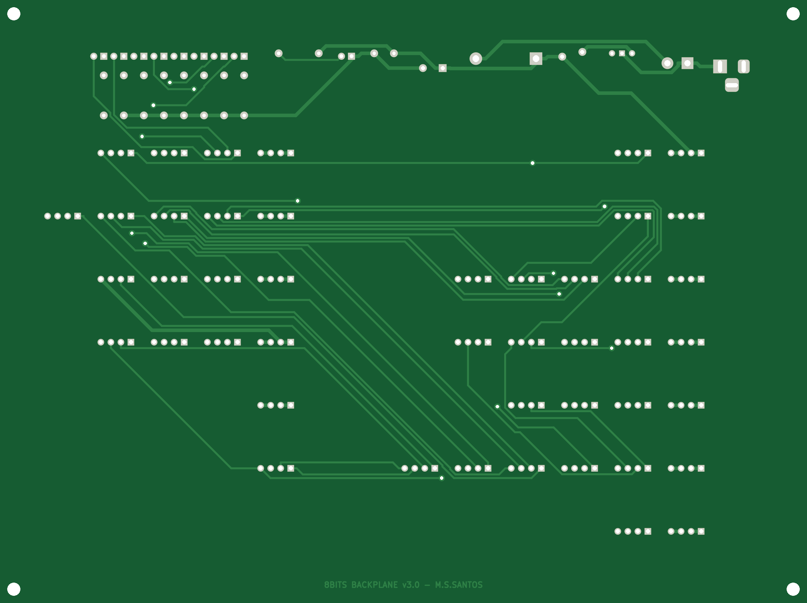
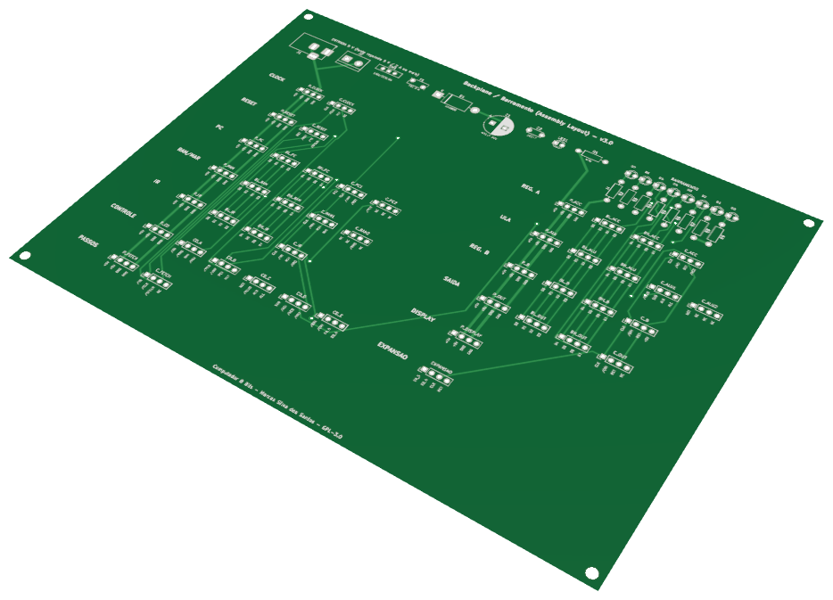

# 01 · Backplane / Barramento

> Placa do **Computador 8 Bits v3.0** — projeto de **Marcos Silva dos Santos** (MarcosObel) — GPL-3.0.

**Placa-mãe: entrada de 5 V protegida, barramento D0…D7 com LEDs e todos os sinais entre os módulos.**

| | |
|---|---|
| Tamanho | **204,5 × 153 mm**, 2 camadas, furo metalizado |
| Componentes | 70 (0 CIs) |
| Furos / vias | 250 / 14 |
| Projeto KiCad | [`hardware/kicad/backplane-barramento/`](../../hardware/kicad/backplane-barramento/) |
| Para a fábrica | [`backplane-barramento-gerber.zip`](../../hardware/fabricacao/backplane-barramento/backplane-barramento-gerber.zip) · [lista de materiais (CSV)](../../hardware/fabricacao/backplane-barramento/lista-de-materiais.csv) · [relatório DRC](../../hardware/fabricacao/backplane-barramento/relatorio-drc.txt) |
| Esquemático | [PDF](../../hardware/fabricacao/backplane-barramento/0-esquematico.pdf) · [imagem](../imagens/esquemas/backplane-barramento.png) |
| Modelo 3D | [visualizador interativo](../3d/visualizador.html#backplane-barramento) · [STL (abre em 3D no GitHub)](../3d/stl/backplane-barramento.stl) · [GLB](../3d/modelos/backplane-barramento.glb) · [STEP (FreeCAD/Fusion)](../../hardware/fabricacao/backplane-barramento/backplane-barramento.step) |

## Função

É a "placa-mãe" do computador. Não tem lógica: recebe a fonte de 5 V, protege e distribui a alimentação para os 12 módulos e liga entre si todos os sinais que precisam passar de uma placa para outra — o **barramento de dados D0…D7** e os **18 sinais de controle** que saem do Decodificador de Controle. Cada módulo se liga a ela com cabos de 4 vias retos.

## Diagrama de funcionamento

Laranja = barramento/dados · roxo = sinais de controle do microcódigo · verde = clock e reset · cinza = sinais internos da placa.

## Como funciona

**Entrada de energia.** A fonte entra pelo jack J1 (5,5 × 2,1 mm, centro positivo) ou pelo borne J2. Passa pela chave LIGA/DESLIGA (SW1) e pelo fusível rearmável F1 (PTC 3 A).

**Proteção contra inversão.** O diodo D1 (1N5822) fica *ao contrário* entre +5 V e GND. Com a polaridade certa ele não conduz. Se a fonte for ligada invertida, D1 conduz forte, a corrente sobe e o PTC abre — os CIs ficam protegidos. Depois de corrigir, o PTC volta sozinho em alguns segundos.

**Reserva de energia.** C1 (470 µF) segura a tensão durante os picos de consumo (LEDs e saídas TTL chaveando juntos); C2 (100 nF) filtra ruído rápido. O LED1 verde indica 5 V presente.

**Barramento.** As linhas D0…D7 passam por todos os conectores BL_* (D0…D3) e BH_* (D4…D7). Os 8 LEDs vermelhos (LED2…LED9) mostram o valor do barramento em tempo real — é a melhor ferramenta de depuração do computador: em cada passo do clock você vê quem está escrevendo no barramento.

**Sinais de controle.** Os conectores CD_A…CD_E recebem os 18 sinais do microcódigo e os levam aos conectores C_* de cada módulo, sempre na mesma ordem de pinos impressa na serigrafia.

## O que cada parte faz

| Componente | Papel no circuito |
|---|---|
| **J1, J2** | entrada de 5 V (jack ou borne) |
| **SW1** | liga/desliga |
| **F1** | fusível rearmável PTC 3 A |
| **D1** | proteção contra inversão de polaridade |
| **C1, C2** | reserva e filtro da alimentação |
| **J3…J14 (P_*)** | alimentação para cada módulo (+5V +5V GND GND) |
| **J15…J28 (BL_*, BH_*)** | barramento de dados para os 7 módulos que leem/escrevem nele |
| **J29…J46 (C_*, CD_*)** | sinais de controle |
| **J47 (EXPANSAO)** | saídas livres para futuras placas |

## O que os LEDs mostram

| LED | Significado |
|---|---|
| **LED1 (verde)** | 5 V presente |
| **LED2…LED9 (vermelhos)** | valor do barramento D7…D0 (aceso = 1) |

## Chaves e ajustes

| Controle | O que faz |
|---|---|
| **SW1** | liga/desliga o computador inteiro |

## Esquemático

Clique para abrir o PDF em alta resolução. Sinais com barra (ex.: /RST) são ativos em nível baixo.

## A placa como sai da fábrica

| Face de cima (componentes) | Face de baixo (solda) |
|---|---|
|  |  |

Imagens geradas das camadas reais (cobre, máscara verde, serigrafia branca e furos). A face de baixo aparece como você a vê com a placa virada.

## Conectores

Todos os conectores são barras de pinos de 2,54 mm. Os nomes dos sinais estão impressos na serigrafia, embaixo de cada pino. Cabos de 4 vias **retos** (pino 1 com pino 1).

| Conector | Nome | Pino 1 | Pino 2 | Pino 3 | Pino 4 | Liga em |
|---|---|---|---|---|---|---|
| **J1** | Jack DC 5,5x2,1 (5 V) | `+5V (centro)` | `GND` | `GND` | — | — |
| **J2** | Borne 5 V | `+5V` | `GND` | — | — | — |
| **J3** | P_ACC | `+5V` | `+5V` | `GND` | `GND` | Registrador A (Acumulador) J1 |
| **J4** | P_B | `+5V` | `+5V` | `GND` | `GND` | Registrador B J1 |
| **J5** | P_ALU | `+5V` | `+5V` | `GND` | `GND` | ULA (Unidade Lógica e Aritmética) J1 |
| **J6** | P_IR | `+5V` | `+5V` | `GND` | `GND` | Registrador de Instrução (IR) J1 |
| **J7** | P_OUT | `+5V` | `+5V` | `GND` | `GND` | Registrador de Saída J1 |
| **J8** | P_PC | `+5V` | `+5V` | `GND` | `GND` | Contador de Programa (PC) J1 |
| **J9** | P_RAM | `+5V` | `+5V` | `GND` | `GND` | RAM e MAR J1 |
| **J10** | P_CD | `+5V` | `+5V` | `GND` | `GND` | Decodificador de Controle J1 |
| **J11** | P_FETCH | `+5V` | `+5V` | `GND` | `GND` | Contador de Passos J1 |
| **J12** | P_CLOCK | `+5V` | `+5V` | `GND` | `GND` | Clock J1 |
| **J13** | P_RESET | `+5V` | `+5V` | `GND` | `GND` | Reset J1 |
| **J14** | P_DISPLAY | `+5V` | `+5V` | `GND` | `GND` | Display Decimal J1 |
| **J15** | BL_ACC | `D0` | `D1` | `D2` | `D3` | Registrador A (Acumulador) J3 |
| **J16** | BL_B | `D0` | `D1` | `D2` | `D3` | Registrador B J3 |
| **J17** | BL_ALU | `D0` | `D1` | `D2` | `D3` | ULA (Unidade Lógica e Aritmética) J2 |
| **J18** | BL_IR | `D0` | `D1` | `D2` | `D3` | Registrador de Instrução (IR) J3 |
| **J19** | BL_OUT | `D0` | `D1` | `D2` | `D3` | Registrador de Saída J3 |
| **J20** | BL_PC | `D0` | `D1` | `D2` | `D3` | Contador de Programa (PC) J4 |
| **J21** | BL_RAM | `D0` | `D1` | `D2` | `D3` | RAM e MAR J4 |
| **J22** | BH_ACC | `D4` | `D5` | `D6` | `D7` | Registrador A (Acumulador) J4 |
| **J23** | BH_B | `D4` | `D5` | `D6` | `D7` | Registrador B J4 |
| **J24** | BH_ALU | `D4` | `D5` | `D6` | `D7` | ULA (Unidade Lógica e Aritmética) J3 |
| **J25** | BH_IR | `D4` | `D5` | `D6` | `D7` | Registrador de Instrução (IR) J4 |
| **J26** | BH_OUT | `D4` | `D5` | `D6` | `D7` | Registrador de Saída J4 |
| **J27** | BH_PC | `D4` | `D5` | `D6` | `D7` | Contador de Programa (PC) J5 |
| **J28** | BH_RAM | `D4` | `D5` | `D6` | `D7` | RAM e MAR J5 |
| **J29** | C_ACC | `CLK` | `/ACI` | `RST` | `/ACO` | Registrador A (Acumulador) J2 |
| **J30** | C_B | `CLK` | `/BRI` | `RST` | `+5V` | Registrador B J2 |
| **J31** | C_IR | `CLK` | `/IRI` | `RST` | `/IRO` | Registrador de Instrução (IR) J2 |
| **J32** | C_OUT | `CLK` | `/ORI` | `RST` | `NC` | Registrador de Saída J2 |
| **J33** | C_PC1 | `PCI` | `CLK` | `/JMP` | `/RST` | Contador de Programa (PC) J2 |
| **J34** | C_PC2 | `/PCO` | `NC` | `NC` | `NC` | Contador de Programa (PC) J3 |
| **J35** | C_RAM1 | `CLK` | `/MAI` | `RST` | `RMI` | RAM e MAR J2 |
| **J36** | C_RAM2 | `NC` | `NC` | `/RMO` | `NC` | RAM e MAR J3 |
| **J37** | C_ALU1 | `/ALUO` | `SUB` | `AL0` | `AL1` | ULA (Unidade Lógica e Aritmética) J8 |
| **J38** | C_ALU2 | `NOT` | `NC` | `NC` | `NC` | ULA (Unidade Lógica e Aritmética) J9 |
| **J39** | CD_A | `/IRI` | `/RMO` | `RMI` | `/MAI` | Decodificador de Controle J5 |
| **J40** | CD_B | `/PCO` | `/JMP` | `PCI` | `HLT` | Decodificador de Controle J6 |
| **J41** | CD_C | `NOT` | `/ALUO` | `AL0` | `AL1` | Decodificador de Controle J7 |
| **J42** | CD_D | `SUB` | `/ACI` | `/ACO` | `/IRO` | Decodificador de Controle J8 |
| **J43** | CD_E | `/BRI` | `/ORI` | `E0_5` | `E0_4` | Decodificador de Controle J9 |
| **J44** | C_FETCH | `/Y5` | `/CLK` | `/STCLR` | `NC` | Contador de Passos J3 |
| **J45** | C_CLOCK | `CLK` | `/CLK` | `HLT` | `NC` | Clock J2 |
| **J46** | C_RESET | `RST` | `/RST` | `/Y5` | `/STCLR` | Reset J2 |
| **J47** | EXPANSAO | `E0_5` | `E0_4` | `CLK` | `RST` | — |

## Lista de componentes

| Tipo | Valor / peça | Qtd. | Referências |
|---|---|---:|---|
| Resistores | 470 | 1 | R1 |
| Resistores | 1k | 8 | R2, R3, R4, R5, R6, R7, R8, R9 |
| Capacitores | 470uF 10V | 1 | C1 |
| Capacitores | 100nF | 1 | C2 |
| LEDs | LED verde 3mm | 1 | LED1 |
| LEDs | LED vermelho 3mm | 8 | LED2, LED3, LED4, LED5, LED6, LED7, LED8, LED9 |
| Conectores | Barra de pinos 1×4, 2,54 mm (macho, 90° ou reta) | 45 | J3, J4, J5, J6, J7, J8, J9, J10, J11, J12, J13, J14, J15, J16, J17, J18, J19, J20, J21, J22, J23, J24, J25, J26, J27, J28, J29, J30, J31, J32, J33, J34, J35, J36, J37, J38, J39, J40, J41, J42, J43, J44, J45, J46, J47 |
| Entrada de energia | Jack DC 5,5x2,1 (5 V) | 1 | J1 |
| Entrada de energia | Borne 5 V | 1 | J2 |
| Entrada de energia | LIGA/DESLIGA | 1 | SW1 |
| Entrada de energia | PTC 3 A (MF-RG300) | 1 | F1 |
| Entrada de energia | 1N5822 | 1 | D1 |

## Como testar

1. Sem nenhum módulo ligado, conecte a fonte: LED1 acende e o multímetro mostra 4,9…5,1 V em qualquer P_*.
2. Meça a resistência entre +5 V e GND com a fonte desligada: deve ser alta (> 1 kΩ, carga dos capacitores).
3. Com um fio de 1 kΩ, ligue D0 ao +5 V num conector BL_*: o LED de D0 acende. Repita para D1…D7.

## Atenção

- Use somente fonte **regulada de 5 V** (2 A ou mais). A placa não tem regulador: 9 V ou 12 V queimam os CIs.
- Os conectores estão agrupados por módulo, com o nome escrito ao lado — confira antes de encaixar o cabo.

## O que mudou na v3.0

- Placa nova (antes a pasta ASSEMBLY LAYOUT estava vazia).

---
[todas as placas](README.md) · [Clock](clock-astavel-monoestavel.md) →
