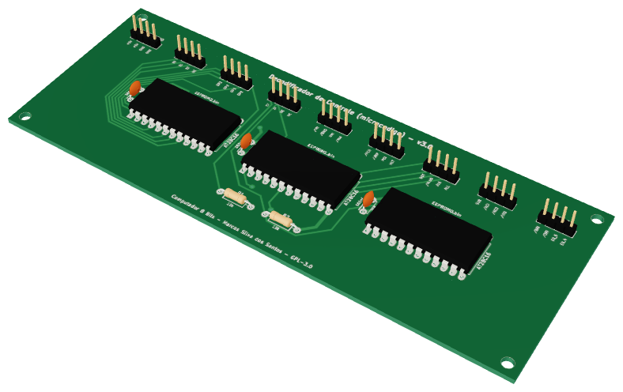
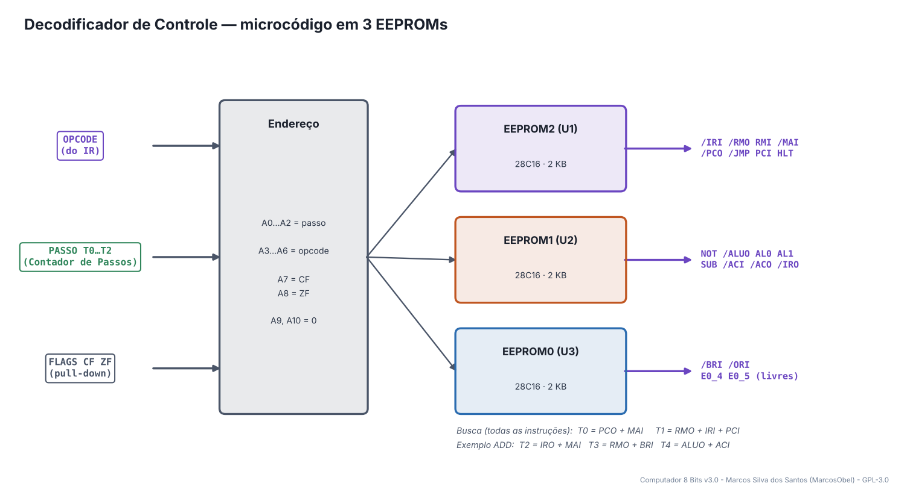
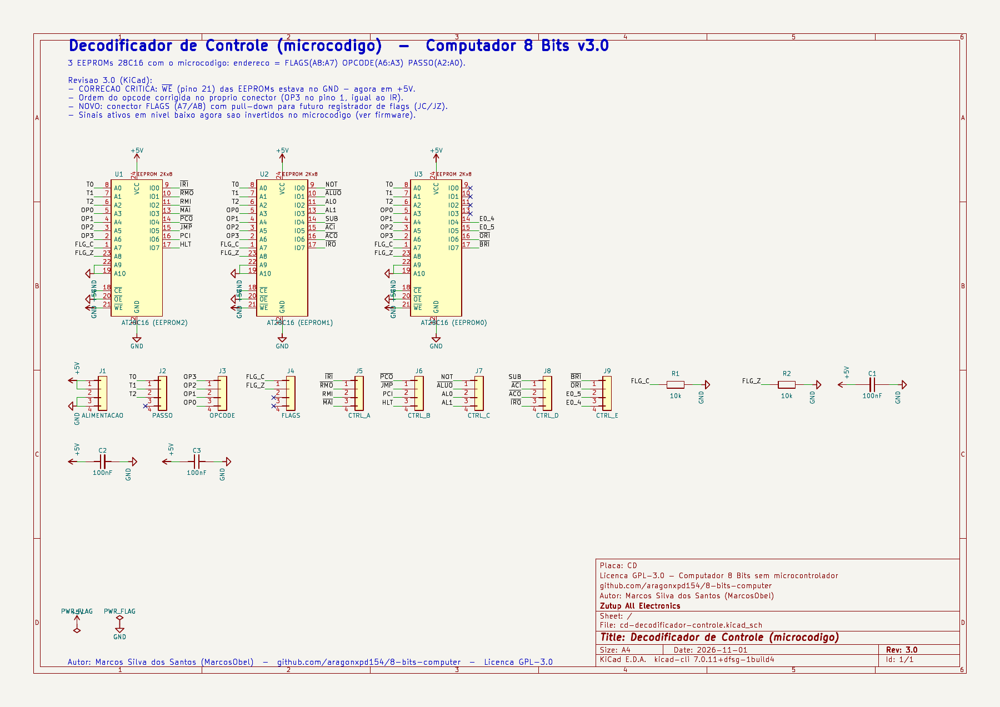
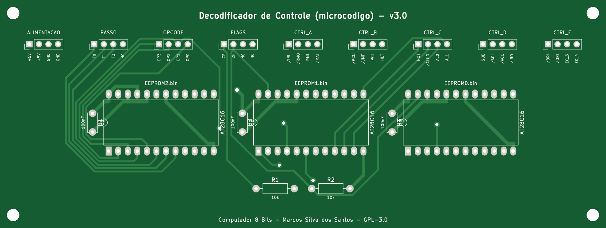
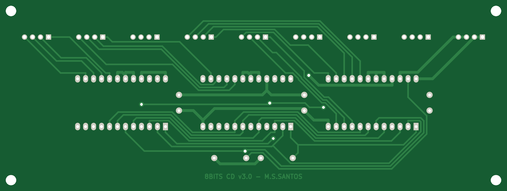
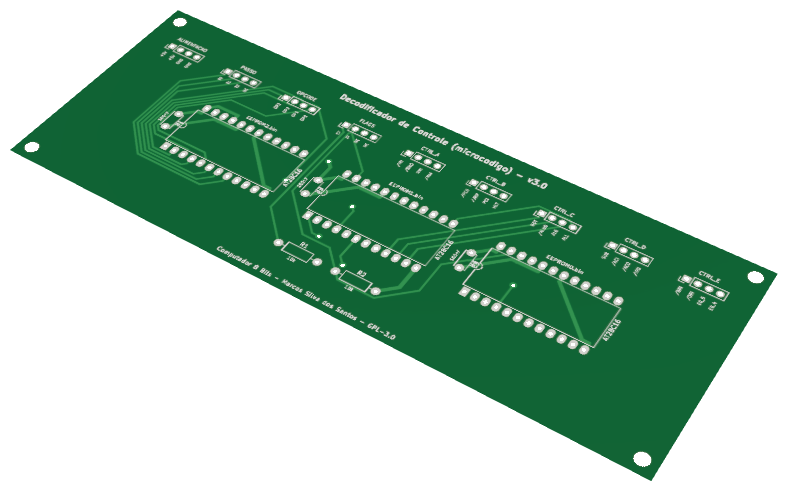

# 07 · Decodificador de Controle

> Placa do **Computador 8 Bits v3.0** — projeto de **Marcos Silva dos Santos** (MarcosObel) — GPL-3.0.

**O "cérebro": 3 EEPROMs com o microcódigo ligam os 18 sinais certos em cada passo de cada instrução.**

| | |
|---|---|
| Tamanho | **161,25 × 60,95 mm**, 2 camadas, furo metalizado |
| Componentes | 17 (3 CIs) |
| Furos / vias | 128 / 6 |
| Projeto KiCad | [`hardware/kicad/cd-decodificador-controle/`](../../hardware/kicad/cd-decodificador-controle/) |
| Para a fábrica | [`cd-decodificador-controle-gerber.zip`](../../hardware/fabricacao/cd-decodificador-controle/cd-decodificador-controle-gerber.zip) · [lista de materiais (CSV)](../../hardware/fabricacao/cd-decodificador-controle/lista-de-materiais.csv) · [relatório DRC](../../hardware/fabricacao/cd-decodificador-controle/relatorio-drc.txt) |
| Esquemático | [PDF](../../hardware/fabricacao/cd-decodificador-controle/0-esquematico.pdf) · [imagem](../imagens/esquemas/cd-decodificador-controle.png) |
| Modelo 3D | [**3D Viewer** (abre no navegador)](https://aragonxpd154.github.io/8-bits-computer/docs/3d/visualizador.html#cd-decodificador-controle) · [STL (abre em 3D no GitHub)](../3d/stl/cd-decodificador-controle.stl) · [GLB](../3d/modelos/cd-decodificador-controle.glb) · [STEP (FreeCAD/Fusion)](../../hardware/fabricacao/cd-decodificador-controle/cd-decodificador-controle.step) |

## Função

Transforma **opcode + passo** em **sinais de controle**. É uma tabela gravada em 3 EEPROMs 28C16: o endereço da EEPROM é formado pelo opcode (do IR), pelo passo T0…T2 (do Contador de Passos) e pelas flags; o byte guardado naquele endereço diz quais sinais ligar. Cada EEPROM fornece 8 sinais.

Liga-se diretamente (cabo próprio) a: [Registrador de Instrução (IR)](ir-registrador-instrucao.md), [Contador de Passos](fetch-contador-passos.md). Todo o resto passa pelo [backplane](backplane-barramento.md).

## Diagrama de funcionamento

Laranja = barramento/dados · roxo = sinais de controle do microcódigo · verde = clock e reset · cinza = sinais internos da placa.

## Como funciona

**Endereço:** A0…A2 = passo (T0…T2), A3…A6 = opcode (OP0…OP3), A7 = flag de carry (CF), A8 = flag zero (ZF), A9 e A10 no GND. As EEPROMs ficam sempre lendo (/CE e /OE no GND, /WE em +5 V).

**EEPROM2 (U1):** /IRI, /RMO, RMI, /MAI, /PCO, /JMP, PCI, HLT. **EEPROM1 (U2):** NOT, /ALUO, AL0, AL1, SUB, /ACI, /ACO, /IRO. **EEPROM0 (U3):** /BRI, /ORI e duas saídas livres (E0_4, E0_5) para expansão.

**Busca (igual para todas as instruções):** T0 = PCO + MAI (endereço do PC vai para a MAR); T1 = RMO + IRI + PCI (a instrução vai da RAM para o IR e o PC soma 1).

**Execução:** T2…T4 dependem do opcode. Exemplo `ADD 15`: T2 = IRO + MAI (o operando 15 vai para a MAR), T3 = RMO + BRI (RAM[15] vai para o registrador B), T4 = ALUO + ACI (A + B volta para A).

**Sinais ativos em 0.** Vários sinais (/PCO, /MAI, /IRI…) ligam em nível baixo. O gerador do microcódigo já grava esses bits invertidos, então nos passos vazios todas as saídas ficam desligadas.

**Flags.** O conector FLAGS (J4) tem pull-down (R1, R2): sem a futura placa de flags, CF = ZF = 0 e `JC`/`JZ` não saltam.

## O que cada parte faz

| Componente | Papel no circuito |
|---|---|
| **U1 AT28C16** | EEPROM2 — sinais de memória, PC e HLT |
| **U2 AT28C16** | EEPROM1 — sinais da ULA, registrador A e IR |
| **U3 AT28C16** | EEPROM0 — registrador B e saída |
| **R1, R2** | pull-down das flags CF e ZF |

## Esquemático

Clique para abrir o PDF em alta resolução. Sinais com barra (ex.: /RST) são ativos em nível baixo.

## A placa como sai da fábrica

| Face de cima (componentes) | Face de baixo (solda) |
|---|---|
|  |  |

Imagens geradas das camadas reais (cobre, máscara verde, serigrafia branca e furos). A face de baixo aparece como você a vê com a placa virada.

## Conectores

Todos os conectores são barras de pinos de 2,54 mm. Os nomes dos sinais estão impressos na serigrafia, embaixo de cada pino. Cabos de 4 vias **retos** (pino 1 com pino 1).

| Conector | Nome | Pino 1 | Pino 2 | Pino 3 | Pino 4 | Liga em |
|---|---|---|---|---|---|---|
| **J1** | ALIMENTACAO | `+5V` | `+5V` | `GND` | `GND` | backplane J10 (P_CD) |
| **J2** | PASSO | `T0` | `T1` | `T2` | `NC` | cabo direto → Contador de Passos J2 |
| **J3** | OPCODE | `OP3` | `OP2` | `OP1` | `OP0` | cabo direto → Registrador de Instrução (IR) J5 |
| **J4** | FLAGS | `CF` | `ZF` | `NC` | `NC` | — |
| **J5** | CTRL_A | `/IRI` | `/RMO` | `RMI` | `/MAI` | backplane J39 (CD_A) |
| **J6** | CTRL_B | `/PCO` | `/JMP` | `PCI` | `HLT` | backplane J40 (CD_B) |
| **J7** | CTRL_C | `NOT` | `/ALUO` | `AL0` | `AL1` | backplane J41 (CD_C) |
| **J8** | CTRL_D | `SUB` | `/ACI` | `/ACO` | `/IRO` | backplane J42 (CD_D) |
| **J9** | CTRL_E | `/BRI` | `/ORI` | `E0_5` | `E0_4` | backplane J43 (CD_E) |

## Lista de componentes

| Tipo | Valor / peça | Qtd. | Referências |
|---|---|---:|---|
| Circuitos integrados | AT28C16 (EEPROM2) | 1 | U1 |
| Circuitos integrados | AT28C16 (EEPROM1) | 1 | U2 |
| Circuitos integrados | AT28C16 (EEPROM0) | 1 | U3 |
| Resistores | 10k | 2 | R1, R2 |
| Capacitores | 100nF | 3 | C1, C2, C3 |
| Conectores | Barra de pinos 1×4, 2,54 mm (macho, 90° ou reta) | 9 | J1, J2, J3, J4, J5, J6, J7, J8, J9 |

## Como testar

1. Grave as EEPROMs (capítulo 6) e confira com `minipro` que a leitura bate com o .bin.
2. Ligue IR e Contador de Passos e use o clock MANUAL. Com o opcode 0000 (NOP), em T0 os sinais /PCO e /MAI devem ir a 0 V e em T1 /RMO e /IRI a 0 V e PCI a 5 V.
3. Mude o opcode para 1110 (OUT) e confira em T2: /ACO = 0 V e /ORI = 0 V.

## Atenção

- Encaixe cada EEPROM no soquete certo: **U1 = EEPROM2.bin, U2 = EEPROM1.bin, U3 = EEPROM0.bin** (etiquete os chips).
- O pino 1 (marca/chanfro) de cada EEPROM fica para o lado indicado na serigrafia. Use soquete de 24 pinos.

## O que mudou na v3.0

- CORRECAO CRITICA: ~{WE} (pino 21) das EEPROMs estava no GND - agora em +5V.
- Ordem do opcode corrigida no proprio conector (OP3 no pino 1, igual ao IR).
- NOVO: conector FLAGS (A7/A8) com pull-down para futuro registrador de flags (JC/JZ).
- Sinais ativos em nivel baixo agora sao invertidos no microcodigo (ver firmware).

---
← [Registrador de Instrução (IR)](ir-registrador-instrucao.md) · [todas as placas](README.md) · [Contador de Passos](fetch-contador-passos.md) →
