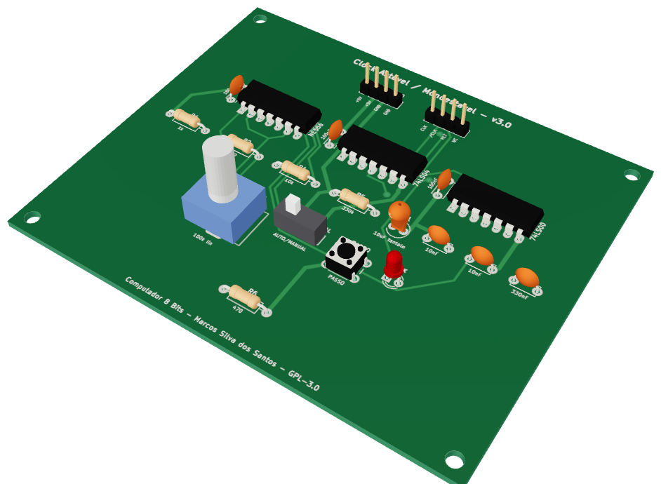
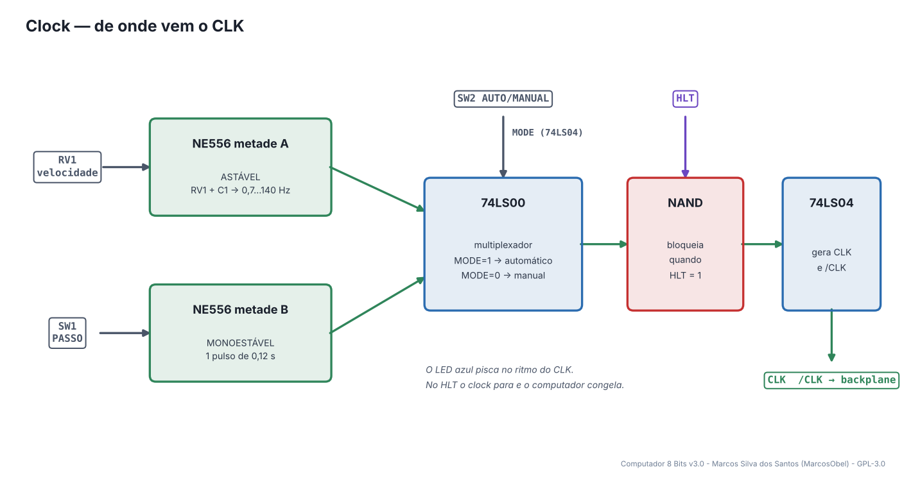
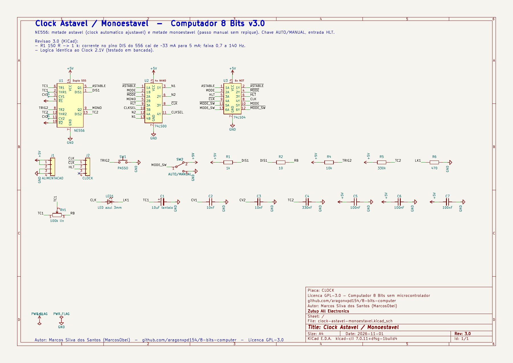
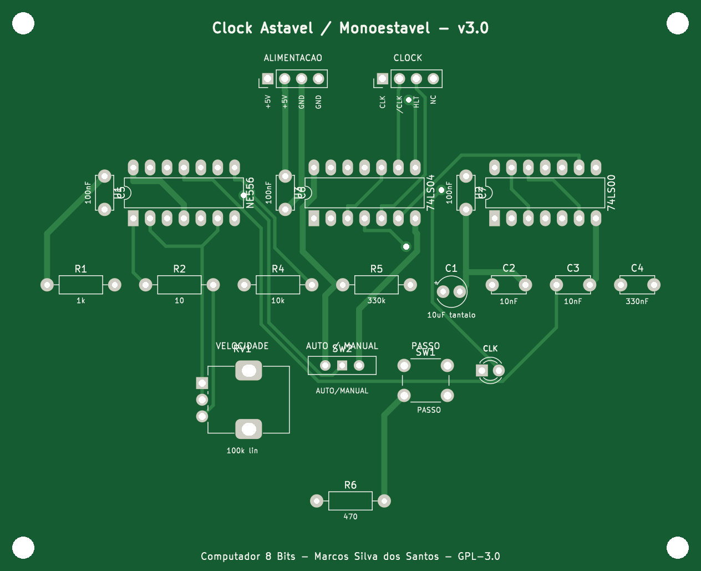
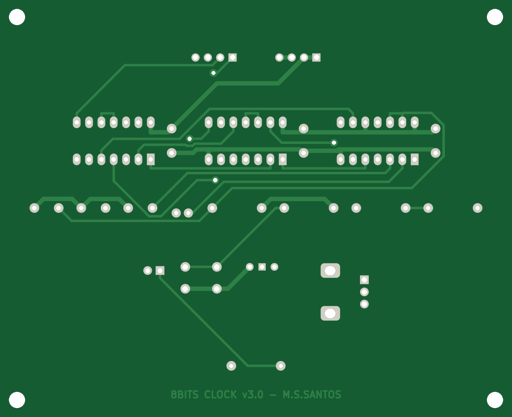
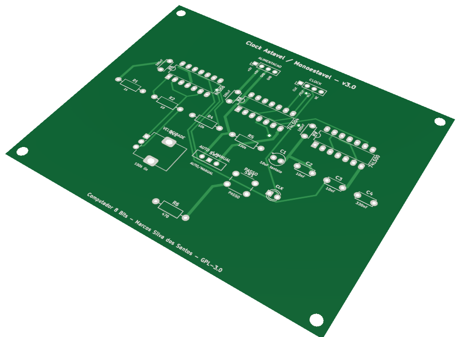

# 02 · Clock

> Placa do **Computador 8 Bits v3.0** - projeto de **Marcos Silva dos Santos** (MarcosObel) - GPL-3.0.

**Gera o "batimento" do computador: automático (0,7–140 Hz) ou passo a passo, e para no HLT.**

| | |
|---|---|
| Tamanho | **105,34 × 85,76 mm**, 2 camadas, furo metalizado |
| Componentes | 21 (3 CIs) |
| Furos / vias | 96 / 4 |
| Projeto KiCad | [`hardware/kicad/clock-astavel-monoestavel/`](../../hardware/kicad/clock-astavel-monoestavel/) |
| Para a fábrica | [`clock-astavel-monoestavel-gerber.zip`](../../hardware/fabricacao/clock-astavel-monoestavel/clock-astavel-monoestavel-gerber.zip) · [lista de materiais (CSV)](../../hardware/fabricacao/clock-astavel-monoestavel/lista-de-materiais.csv) · [relatório DRC](../../hardware/fabricacao/clock-astavel-monoestavel/relatorio-drc.txt) |
| Esquemático | [PDF](../../hardware/fabricacao/clock-astavel-monoestavel/0-esquematico.pdf) · [imagem](../imagens/esquemas/clock-astavel-monoestavel.png) |
| Modelo 3D | [**3D Viewer** (abre no navegador)](https://aragonxpd154.github.io/8-bits-computer/docs/3d/visualizador.html#clock-astavel-monoestavel) · [STL (abre em 3D no GitHub)](../3d/stl/clock-astavel-monoestavel.stl) · [GLB](../3d/modelos/clock-astavel-monoestavel.glb) · [STEP (FreeCAD/Fusion)](../../hardware/fabricacao/clock-astavel-monoestavel/clock-astavel-monoestavel.step) |

## Função

Produz o sinal **CLK** que sincroniza todo o computador, e o seu inverso **/CLK**. Há dois modos: **AUTOMÁTICO**, com velocidade ajustável no potenciômetro, e **MANUAL**, em que cada toque no botão PASSO gera exatamente um pulso - ideal para ver cada passo da instrução nos LEDs. Quando o programa executa `HLT`, o sinal HLT chega aqui e trava o clock.

## Diagrama de funcionamento

Laranja = barramento/dados · roxo = sinais de controle do microcódigo · verde = clock e reset · cinza = sinais internos da placa.

## Como funciona

**Metade 1 do NE556 - astável.** Oscila sozinho, carregando e descarregando C1 (10 µF) através de R1 (1 kΩ) e do potenciômetro RV1 (100 kΩ). A frequência é f ≈ 1,44 / ((R1 + 2·RV1) · C1): de **≈ 0,7 Hz** (RV1 no máximo) até **≈ 140 Hz** (RV1 no mínimo). R2 (10 Ω) evita curto quando o potenciômetro está em zero.

**Metade 2 do NE556 - monoestável.** O botão PASSO (SW1) dispara um único pulso de t ≈ 1,1 · R5 · C4 = 1,1 · 330 kΩ · 330 nF ≈ 0,12 s. Como o pulso tem duração fixa, o **repique** (bounce) do botão é ignorado: um toque = um pulso.

**Seleção do modo.** A chave AUTO/MANUAL (SW2) é invertida duas vezes pelo 74LS04 (sinal MODE limpo). Três portas NAND do 74LS00 formam um multiplexador: quando MODE = 1 passa o astável, quando MODE = 0 passa o monoestável.

**HLT.** A última porta NAND junta o clock escolhido com /HLT: com HLT = 1 a saída fica parada. Uma porta do 74LS04 gera o CLK final e a saída /CLK, que vai para o Contador de Passos.

C2 e C3 (10 nF) estabilizam o pino de controle (CV) de cada 555; C5…C7 são desacoplamento dos CIs.

## O que cada parte faz

| Componente | Papel no circuito |
|---|---|
| **U1 NE556** | dois temporizadores 555: astável (automático) e monoestável (passo manual) |
| **U2 74LS00** | multiplexador AUTO/MANUAL e bloqueio por HLT |
| **U3 74LS04** | inversores: limpa a chave de modo, gera CLK e /CLK, inverte HLT |
| **RV1 + C1** | definem a velocidade do clock automático |
| **R5 + C4** | definem a largura do pulso manual |

## O que os LEDs mostram

| LED | Significado |
|---|---|
| **LED1 (azul)** | pisca no ritmo do CLK |

## Chaves e ajustes

| Controle | O que faz |
|---|---|
| **RV1** | velocidade do clock automático |
| **SW2** | AUTO / MANUAL |
| **SW1 PASSO** | um pulso de clock por toque (modo manual) |

## Esquemático

Clique para abrir o PDF em alta resolução. Sinais com barra (ex.: /RST) são ativos em nível baixo.

## A placa como sai da fábrica

| Face de cima (componentes) | Face de baixo (solda) |
|---|---|
|  |  |

Imagens geradas das camadas reais (cobre, máscara verde, serigrafia branca e furos). A face de baixo aparece como você a vê com a placa virada.

## Conectores

Todos os conectores são barras de pinos de 2,54 mm. Os nomes dos sinais estão impressos na serigrafia, embaixo de cada pino. Cabos de 4 vias **retos** (pino 1 com pino 1).

| Conector | Nome | Pino 1 | Pino 2 | Pino 3 | Pino 4 | Liga em |
|---|---|---|---|---|---|---|
| **J1** | ALIMENTACAO | `+5V` | `+5V` | `GND` | `GND` | backplane J12 (P_CLOCK) |
| **J2** | CLOCK | `CLK` | `/CLK` | `HLT` | `NC` | backplane J45 (C_CLOCK) |

## Lista de componentes

| Tipo | Valor / peça | Qtd. | Referências |
|---|---|---:|---|
| Circuitos integrados | NE556 | 1 | U1 |
| Circuitos integrados | 74LS00 | 1 | U2 |
| Circuitos integrados | 74LS04 | 1 | U3 |
| Resistores | 1k | 1 | R1 |
| Resistores | 10 | 1 | R2 |
| Resistores | 100k lin | 1 | RV1 |
| Resistores | 10k | 1 | R4 |
| Resistores | 330k | 1 | R5 |
| Resistores | 470 | 1 | R6 |
| Capacitores | 10uF tantalo | 1 | C1 |
| Capacitores | 10nF | 2 | C2, C3 |
| Capacitores | 330nF | 1 | C4 |
| Capacitores | 100nF | 3 | C5, C6, C7 |
| LEDs | LED azul 3mm | 1 | LED1 |
| Chaves e botões | PASSO | 1 | SW1 |
| Chaves e botões | AUTO/MANUAL | 1 | SW2 |
| Conectores | Barra de pinos 1×4, 2,54 mm (macho, 90° ou reta) | 2 | J1, J2 |

## Como testar

1. Ligue só esta placa ao backplane e ponha o pino HLT (J2-3) no GND com um fio - sem o Decodificador a entrada fica solta, e entrada TTL solta vale 1 (clock parado).
2. Em AUTO, o LED azul pisca; girando RV1 a velocidade muda de ~1 a muitas piscadas por segundo.
3. Em MANUAL, cada toque em PASSO acende o LED uma única vez.
4. Passe o fio do HLT do GND para o +5 V: o clock para. Volte para o GND: funciona de novo.
5. Com osciloscópio: CLK e /CLK são opostos, bordas limpas, nível alto > 3,5 V.

## Atenção

- C1 é **tântalo polarizado**: o lado + fica no pino 2/6 do 556 (marcado na serigrafia).
- Esta é a única placa já testada em bancada na versão anterior (2.1); a lógica não mudou.

## O que mudou na v3.0

- R1 150 R -> 1 k: corrente no pino DIS do 556 cai de ~33 mA para 5 mA; faixa 0,7 a 140 Hz.
- Logica identica ao Clock 2.1V (testado em bancada).

---
← [Backplane / Barramento](backplane-barramento.md) · [todas as placas](README.md) · [Reset](reset-circuito.md) →
