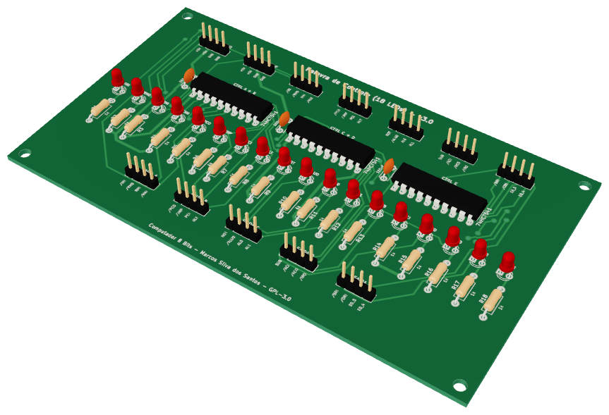
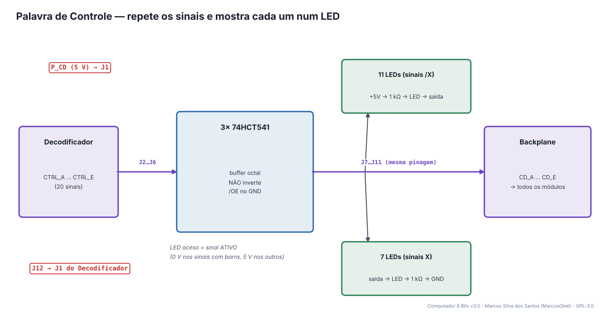
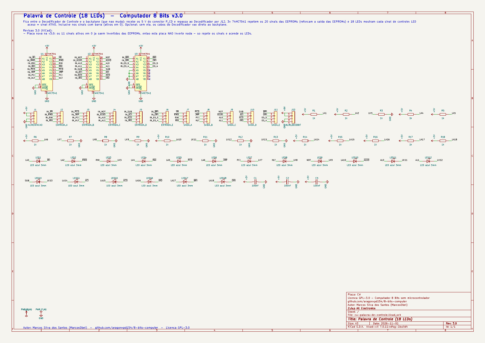
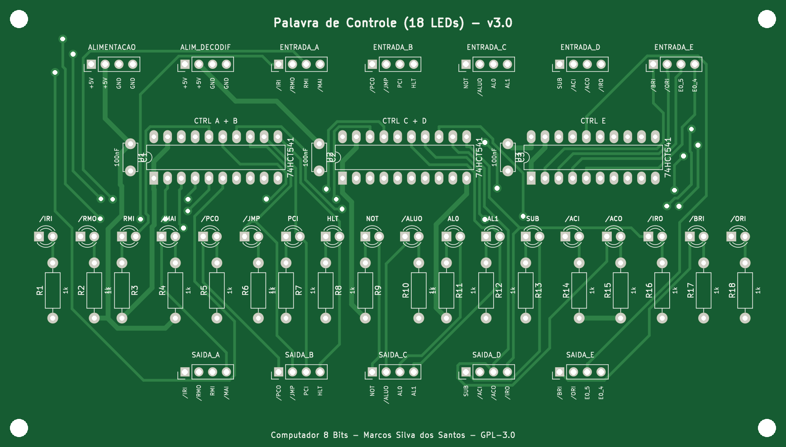
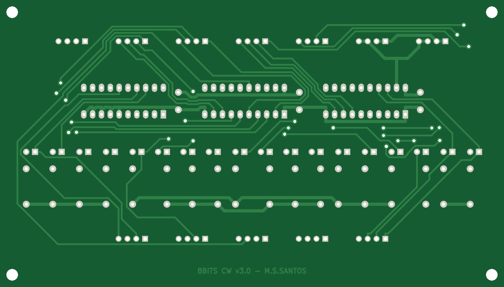
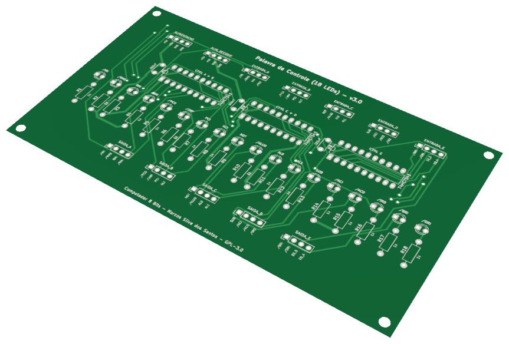

# 08 · Palavra de Controle

> Placa do **Computador 8 Bits v3.0** — projeto de **Marcos Silva dos Santos** (MarcosObel) — GPL-3.0.

**Placa opcional: 18 LEDs mostram, em cada passo, quais sinais de controle o microcódigo ligou.**

| | |
|---|---|
| Tamanho | **144,74 × 82,26 mm**, 2 camadas, furo metalizado |
| Componentes | 54 (3 CIs) |
| Furos / vias | 215 / 25 |
| Projeto KiCad | [`hardware/kicad/cw-palavra-de-controle/`](../../hardware/kicad/cw-palavra-de-controle/) |
| Para a fábrica | [`cw-palavra-de-controle-gerber.zip`](../../hardware/fabricacao/cw-palavra-de-controle/cw-palavra-de-controle-gerber.zip) · [lista de materiais (CSV)](../../hardware/fabricacao/cw-palavra-de-controle/lista-de-materiais.csv) · [relatório DRC](../../hardware/fabricacao/cw-palavra-de-controle/relatorio-drc.txt) |
| Esquemático | [PDF](../../hardware/fabricacao/cw-palavra-de-controle/0-esquematico.pdf) · [imagem](../imagens/esquemas/cw-palavra-de-controle.png) |
| Modelo 3D | [**3D Viewer** (abre no navegador)](https://aragonxpd154.github.io/8-bits-computer/docs/3d/visualizador.html#cw-palavra-de-controle) · [STL (abre em 3D no GitHub)](../3d/stl/cw-palavra-de-controle.stl) · [GLB](../3d/modelos/cw-palavra-de-controle.glb) · [STEP (FreeCAD/Fusion)](../../hardware/fabricacao/cw-palavra-de-controle/cw-palavra-de-controle.step) |

## Função

Mostra a **palavra de controle** — os 18 sinais que o Decodificador liga em cada passo de cada instrução. Com o clock em MANUAL dá para ver, passo a passo, por que cada registrador carrega ou escreve no barramento. De quebra, os 3 buffers reforçam os sinais que saem das EEPROMs. É **opcional**: sem ela os cabos do Decodificador vão direto ao backplane, como antes, e o backplane não muda em nada.

Liga-se diretamente (cabo próprio) a: [Decodificador de Controle](cd-decodificador-controle.md). Todo o resto passa pelo [backplane](backplane-barramento.md).

## Diagrama de funcionamento

Laranja = barramento/dados · roxo = sinais de controle do microcódigo · verde = clock e reset · cinza = sinais internos da placa.

## Como funciona

**Onde fica.** Entre o Decodificador e o backplane. Os 5 cabos CTRL_A…CTRL_E do Decodificador entram em ENTRADA_A…E (J2…J6); as saídas SAIDA_A…E (J7…J11) vão para CD_A…CD_E no backplane, com a mesma pinagem.

**Alimentação sem mexer no backplane.** O cabo do conector P_CD do backplane chega em J1 desta placa, e J12 (ALIM_DECODIF) repassa os 5 V para o J1 do Decodificador.

**Buffers (3× 74HCT541).** Cada canal copia a entrada na saída, sem inverter. A família HCT tem entradas compatíveis com TTL e saídas CMOS fortes: a EEPROM passa a alimentar só uma entrada CMOS (quase nenhuma corrente), e o 74HCT541 é quem aciona os módulos e os LEDs. /OE1 e /OE2 no GND = sempre ligados.

**LED aceso = sinal ativo.** Nos sinais com barra (ativos em 0) o LED vai do +5 V (via 1 kΩ) até a saída: acende quando a saída vai a 0 V. Nos sinais ativos em 1 (HLT, PCI, RMI, SUB, AL0, AL1, NOT) o LED vai da saída ao GND (via 1 kΩ). Assim todos os LEDs seguem a mesma regra, sem pensar em polaridade.

**Não inverte nada.** Os sinais ativos em 0 já saem invertidos das EEPROMs; esta placa só repete e mostra. E0_4 e E0_5 (saídas livres da EEPROM0) passam pela placa sem LED.

**O que esperar.** Em T0 acendem PCO e MAI; em T1, RMO, IRI e PCI — em toda instrução. Em `ADD`: T2 IRO+MAI, T3 RMO+BRI, T4 ALUO+ACI. No `HLT` fica aceso só o HLT.

## O que cada parte faz

| Componente | Papel no circuito |
|---|---|
| **U1 74HCT541** | repete CTRL_A e CTRL_B: /IRI /RMO RMI /MAI /PCO /JMP PCI HLT |
| **U2 74HCT541** | repete CTRL_C e CTRL_D: NOT /ALUO AL0 AL1 SUB /ACI /ACO /IRO |
| **U3 74HCT541** | repete CTRL_E: /BRI /ORI E0_5 E0_4 (4 canais livres no GND) |
| **LED1…LED18 + R1…R18** | um LED por sinal de controle, 1 kΩ cada |
| **J2…J6 / J7…J11** | entradas do Decodificador / saídas para o backplane |
| **J1 / J12** | entrada de 5 V (P_CD) / repasse para o Decodificador |

## O que os LEDs mostram

| LED | Significado |
|---|---|
| **LED1…LED4** | /IRI /RMO RMI /MAI |
| **LED5…LED8** | /PCO /JMP PCI HLT |
| **LED9…LED12** | NOT /ALUO AL0 AL1 |
| **LED13…LED16** | SUB /ACI /ACO /IRO |
| **LED17, LED18** | /BRI /ORI |
| **todos** | aceso = sinal ATIVO naquele passo |

## Esquemático

Clique para abrir o PDF em alta resolução. Sinais com barra (ex.: /RST) são ativos em nível baixo.

## A placa como sai da fábrica

| Face de cima (componentes) | Face de baixo (solda) |
|---|---|
|  |  |

Imagens geradas das camadas reais (cobre, máscara verde, serigrafia branca e furos). A face de baixo aparece como você a vê com a placa virada.

## Conectores

Todos os conectores são barras de pinos de 2,54 mm. Os nomes dos sinais estão impressos na serigrafia, embaixo de cada pino. Cabos de 4 vias **retos** (pino 1 com pino 1).

| Conector | Nome | Pino 1 | Pino 2 | Pino 3 | Pino 4 | Liga em |
|---|---|---|---|---|---|---|
| **J1** | ALIMENTACAO | `+5V` | `+5V` | `GND` | `GND` | backplane J10 (P_CD) |
| **J2** | ENTRADA_A | `/IRI` | `/RMO` | `RMI` | `/MAI` | cabo direto → Decodificador de Controle J5 |
| **J3** | ENTRADA_B | `/PCO` | `/JMP` | `PCI` | `HLT` | cabo direto → Decodificador de Controle J6 |
| **J4** | ENTRADA_C | `NOT` | `/ALUO` | `AL0` | `AL1` | cabo direto → Decodificador de Controle J7 |
| **J5** | ENTRADA_D | `SUB` | `/ACI` | `/ACO` | `/IRO` | cabo direto → Decodificador de Controle J8 |
| **J6** | ENTRADA_E | `/BRI` | `/ORI` | `E0_5` | `E0_4` | cabo direto → Decodificador de Controle J9 |
| **J7** | SAIDA_A | `/IRI` | `/RMO` | `RMI` | `/MAI` | backplane J39 (CD_A) |
| **J8** | SAIDA_B | `/PCO` | `/JMP` | `PCI` | `HLT` | backplane J40 (CD_B) |
| **J9** | SAIDA_C | `NOT` | `/ALUO` | `AL0` | `AL1` | backplane J41 (CD_C) |
| **J10** | SAIDA_D | `SUB` | `/ACI` | `/ACO` | `/IRO` | backplane J42 (CD_D) |
| **J11** | SAIDA_E | `/BRI` | `/ORI` | `E0_5` | `E0_4` | backplane J43 (CD_E) |
| **J12** | ALIM_DECODIF | `+5V` | `+5V` | `GND` | `GND` | cabo direto → Decodificador de Controle J1 |

## Lista de componentes

| Tipo | Valor / peça | Qtd. | Referências |
|---|---|---:|---|
| Circuitos integrados | 74HCT541 | 3 | U1, U2, U3 |
| Resistores | 1k | 18 | R1, R2, R3, R4, R5, R6, R7, R8, R9, R10, R11, R12, R13, R14, R15, R16, R17, R18 |
| Capacitores | 100nF | 3 | C1, C2, C3 |
| LEDs | LED azul 3mm | 18 | LED1, LED2, LED3, LED4, LED5, LED6, LED7, LED8, LED9, LED10, LED11, LED12, LED13, LED14, LED15, LED16, LED17, LED18 |
| Conectores | Barra de pinos 1×4, 2,54 mm (macho, 90° ou reta) | 12 | J1, J2, J3, J4, J5, J6, J7, J8, J9, J10, J11, J12 |

## Como testar

1. Só a alimentação (J1 em P_CD), sem cabos de sinal: confira 5 V em J12 e no pino 20 dos três CIs. Com as entradas soltas os LEDs podem acender ao acaso — é normal; por isso **nunca** ligue as saídas no backplane sem o Decodificador conectado nas entradas.
2. Com um fio, ponha J2 pino 1 (/IRI) no GND: o LED do /IRI acende. No +5 V: apaga. Repita para alguns sinais ativos em 1 (ex.: HLT, J3 pino 4): acende no +5 V.
3. Monte o computador com o Decodificador e o Contador de Passos, clock em MANUAL e RESET: em T0 acendem PCO e MAI, em T1 RMO, IRI e PCI.
4. Rode `t04-add.asm` passo a passo e confira os LEDs com a tabela de instruções (capítulo 1).

## Atenção

- Use **74HCT541** (não 74LS541): a família HCT tira quase nenhuma corrente da EEPROM e acende bem os LEDs azuis.
- Lembre de passar o cabo de alimentação: backplane P_CD → J1 desta placa, e J12 → J1 do Decodificador.
- Sem esta placa, ligue o Decodificador direto no backplane (J1 → P_CD e J5…J9 → CD_A…CD_E): funciona igual, só sem os LEDs.

## O que mudou na v3.0

- Placa nova na v3.0: os 11 sinais ativos em 0 ja saem invertidos das EEPROMs, entao esta placa NAO inverte nada - so repete os sinais e acende os LEDs.

---
← [Decodificador de Controle](cd-decodificador-controle.md) · [todas as placas](README.md) · [Contador de Passos](fetch-contador-passos.md) →
