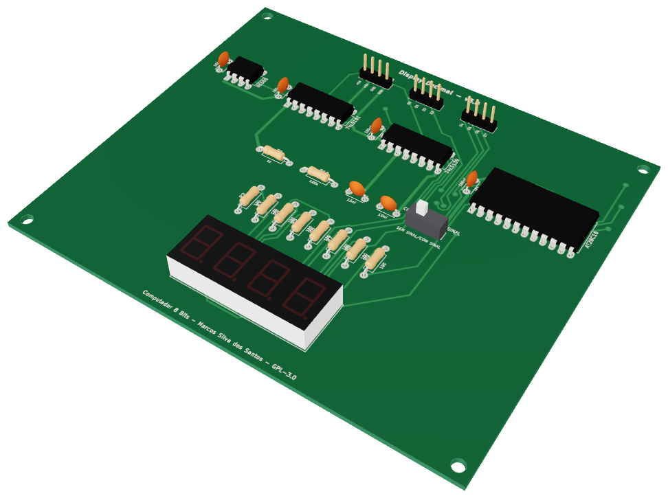
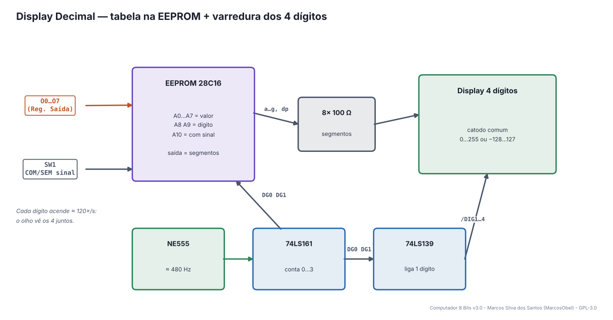
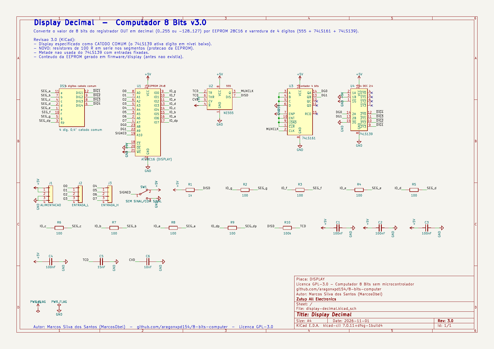
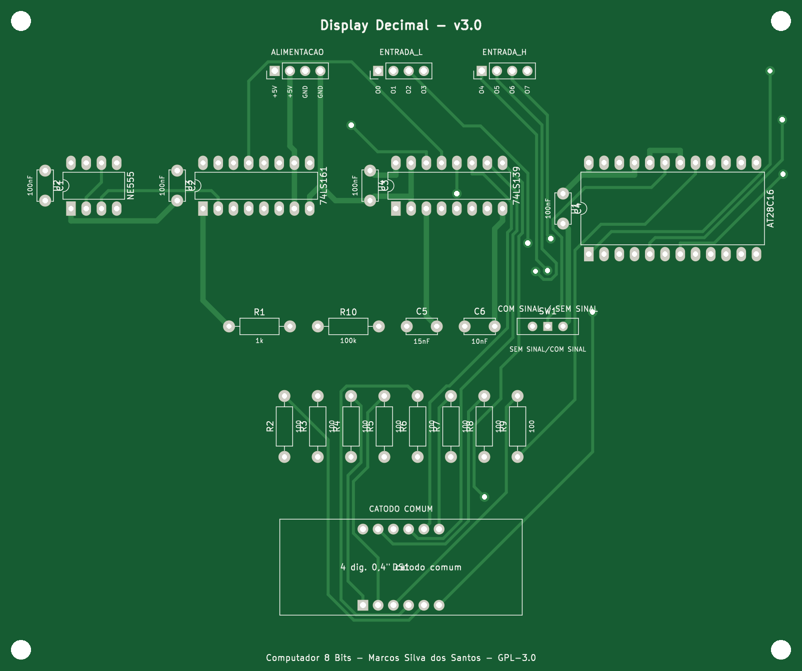
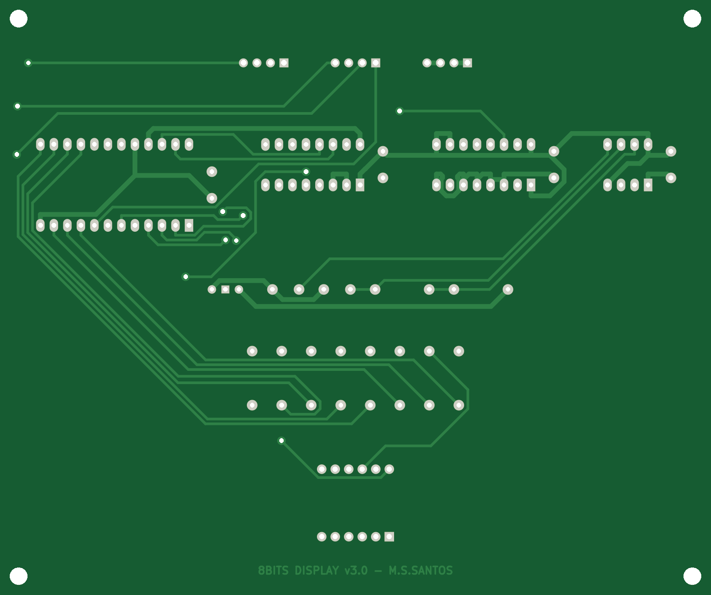
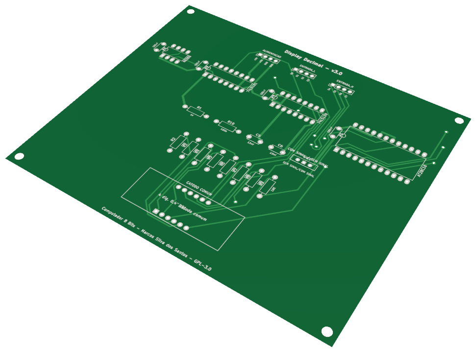

# 13 · Display Decimal

> Placa do **Computador 8 Bits v3.0** — projeto de **Marcos Silva dos Santos** (MarcosObel) — GPL-3.0.

**Mostra o valor do registrador de saída em decimal, 0…255 ou −128…127, em 4 dígitos.**

| | |
|---|---|
| Tamanho | **133,65 × 111,88 mm**, 2 camadas, furo metalizado |
| Componentes | 25 (5 CIs) |
| Furos / vias | 138 / 11 |
| Projeto KiCad | [`hardware/kicad/display-decimal/`](../../hardware/kicad/display-decimal/) |
| Para a fábrica | [`display-decimal-gerber.zip`](../../hardware/fabricacao/display-decimal/display-decimal-gerber.zip) · [lista de materiais (CSV)](../../hardware/fabricacao/display-decimal/lista-de-materiais.csv) · [relatório DRC](../../hardware/fabricacao/display-decimal/relatorio-drc.txt) |
| Esquemático | [PDF](../../hardware/fabricacao/display-decimal/0-esquematico.pdf) · [imagem](../imagens/esquemas/display-decimal.png) |
| Modelo 3D | [**3D Viewer** (abre no navegador)](https://aragonxpd154.github.io/8-bits-computer/docs/3d/visualizador.html#display-decimal) · [STL (abre em 3D no GitHub)](../3d/stl/display-decimal.stl) · [GLB](../3d/modelos/display-decimal.glb) · [STEP (FreeCAD/Fusion)](../../hardware/fabricacao/display-decimal/display-decimal.step) |

## Função

Converte o número binário de 8 bits em **decimal** e mostra num display de 4 dígitos de 7 segmentos. A chave escolhe entre **sem sinal** (0…255) e **com sinal** (−128…127, complemento de 2).

Liga-se diretamente (cabo próprio) a: [Registrador de Saída](out-registrador-saida.md). Todo o resto passa pelo [backplane](backplane-barramento.md).

## Diagrama de funcionamento

Laranja = barramento/dados · roxo = sinais de controle do microcódigo · verde = clock e reset · cinza = sinais internos da placa.

## Como funciona

**Tabela na EEPROM (U1 28C16).** Em vez de lógica de conversão, uma EEPROM guarda o desenho de cada dígito: endereço = valor (A0…A7) + qual dígito (A8, A9) + modo com/sem sinal (A10); o byte lido são os segmentos a…g e o ponto.

**Multiplexação.** Os 4 dígitos dividem os mesmos 8 fios de segmento. O 555 (U2) oscila a f ≈ 1,44 / ((R1 + 2·R10)·C5) ≈ 480 Hz; o 74LS161 (U3) conta 0…3 (DG0, DG1) e o 74LS139 (U4) acende um dígito por vez. Cada dígito pisca ≈ 120 vezes por segundo — o olho vê os 4 acesos.

**Catodo comum.** O 74LS139 ativa o dígito puxando o catodo para 0 V. Os resistores de 100 Ω (R2…R9) limitam a corrente dos segmentos e protegem as saídas da EEPROM.

## O que cada parte faz

| Componente | Papel no circuito |
|---|---|
| **U1 AT28C16** | tabela binário → 7 segmentos (DISPLAY.bin) |
| **U2 NE555** | oscilador da varredura (~480 Hz) |
| **U3 74LS161** | contador do dígito atual (0…3) |
| **U4 74LS139** | seleciona um dos 4 dígitos |
| **DS1** | display 4 dígitos, catodo comum, 0,4" |
| **R2…R9** | resistores dos segmentos (100 Ω) |

## Chaves e ajustes

| Controle | O que faz |
|---|---|
| **SW1** | SEM SINAL (0…255) / COM SINAL (−128…127) |

## Esquemático

Clique para abrir o PDF em alta resolução. Sinais com barra (ex.: /RST) são ativos em nível baixo.

## A placa como sai da fábrica

| Face de cima (componentes) | Face de baixo (solda) |
|---|---|
|  |  |

Imagens geradas das camadas reais (cobre, máscara verde, serigrafia branca e furos). A face de baixo aparece como você a vê com a placa virada.

## Conectores

Todos os conectores são barras de pinos de 2,54 mm. Os nomes dos sinais estão impressos na serigrafia, embaixo de cada pino. Cabos de 4 vias **retos** (pino 1 com pino 1).

| Conector | Nome | Pino 1 | Pino 2 | Pino 3 | Pino 4 | Liga em |
|---|---|---|---|---|---|---|
| **J1** | ALIMENTACAO | `+5V` | `+5V` | `GND` | `GND` | backplane J14 (P_DISPLAY) |
| **J2** | ENTRADA_L | `O0` | `O1` | `O2` | `O3` | cabo direto → Registrador de Saída J5 |
| **J3** | ENTRADA_H | `O4` | `O5` | `O6` | `O7` | cabo direto → Registrador de Saída J6 |

## Lista de componentes

| Tipo | Valor / peça | Qtd. | Referências |
|---|---|---:|---|
| Circuitos integrados | AT28C16 (DISPLAY) | 1 | U1 |
| Circuitos integrados | NE555 | 1 | U2 |
| Circuitos integrados | 74LS161 | 1 | U3 |
| Circuitos integrados | 74LS139 | 1 | U4 |
| Circuitos integrados | 4 dig. 0,4" catodo comum | 1 | DS1 |
| Resistores | 100 | 8 | R2, R3, R4, R5, R6, R7, R8, R9 |
| Resistores | 1k | 1 | R1 |
| Resistores | 100k | 1 | R10 |
| Capacitores | 15nF | 1 | C5 |
| Capacitores | 10nF | 1 | C6 |
| Capacitores | 100nF | 4 | C1, C2, C3, C4 |
| Chaves e botões | SEM SINAL/COM SINAL | 1 | SW1 |
| Conectores | Barra de pinos 1×4, 2,54 mm (macho, 90° ou reta) | 3 | J1, J2, J3 |

## Como testar

1. Grave DISPLAY.bin na EEPROM (capítulo 6).
2. Com o Registrador de Saída zerado o display mostra "0". Coloque 1111 1111 no registrador: mostra 255 (sem sinal) ou −1 (com sinal).
3. Se aparecerem segmentos trocados, confira se o display é mesmo de **catodo comum**.

## Atenção

- Use display de **catodo comum** de 4 dígitos (tipo 5641AS / 3461AS). Anodo comum não funciona.

## O que mudou na v3.0

- Display especificado como CATODO COMUM (o 74LS139 ativa digito em nivel baixo).
- NOVO: resistores de 100 R em serie nos segmentos (protecao da EEPROM).
- Metade nao usada do 74LS139 com entradas fixadas.
- Conteudo da EEPROM gerado em firmware/display (antes nao existia).

---
← [Registrador de Saída](out-registrador-saida.md) · [todas as placas](README.md)
