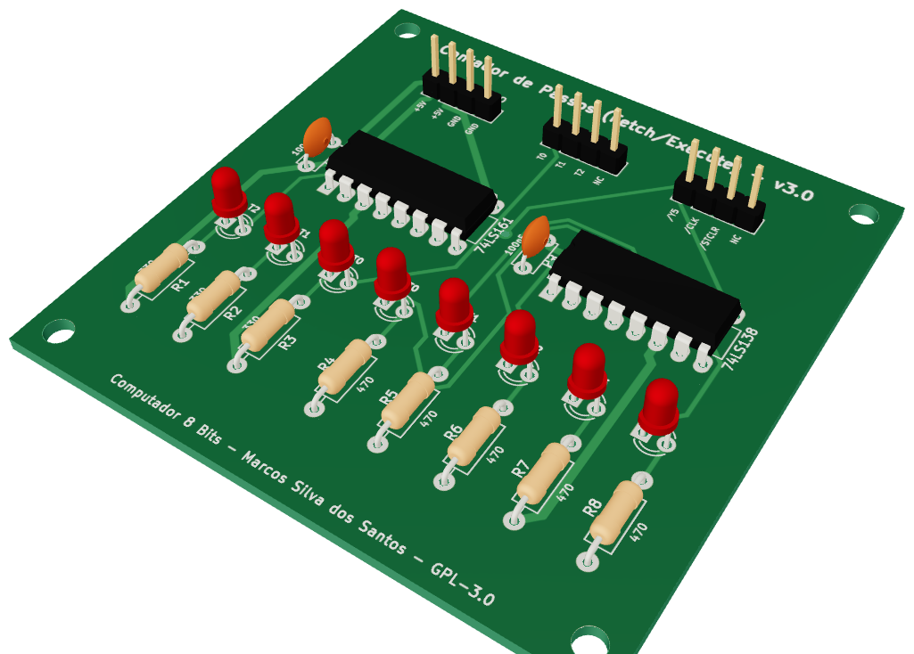
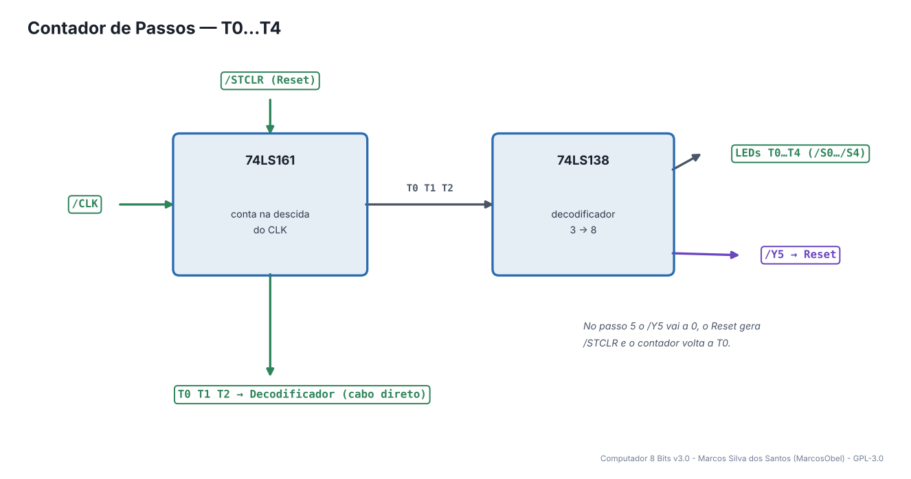
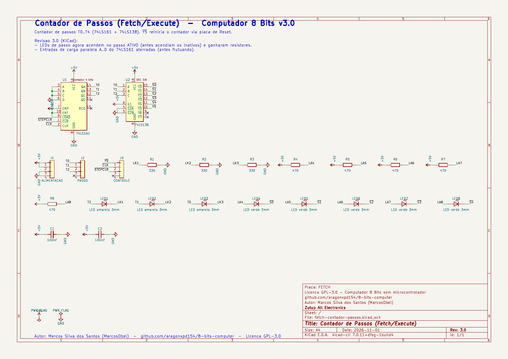
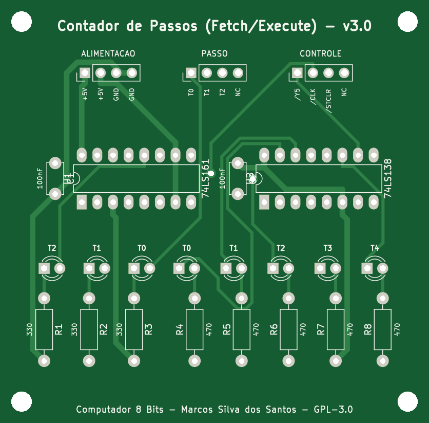
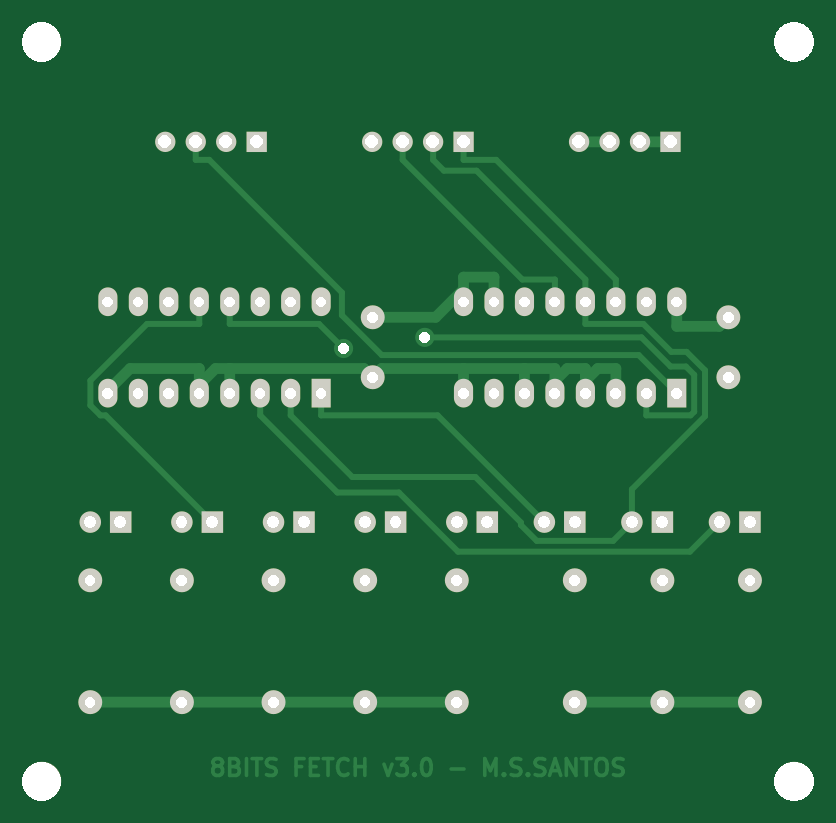
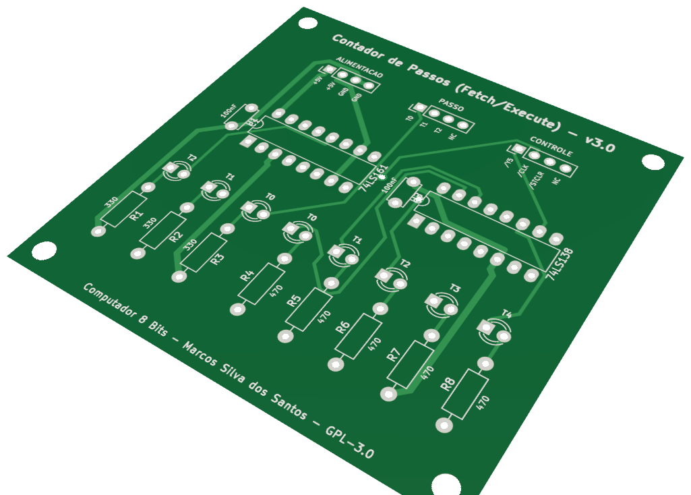

# 08 · Contador de Passos

> Placa do **Computador 8 Bits v3.0** — projeto de **Marcos Silva dos Santos** (MarcosObel) — GPL-3.0.

**Conta os passos T0…T4 de cada instrução e avisa (/Y5) quando a instrução terminou.**

| | |
|---|---|
| Tamanho | **69,7 × 68,61 mm**, 2 camadas, furo metalizado |
| Componentes | 23 (2 CIs) |
| Furos / vias | 86 / 2 |
| Projeto KiCad | [`hardware/kicad/fetch-contador-passos/`](../../hardware/kicad/fetch-contador-passos/) |
| Para a fábrica | [`fetch-contador-passos-gerber.zip`](../../hardware/fabricacao/fetch-contador-passos/fetch-contador-passos-gerber.zip) · [lista de materiais (CSV)](../../hardware/fabricacao/fetch-contador-passos/lista-de-materiais.csv) · [relatório DRC](../../hardware/fabricacao/fetch-contador-passos/relatorio-drc.txt) |
| Esquemático | [PDF](../../hardware/fabricacao/fetch-contador-passos/0-esquematico.pdf) · [imagem](../imagens/esquemas/fetch-contador-passos.png) |
| Modelo 3D | [visualizador interativo](../3d/visualizador.html#fetch-contador-passos) · [STL (abre em 3D no GitHub)](../3d/stl/fetch-contador-passos.stl) · [GLB](../3d/modelos/fetch-contador-passos.glb) · [STEP (FreeCAD/Fusion)](../../hardware/fabricacao/fetch-contador-passos/fetch-contador-passos.step) |

## Função

Toda instrução é executada em até 5 passos (T0 a T4), um por pulso de clock. Esta placa conta o passo atual, manda o número (T0…T2 em binário) para o Decodificador de Controle e mostra nos LEDs em qual passo o computador está.

Liga-se diretamente (cabo próprio) a: [Decodificador de Controle](cd-decodificador-controle.md). Todo o resto passa pelo [backplane](backplane-barramento.md).

## Diagrama de funcionamento

Laranja = barramento/dados · roxo = sinais de controle do microcódigo · verde = clock e reset · cinza = sinais internos da placa.

## Como funciona

**74LS161** conta na borda de **/CLK**, ou seja, na **descida** do CLK. Assim o passo muda no meio do ciclo e os sinais de controle já estão estáveis quando chega a próxima subida do CLK (quando os registradores carregam).

**74LS138** é um decodificador 3→8: transforma o número binário em uma linha ativa. /S0…/S4 acendem os LEDs de passo; /Y5 vai para a placa de Reset.

**Fim da instrução:** quando o contador chega a 5, /Y5 vai a 0, a placa de Reset gera /STCLR = 0 e o 74LS161 volta imediatamente a 0. O estado 5 dura poucos nanossegundos — na prática a sequência é T0…T4, T0…

## O que cada parte faz

| Componente | Papel no circuito |
|---|---|
| **U1 74LS161** | contador do passo (conta na descida do CLK) |
| **U2 74LS138** | decodifica o passo em linhas /S0…/S4 e /Y5 |

## O que os LEDs mostram

| LED | Significado |
|---|---|
| **LED1…LED3 (amarelos)** | passo em binário T2 T1 T0 |
| **LED4…LED8 (verdes)** | passo atual T0…T4 (um aceso por vez) |

## Esquemático

Clique para abrir o PDF em alta resolução. Sinais com barra (ex.: /RST) são ativos em nível baixo.

## A placa como sai da fábrica

| Face de cima (componentes) | Face de baixo (solda) |
|---|---|
|  |  |

Imagens geradas das camadas reais (cobre, máscara verde, serigrafia branca e furos). A face de baixo aparece como você a vê com a placa virada.

## Conectores

Todos os conectores são barras de pinos de 2,54 mm. Os nomes dos sinais estão impressos na serigrafia, embaixo de cada pino. Cabos de 4 vias **retos** (pino 1 com pino 1).

| Conector | Nome | Pino 1 | Pino 2 | Pino 3 | Pino 4 | Liga em |
|---|---|---|---|---|---|---|
| **J1** | ALIMENTACAO | `+5V` | `+5V` | `GND` | `GND` | backplane J11 (P_FETCH) |
| **J2** | PASSO | `T0` | `T1` | `T2` | `NC` | cabo direto → Decodificador de Controle J2 |
| **J3** | CONTROLE | `/Y5` | `/CLK` | `/STCLR` | `NC` | backplane J44 (C_FETCH) |

## Lista de componentes

| Tipo | Valor / peça | Qtd. | Referências |
|---|---|---:|---|
| Circuitos integrados | 74LS161 | 1 | U1 |
| Circuitos integrados | 74LS138 | 1 | U2 |
| Resistores | 330 | 3 | R1, R2, R3 |
| Resistores | 470 | 5 | R4, R5, R6, R7, R8 |
| Capacitores | 100nF | 2 | C1, C2 |
| LEDs | LED amarelo 3mm | 3 | LED1, LED2, LED3 |
| LEDs | LED verde 3mm | 5 | LED4, LED5, LED6, LED7, LED8 |
| Conectores | Barra de pinos 1×4, 2,54 mm (macho, 90° ou reta) | 3 | J1, J2, J3 |

## Como testar

1. Ligue Clock (com HLT no GND), Reset e esta placa. Em clock MANUAL, cada toque avança um LED verde: T0 → T1 → T2 → T3 → T4 → T0.
2. Os LEDs amarelos mostram 000, 001, 010, 011, 100.
3. RESET volta para T0 a qualquer momento.

## Atenção

- Sem a placa de Reset ligada o contador vai até T7 (não há quem gere /STCLR) — monte as duas juntas.

## O que mudou na v3.0

- LEDs de passo agora acendem no passo ATIVO (antes acendiam os inativos) e ganharam resistores.
- Entradas de carga paralela A..D do 74LS161 aterradas (antes flutuando).

---
← [Decodificador de Controle](cd-decodificador-controle.md) · [todas as placas](README.md) · [Registrador A (Acumulador)](acc-registrador-a.md) →
