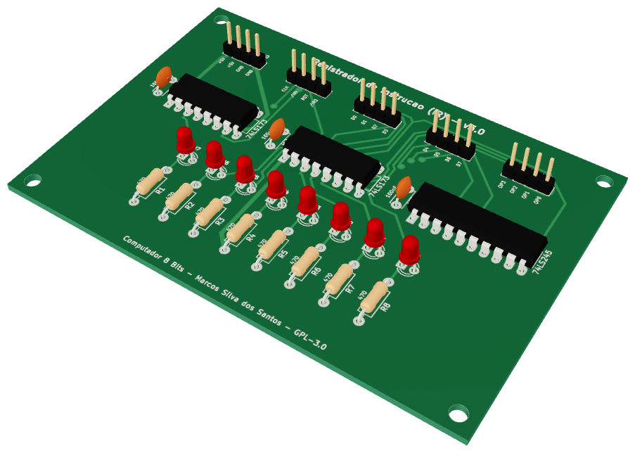
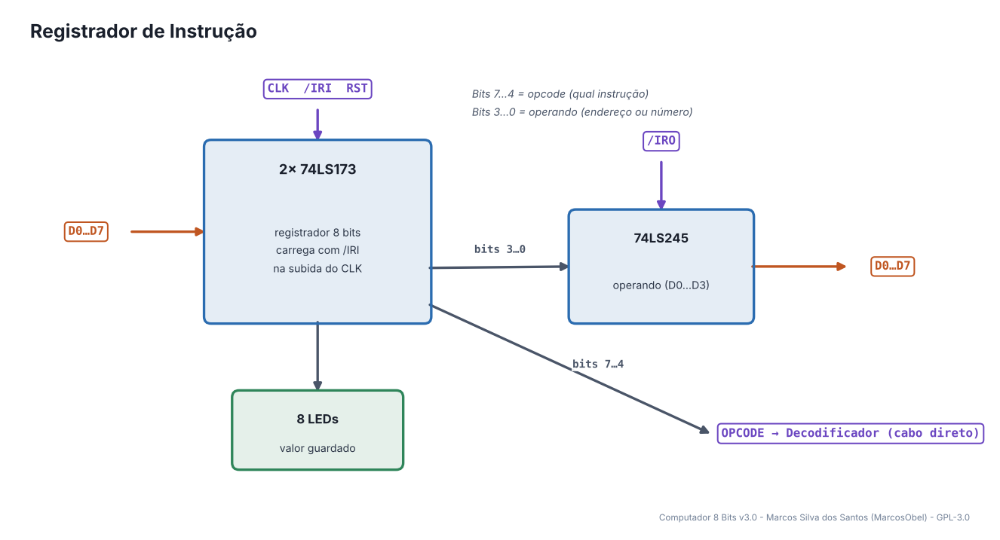
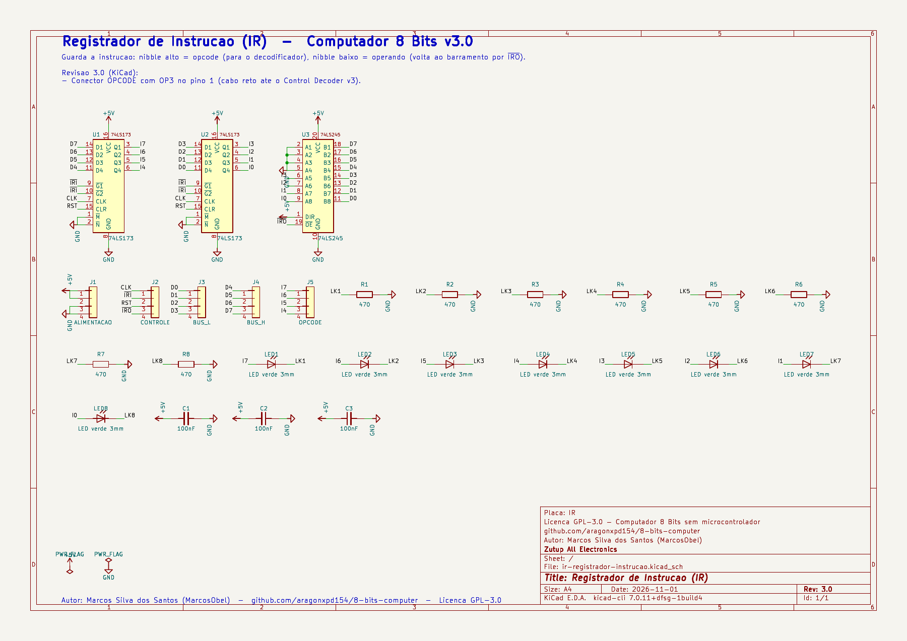
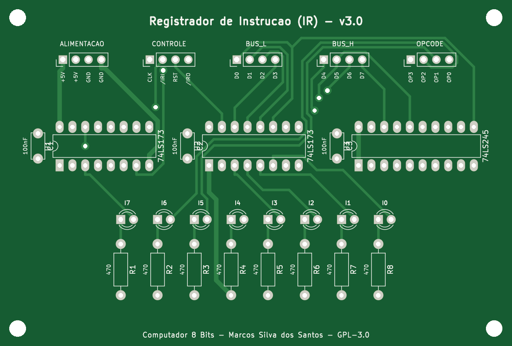
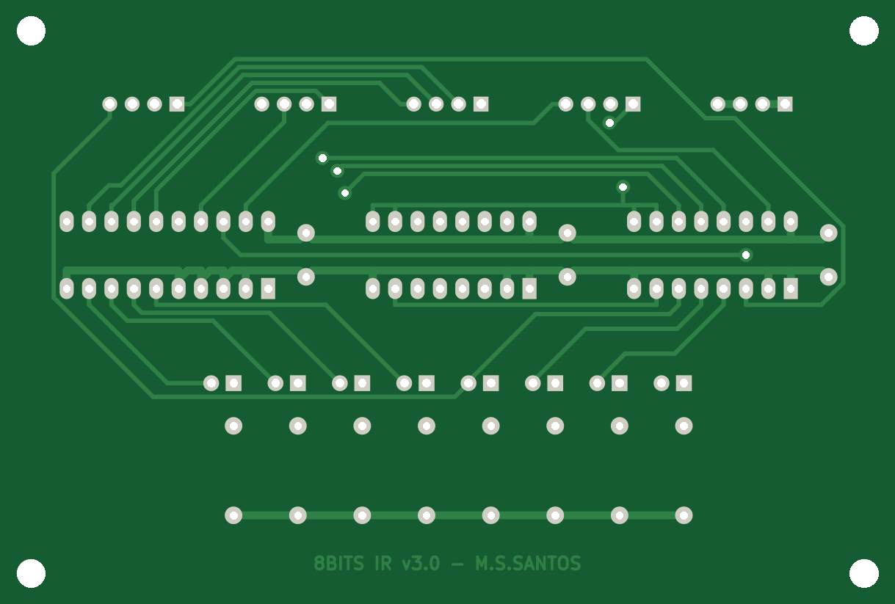
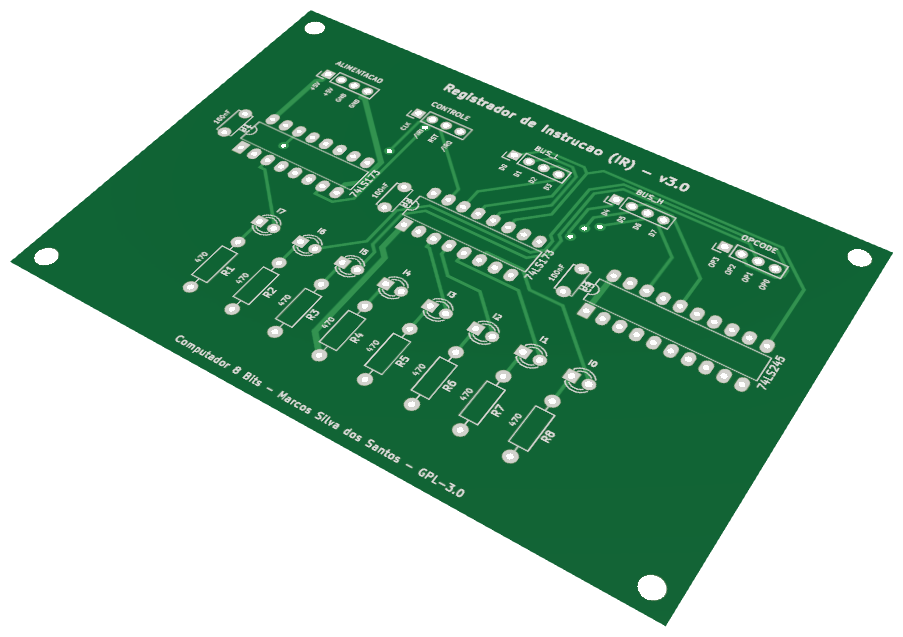

# 06 · Registrador de Instrução (IR)

> Placa do **Computador 8 Bits v3.0** — projeto de **Marcos Silva dos Santos** (MarcosObel) — GPL-3.0.

**Guarda a instrução atual: o opcode vai para o Controle, o operando volta ao barramento.**

| | |
|---|---|
| Tamanho | **101,55 × 68,61 mm**, 2 camadas, furo metalizado |
| Componentes | 27 (3 CIs) |
| Furos / vias | 120 / 6 |
| Projeto KiCad | [`hardware/kicad/ir-registrador-instrucao/`](../../hardware/kicad/ir-registrador-instrucao/) |
| Para a fábrica | [`ir-registrador-instrucao-gerber.zip`](../../hardware/fabricacao/ir-registrador-instrucao/ir-registrador-instrucao-gerber.zip) · [lista de materiais (CSV)](../../hardware/fabricacao/ir-registrador-instrucao/lista-de-materiais.csv) · [relatório DRC](../../hardware/fabricacao/ir-registrador-instrucao/relatorio-drc.txt) |
| Esquemático | [PDF](../../hardware/fabricacao/ir-registrador-instrucao/0-esquematico.pdf) · [imagem](../imagens/esquemas/ir-registrador-instrucao.png) |
| Modelo 3D | [visualizador interativo](../3d/visualizador.html#ir-registrador-instrucao) · [STL (abre em 3D no GitHub)](../3d/stl/ir-registrador-instrucao.stl) · [GLB](../3d/modelos/ir-registrador-instrucao.glb) · [STEP (FreeCAD/Fusion)](../../hardware/fabricacao/ir-registrador-instrucao/ir-registrador-instrucao.step) |

## Função

Cada instrução tem 8 bits: os **4 de cima são o opcode** (qual instrução) e os **4 de baixo são o operando** (um endereço ou um número de 0 a 15). O IR guarda a instrução lida da RAM durante toda a sua execução.

Liga-se diretamente (cabo próprio) a: [Decodificador de Controle](cd-decodificador-controle.md). Todo o resto passa pelo [backplane](backplane-barramento.md).

## Diagrama de funcionamento

Laranja = barramento/dados · roxo = sinais de controle do microcódigo · verde = clock e reset · cinza = sinais internos da placa.

## Como funciona

**Dois 74LS173** guardam o byte: U1 o nibble alto, U2 o nibble baixo. Carregam na borda do CLK quando /IRI = 0 (passo T1 de toda instrução) e são zerados por RST.

**Opcode.** O nibble alto sai direto pelo conector OPCODE (J5) para o Decodificador de Controle, com OP3 no pino 1 — cabo reto.

**Operando.** O 74LS245 coloca **só o nibble baixo** no barramento quando /IRO = 0 (as outras 4 entradas estão no GND, então D4…D7 = 0). É assim que `LDA 14` manda o endereço 14 para a MAR.

## O que cada parte faz

| Componente | Papel no circuito |
|---|---|
| **U1, U2 74LS173** | registrador de 8 bits (opcode + operando) |
| **U3 74LS245** | devolve o operando ao barramento (/IRO) |

## O que os LEDs mostram

| LED | Significado |
|---|---|
| **LED1…LED4** | opcode (bits 7…4) |
| **LED5…LED8** | operando (bits 3…0) |

## Esquemático

Clique para abrir o PDF em alta resolução. Sinais com barra (ex.: /RST) são ativos em nível baixo.

## A placa como sai da fábrica

| Face de cima (componentes) | Face de baixo (solda) |
|---|---|
|  |  |

Imagens geradas das camadas reais (cobre, máscara verde, serigrafia branca e furos). A face de baixo aparece como você a vê com a placa virada.

## Conectores

Todos os conectores são barras de pinos de 2,54 mm. Os nomes dos sinais estão impressos na serigrafia, embaixo de cada pino. Cabos de 4 vias **retos** (pino 1 com pino 1).

| Conector | Nome | Pino 1 | Pino 2 | Pino 3 | Pino 4 | Liga em |
|---|---|---|---|---|---|---|
| **J1** | ALIMENTACAO | `+5V` | `+5V` | `GND` | `GND` | backplane J6 (P_IR) |
| **J2** | CONTROLE | `CLK` | `/IRI` | `RST` | `/IRO` | backplane J31 (C_IR) |
| **J3** | BUS_L | `D0` | `D1` | `D2` | `D3` | backplane J18 (BL_IR) |
| **J4** | BUS_H | `D4` | `D5` | `D6` | `D7` | backplane J25 (BH_IR) |
| **J5** | OPCODE | `OP3` | `OP2` | `OP1` | `OP0` | cabo direto → Decodificador de Controle J3 |

## Lista de componentes

| Tipo | Valor / peça | Qtd. | Referências |
|---|---|---:|---|
| Circuitos integrados | 74LS173 | 2 | U1, U2 |
| Circuitos integrados | 74LS245 | 1 | U3 |
| Resistores | 470 | 8 | R1, R2, R3, R4, R5, R6, R7, R8 |
| Capacitores | 100nF | 3 | C1, C2, C3 |
| LEDs | LED verde 3mm | 8 | LED1, LED2, LED3, LED4, LED5, LED6, LED7, LED8 |
| Conectores | Barra de pinos 1×4, 2,54 mm (macho, 90° ou reta) | 5 | J1, J2, J3, J4, J5 |

## Como testar

1. Coloque um valor no barramento (por exemplo pela RAM em RUN com /RMO), aplique /IRI = 0 e dê um pulso de clock: os LEDs copiam o valor.
2. Com /IRO = 0, os LEDs do barramento mostram 0000 + nibble baixo.
3. RESET zera todos os LEDs.

## Atenção

- A placa é igual à do Registrador A e B, mudando os sinais de controle e o conector OPCODE.

## O que mudou na v3.0

- Conector OPCODE com OP3 no pino 1 (cabo reto ate o Control Decoder v3).

---
← [RAM e MAR](ram-mar-memoria.md) · [todas as placas](README.md) · [Decodificador de Controle](cd-decodificador-controle.md) →
