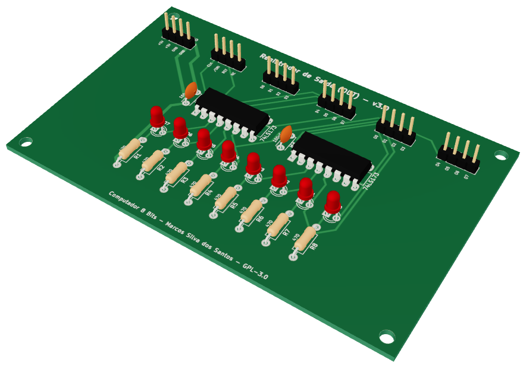
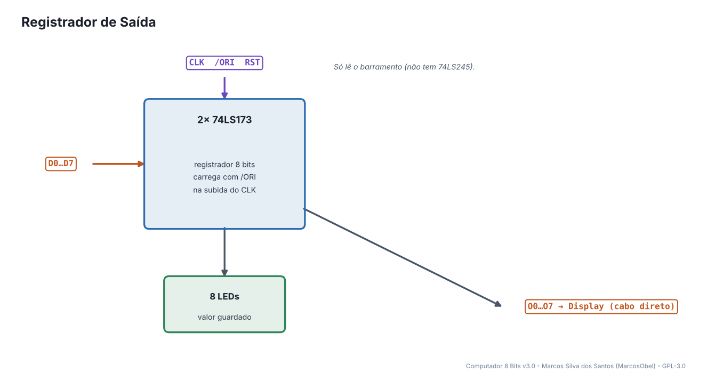
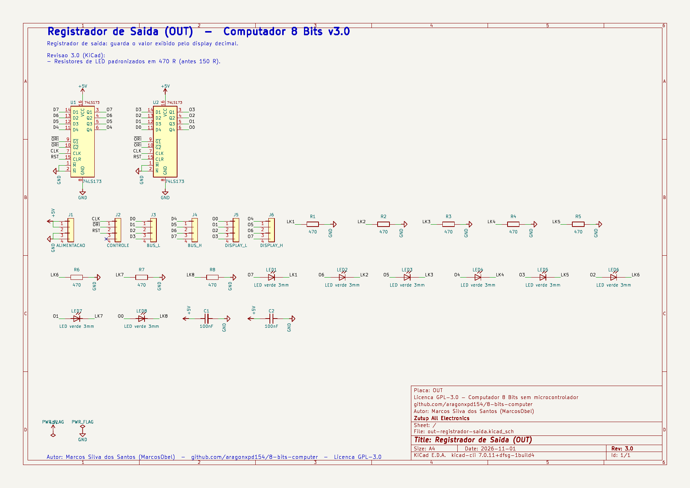
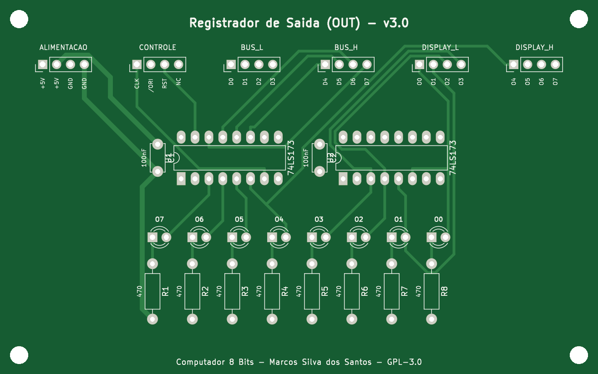
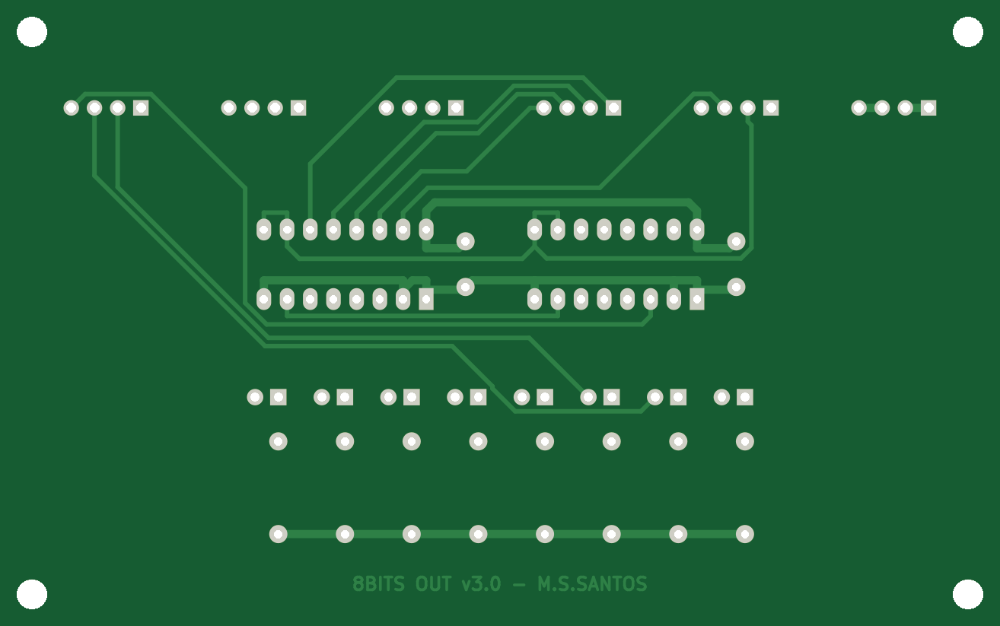
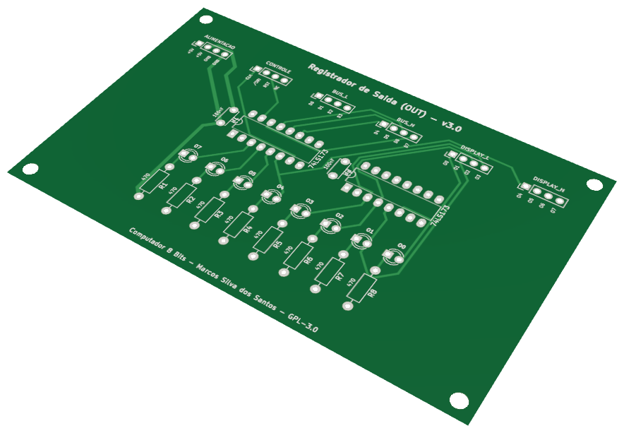

# 12 · Registrador de Saída

> Placa do **Computador 8 Bits v3.0** — projeto de **Marcos Silva dos Santos** (MarcosObel) — GPL-3.0.

**Guarda o valor que aparece no display (instrução OUT).**

| | |
|---|---|
| Tamanho | **109,5 × 68,61 mm**, 2 camadas, furo metalizado |
| Componentes | 26 (2 CIs) |
| Furos / vias | 96 / 0 |
| Projeto KiCad | [`hardware/kicad/out-registrador-saida/`](../../hardware/kicad/out-registrador-saida/) |
| Para a fábrica | [`out-registrador-saida-gerber.zip`](../../hardware/fabricacao/out-registrador-saida/out-registrador-saida-gerber.zip) · [lista de materiais (CSV)](../../hardware/fabricacao/out-registrador-saida/lista-de-materiais.csv) · [relatório DRC](../../hardware/fabricacao/out-registrador-saida/relatorio-drc.txt) |
| Esquemático | [PDF](../../hardware/fabricacao/out-registrador-saida/0-esquematico.pdf) · [imagem](../imagens/esquemas/out-registrador-saida.png) |
| Modelo 3D | [visualizador interativo](../3d/visualizador.html#out-registrador-saida) · [STL (abre em 3D no GitHub)](../3d/stl/out-registrador-saida.stl) · [GLB](../3d/modelos/out-registrador-saida.glb) · [STEP (FreeCAD/Fusion)](../../hardware/fabricacao/out-registrador-saida/out-registrador-saida.step) |

## Função

Guarda o número que o programa quer mostrar. Na instrução `OUT` o valor de A passa pelo barramento e é copiado aqui; a placa do Display lê estas saídas continuamente.

Liga-se diretamente (cabo próprio) a: [Display Decimal](display-decimal.md). Todo o resto passa pelo [backplane](backplane-barramento.md).

## Diagrama de funcionamento

Laranja = barramento/dados · roxo = sinais de controle do microcódigo · verde = clock e reset · cinza = sinais internos da placa.

## Como funciona

**Dois 74LS173** carregam o barramento quando /ORI = 0 na subida do CLK. RST zera.

Não há 74LS245: esta placa só lê o barramento. As saídas O0…O7 vão por cabos diretos (J5, J6) para o Display.

## O que cada parte faz

| Componente | Papel no circuito |
|---|---|
| **U1, U2 74LS173** | registrador de 8 bits |

## O que os LEDs mostram

| LED | Significado |
|---|---|
| **LED1…LED8** | valor mostrado no display, em binário |

## Esquemático

Clique para abrir o PDF em alta resolução. Sinais com barra (ex.: /RST) são ativos em nível baixo.

## A placa como sai da fábrica

| Face de cima (componentes) | Face de baixo (solda) |
|---|---|
|  |  |

Imagens geradas das camadas reais (cobre, máscara verde, serigrafia branca e furos). A face de baixo aparece como você a vê com a placa virada.

## Conectores

Todos os conectores são barras de pinos de 2,54 mm. Os nomes dos sinais estão impressos na serigrafia, embaixo de cada pino. Cabos de 4 vias **retos** (pino 1 com pino 1).

| Conector | Nome | Pino 1 | Pino 2 | Pino 3 | Pino 4 | Liga em |
|---|---|---|---|---|---|---|
| **J1** | ALIMENTACAO | `+5V` | `+5V` | `GND` | `GND` | backplane J7 (P_OUT) |
| **J2** | CONTROLE | `CLK` | `/ORI` | `RST` | `NC` | backplane J32 (C_OUT) |
| **J3** | BUS_L | `D0` | `D1` | `D2` | `D3` | backplane J19 (BL_OUT) |
| **J4** | BUS_H | `D4` | `D5` | `D6` | `D7` | backplane J26 (BH_OUT) |
| **J5** | DISPLAY_L | `O0` | `O1` | `O2` | `O3` | cabo direto → Display Decimal J2 |
| **J6** | DISPLAY_H | `O4` | `O5` | `O6` | `O7` | cabo direto → Display Decimal J3 |

## Lista de componentes

| Tipo | Valor / peça | Qtd. | Referências |
|---|---|---:|---|
| Circuitos integrados | 74LS173 | 2 | U1, U2 |
| Resistores | 470 | 8 | R1, R2, R3, R4, R5, R6, R7, R8 |
| Capacitores | 100nF | 2 | C1, C2 |
| LEDs | LED verde 3mm | 8 | LED1, LED2, LED3, LED4, LED5, LED6, LED7, LED8 |
| Conectores | Barra de pinos 1×4, 2,54 mm (macho, 90° ou reta) | 6 | J1, J2, J3, J4, J5, J6 |

## Como testar

1. Coloque um valor no barramento, /ORI = 0 e um pulso de clock: os LEDs copiam e o display mostra o número em decimal.

## O que mudou na v3.0

- Resistores de LED padronizados em 470 R (antes 150 R).

---
← [ULA (Unidade Lógica e Aritmética)](alu-unidade-logica-aritmetica.md) · [todas as placas](README.md) · [Display Decimal](display-decimal.md) →
