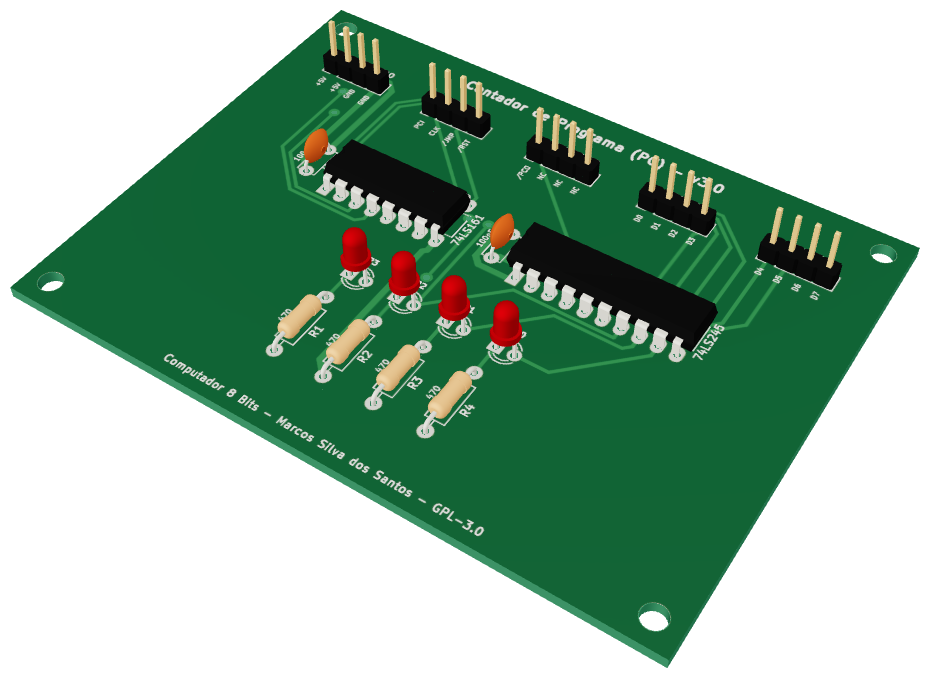
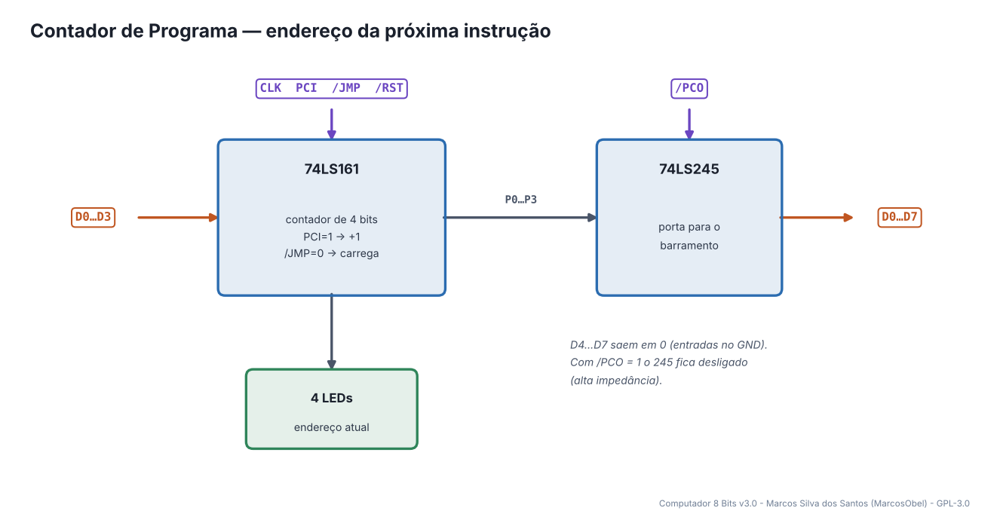
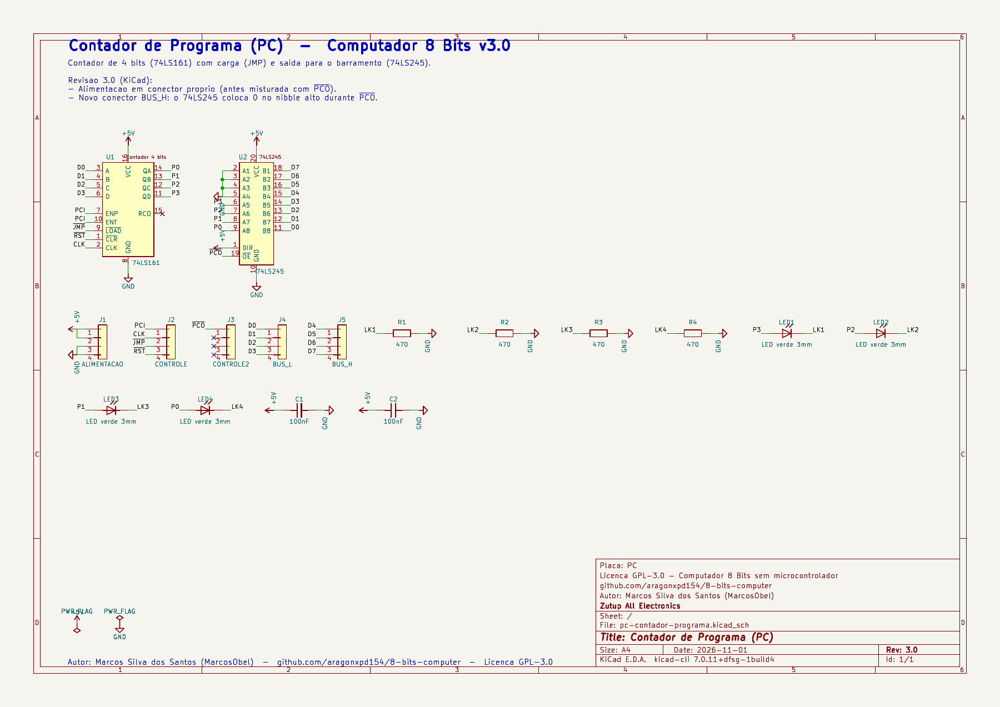
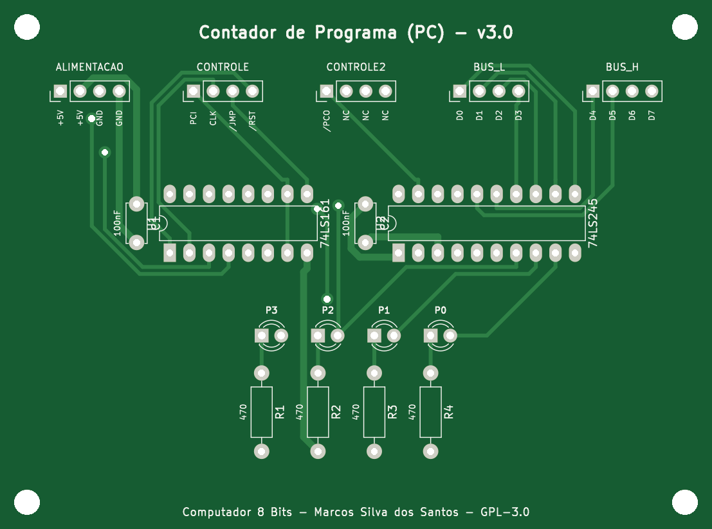
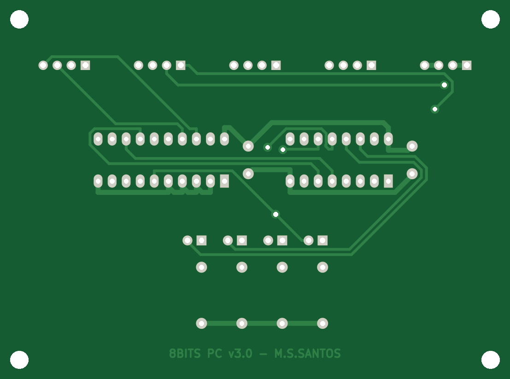
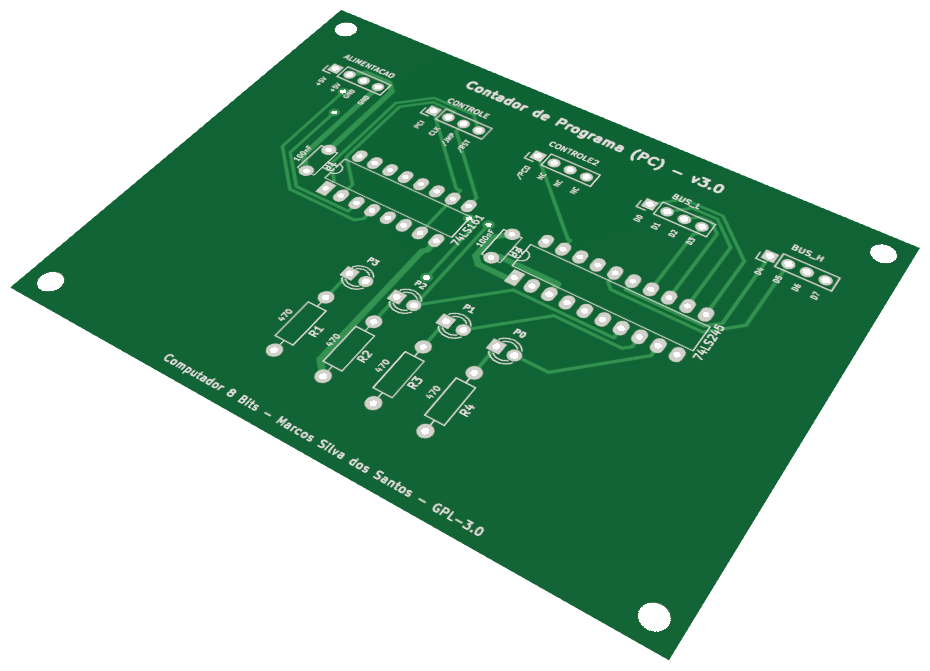

# 04 · Contador de Programa (PC)

> Placa do **Computador 8 Bits v3.0** — projeto de **Marcos Silva dos Santos** (MarcosObel) — GPL-3.0.

**Guarda o endereço da próxima instrução (0…15), conta +1 a cada busca e salta no JMP.**

| | |
|---|---|
| Tamanho | **92,25 × 68,61 mm**, 2 camadas, furo metalizado |
| Componentes | 17 (2 CIs) |
| Furos / vias | 85 / 5 |
| Projeto KiCad | [`hardware/kicad/pc-contador-programa/`](../../hardware/kicad/pc-contador-programa/) |
| Para a fábrica | [`pc-contador-programa-gerber.zip`](../../hardware/fabricacao/pc-contador-programa/pc-contador-programa-gerber.zip) · [lista de materiais (CSV)](../../hardware/fabricacao/pc-contador-programa/lista-de-materiais.csv) · [relatório DRC](../../hardware/fabricacao/pc-contador-programa/relatorio-drc.txt) |
| Esquemático | [PDF](../../hardware/fabricacao/pc-contador-programa/0-esquematico.pdf) · [imagem](../imagens/esquemas/pc-contador-programa.png) |
| Modelo 3D | [**3D Viewer** (abre no navegador)](https://aragonxpd154.github.io/8-bits-computer/docs/3d/visualizador.html#pc-contador-programa) · [STL (abre em 3D no GitHub)](../3d/stl/pc-contador-programa.stl) · [GLB](../3d/modelos/pc-contador-programa.glb) · [STEP (FreeCAD/Fusion)](../../hardware/fabricacao/pc-contador-programa/pc-contador-programa.step) |

## Função

O **Program Counter** diz em qual endereço da RAM está a próxima instrução. No início de cada instrução ele coloca o endereço no barramento (/PCO) e, logo depois, conta +1 (PCI). Na instrução `JMP` ele carrega um novo endereço vindo do barramento (/JMP).

## Diagrama de funcionamento

Laranja = barramento/dados · roxo = sinais de controle do microcódigo · verde = clock e reset · cinza = sinais internos da placa.

## Como funciona

**74LS161** é um contador binário síncrono de 4 bits. Com PCI = 1 (entradas ENP e ENT), ele soma 1 na borda de subida do CLK. Com /JMP = 0 (entrada /LOAD), em vez de contar ele copia D0…D3 do barramento.

**/RST** vai na entrada /CLR: o reset zera o contador imediatamente, sem esperar o clock.

**74LS245** é a "porta" para o barramento. Com /PCO = 0, as saídas P0…P3 vão para D0…D3 e as entradas aterradas colocam 0 em D4…D7. Com /PCO = 1 ele fica em alta impedância e não interfere no barramento.

Os 4 LEDs mostram o endereço atual em binário.

## O que cada parte faz

| Componente | Papel no circuito |
|---|---|
| **U1 74LS161** | contador de 4 bits com carga paralela (JMP) e clear (reset) |
| **U2 74LS245** | buffer 3-state: coloca o endereço no barramento quando /PCO = 0 |

## O que os LEDs mostram

| LED | Significado |
|---|---|
| **LED1…LED4** | endereço atual P3…P0 (aceso = 1) |

## Esquemático

Clique para abrir o PDF em alta resolução. Sinais com barra (ex.: /RST) são ativos em nível baixo.

## A placa como sai da fábrica

| Face de cima (componentes) | Face de baixo (solda) |
|---|---|
|  |  |

Imagens geradas das camadas reais (cobre, máscara verde, serigrafia branca e furos). A face de baixo aparece como você a vê com a placa virada.

## Conectores

Todos os conectores são barras de pinos de 2,54 mm. Os nomes dos sinais estão impressos na serigrafia, embaixo de cada pino. Cabos de 4 vias **retos** (pino 1 com pino 1).

| Conector | Nome | Pino 1 | Pino 2 | Pino 3 | Pino 4 | Liga em |
|---|---|---|---|---|---|---|
| **J1** | ALIMENTACAO | `+5V` | `+5V` | `GND` | `GND` | backplane J8 (P_PC) |
| **J2** | CONTROLE | `PCI` | `CLK` | `/JMP` | `/RST` | backplane J33 (C_PC1) |
| **J3** | CONTROLE2 | `/PCO` | `NC` | `NC` | `NC` | backplane J34 (C_PC2) |
| **J4** | BUS_L | `D0` | `D1` | `D2` | `D3` | backplane J20 (BL_PC) |
| **J5** | BUS_H | `D4` | `D5` | `D6` | `D7` | backplane J27 (BH_PC) |

## Lista de componentes

| Tipo | Valor / peça | Qtd. | Referências |
|---|---|---:|---|
| Circuitos integrados | 74LS161 | 1 | U1 |
| Circuitos integrados | 74LS245 | 1 | U2 |
| Resistores | 470 | 4 | R1, R2, R3, R4 |
| Capacitores | 100nF | 2 | C1, C2 |
| LEDs | LED verde 3mm | 4 | LED1, LED2, LED3, LED4 |
| Conectores | Barra de pinos 1×4, 2,54 mm (macho, 90° ou reta) | 5 | J1, J2, J3, J4, J5 |

## Como testar

1. Com Clock e Reset ligados e PCI (J2-1) ligado ao +5 V por um fio: os LEDs contam 0, 1, 2 … 15, 0.
2. Aperte RESET: os LEDs voltam a 0000.
3. Com /PCO (J3-1) em 0 V, os LEDs do barramento no backplane mostram o mesmo valor do PC.

## Atenção

- No computador montado, PCI, /JMP e /PCO vêm do Decodificador de Controle — não deixe fios de teste ligados.

## O que mudou na v3.0

- Alimentacao em conector proprio (antes misturada com ~{PCO}).
- Novo conector BUS_H: o 74LS245 coloca 0 no nibble alto durante ~{PCO}.

---
← [Reset](reset-circuito.md) · [todas as placas](README.md) · [RAM e MAR](ram-mar-memoria.md) →
