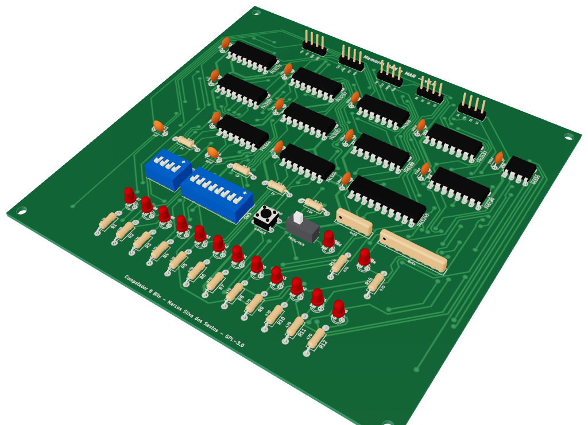
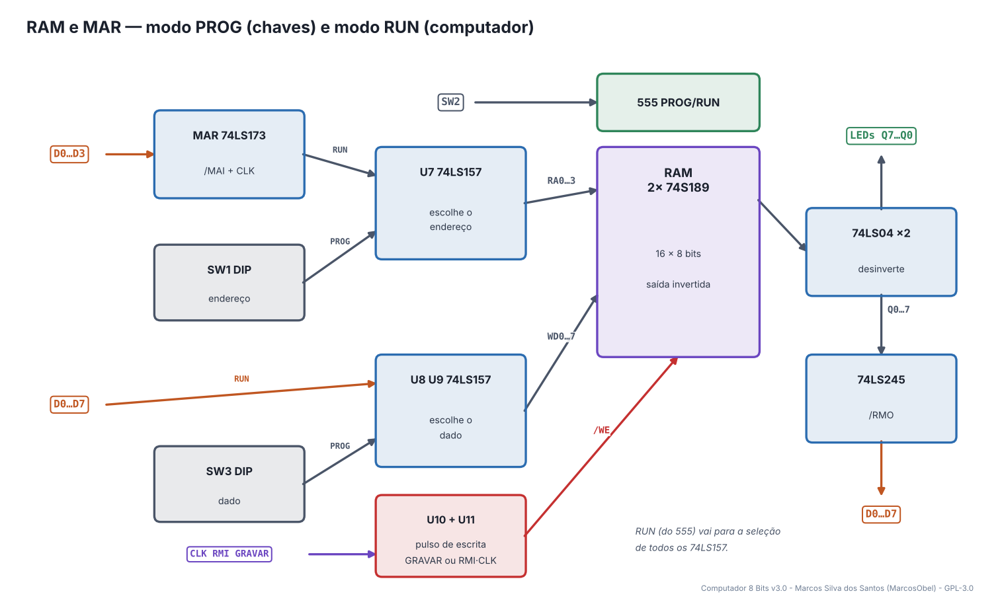
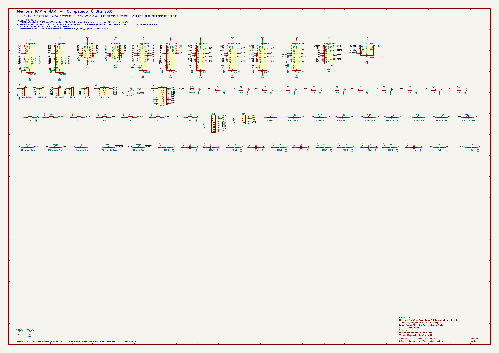
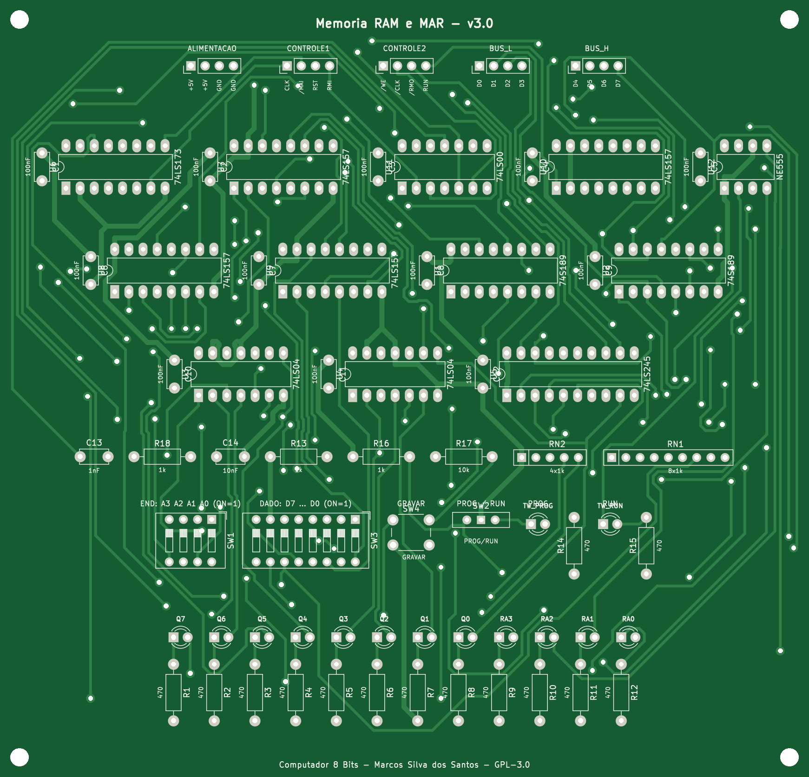
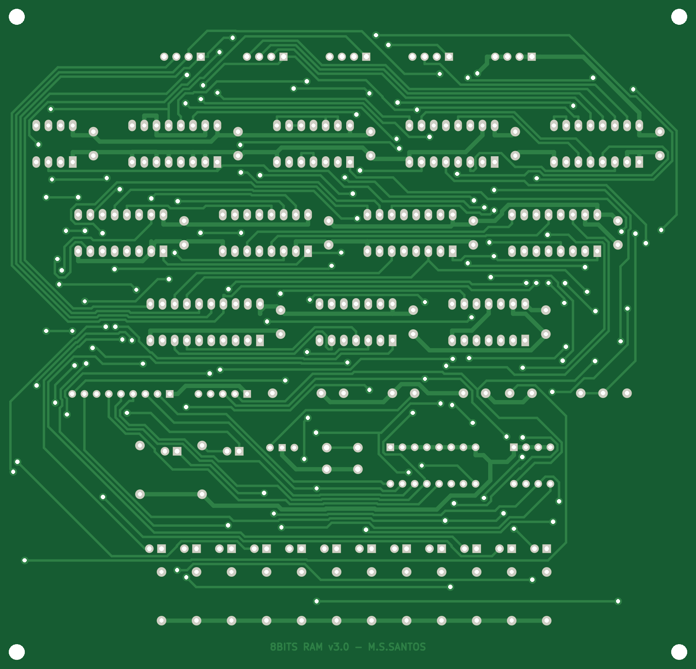
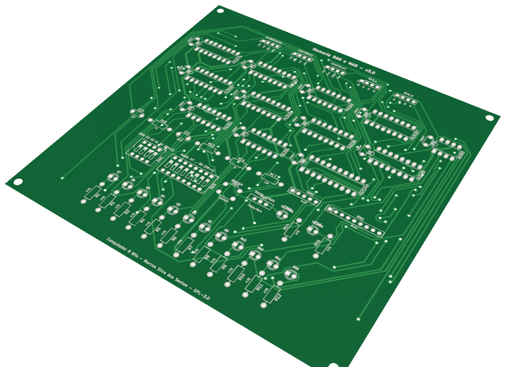

# 05 · RAM e MAR

> Placa do **Computador 8 Bits v3.0** — projeto de **Marcos Silva dos Santos** (MarcosObel) — GPL-3.0.

**16 bytes de memória, o registrador de endereço (MAR) e a programação manual por chaves DIP.**

| | |
|---|---|
| Tamanho | **145,1 × 139,47 mm**, 2 camadas, furo metalizado |
| Componentes | 69 (12 CIs) |
| Furos / vias | 494 / 151 |
| Projeto KiCad | [`hardware/kicad/ram-mar-memoria/`](../../hardware/kicad/ram-mar-memoria/) |
| Para a fábrica | [`ram-mar-memoria-gerber.zip`](../../hardware/fabricacao/ram-mar-memoria/ram-mar-memoria-gerber.zip) · [lista de materiais (CSV)](../../hardware/fabricacao/ram-mar-memoria/lista-de-materiais.csv) · [relatório DRC](../../hardware/fabricacao/ram-mar-memoria/relatorio-drc.txt) |
| Esquemático | [PDF](../../hardware/fabricacao/ram-mar-memoria/0-esquematico.pdf) · [imagem](../imagens/esquemas/ram-mar-memoria.png) |
| Modelo 3D | [visualizador interativo](../3d/visualizador.html#ram-mar-memoria) · [STL (abre em 3D no GitHub)](../3d/stl/ram-mar-memoria.stl) · [GLB](../3d/modelos/ram-mar-memoria.glb) · [STEP (FreeCAD/Fusion)](../../hardware/fabricacao/ram-mar-memoria/ram-mar-memoria.step) |

## Função

Guarda o **programa e os dados** (16 posições de 8 bits). A **MAR** (Memory Address Register) guarda o endereço que será lido ou escrito. Uma chave **PROG/RUN** escolhe quem manda: no modo PROG você escolhe endereço e dado nas chaves DIP e aperta GRAVAR; no modo RUN quem manda é o computador.

## Diagrama de funcionamento

Laranja = barramento/dados · roxo = sinais de controle do microcódigo · verde = clock e reset · cinza = sinais internos da placa.

## Como funciona

**MAR (U6 74LS173).** Na borda do CLK, se /MAI = 0, copia D0…D3 do barramento. É zerada pelo RST.

**Multiplexadores (U7…U10 74LS157).** Cada 74LS157 tem 4 chaves eletrônicas de 2 posições. Com RUN = 0 (modo PROG) eles passam as **chaves DIP** (endereço SW1, dado SW3, botão GRAVAR); com RUN = 1 passam a **MAR**, o **barramento** e o pulso de escrita automático.

**Memória (U1, U2 74S189).** Cada chip guarda 16 × 4 bits; dois chips formam 16 × 8. As saídas do 74S189 são **invertidas**, por isso U3 e U4 (74LS04) desinvertem o dado.

**Saída para o barramento (U5 74LS245).** Com /RMO = 0 o byte lido vai para D0…D7.

**Pulso de escrita sincronizado.** Na instrução `STA` o microcódigo liga RMI. U11 (74LS00) bufferiza o CLK, e o diferenciador C13 (1 nF) + R18 (1 kΩ) transforma a subida do clock num pulso de ≈ 1 µs. /WE_RUN = NAND(pulso, RMI): a RAM é escrita só nesse instante, com endereço e dado já estáveis.

**Chave PROG/RUN sem repique (U12 NE555).** O 555 trabalha como flip-flop SR: um lado da chave vai no TRIGGER (liga RUN), o outro no RESET (desliga RUN). A saída troca uma única vez, sem oscilar.

**Chaves DIP.** Ligam ao +5 V, com pull-down de 1 kΩ (RN1, RN2): **chave LIGADA = bit 1**.

## O que cada parte faz

| Componente | Papel no circuito |
|---|---|
| **U6 74LS173** | MAR — endereço de 4 bits |
| **U7 74LS157** | escolhe o endereço: chaves (PROG) ou MAR (RUN) |
| **U8, U9 74LS157** | escolhe o dado a gravar: chaves (PROG) ou barramento (RUN) |
| **U10 74LS157** | escolhe o pulso de escrita: botão GRAVAR ou automático |
| **U1, U2 74S189** | RAM 16 × 4 bits cada (nibble alto e baixo) |
| **U3, U4 74LS04** | desinvertem as saídas da RAM |
| **U5 74LS245** | coloca o byte lido no barramento (/RMO) |
| **U11 74LS00** | buffer do clock e porta de escrita (RMI) |
| **U12 NE555** | flip-flop da chave PROG/RUN (sem repique) |
| **SW1, SW3** | chaves DIP de endereço (4) e dado (8) |
| **SW4** | botão GRAVAR |

## O que os LEDs mostram

| LED | Significado |
|---|---|
| **LED1…LED8** | conteúdo da posição atual Q7…Q0 |
| **LED9…LED12 (amarelos)** | endereço atual A3…A0 |
| **LED13 (vermelho)** | modo PROG |
| **LED14 (verde)** | modo RUN |

## Chaves e ajustes

| Controle | O que faz |
|---|---|
| **SW2 PROG/RUN** | programação manual × execução |
| **SW1 ENDEREÇO** | endereço em modo PROG |
| **SW3 DADO** | byte a gravar em modo PROG |
| **SW4 GRAVAR** | grava o byte das chaves no endereço das chaves |

## Esquemático

Clique para abrir o PDF em alta resolução. Sinais com barra (ex.: /RST) são ativos em nível baixo.

## A placa como sai da fábrica

| Face de cima (componentes) | Face de baixo (solda) |
|---|---|
|  |  |

Imagens geradas das camadas reais (cobre, máscara verde, serigrafia branca e furos). A face de baixo aparece como você a vê com a placa virada.

## Conectores

Todos os conectores são barras de pinos de 2,54 mm. Os nomes dos sinais estão impressos na serigrafia, embaixo de cada pino. Cabos de 4 vias **retos** (pino 1 com pino 1).

| Conector | Nome | Pino 1 | Pino 2 | Pino 3 | Pino 4 | Liga em |
|---|---|---|---|---|---|---|
| **J1** | ALIMENTACAO | `+5V` | `+5V` | `GND` | `GND` | backplane J9 (P_RAM) |
| **J2** | CONTROLE1 | `CLK` | `/MAI` | `RST` | `RMI` | backplane J35 (C_RAM1) |
| **J3** | CONTROLE2 | `/WE` | `/CLK` | `/RMO` | `RUN` | backplane J36 (C_RAM2) |
| **J4** | BUS_L | `D0` | `D1` | `D2` | `D3` | backplane J21 (BL_RAM) |
| **J5** | BUS_H | `D4` | `D5` | `D6` | `D7` | backplane J28 (BH_RAM) |

## Lista de componentes

| Tipo | Valor / peça | Qtd. | Referências |
|---|---|---:|---|
| Circuitos integrados | 74LS173 | 1 | U6 |
| Circuitos integrados | 74LS157 | 4 | U7, U8, U9, U10 |
| Circuitos integrados | 74S189 | 2 | U1, U2 |
| Circuitos integrados | 74LS04 | 2 | U3, U4 |
| Circuitos integrados | 74LS245 | 1 | U5 |
| Circuitos integrados | 74LS00 | 1 | U11 |
| Circuitos integrados | NE555 | 1 | U12 |
| Resistores | 1k | 3 | R13, R16, R18 |
| Resistores | 470 | 14 | R1, R2, R3, R4, R5, R6, R7, R8, R9, R10, R11, R12, R14, R15 |
| Resistores | 4x1k | 1 | RN2 |
| Resistores | 8x1k | 1 | RN1 |
| Resistores | 10k | 1 | R17 |
| Capacitores | 1nF | 1 | C13 |
| Capacitores | 10nF | 1 | C14 |
| Capacitores | 100nF | 12 | C1, C2, C3, C4, C5, C6, C7, C8, C9, C10, C11, C12 |
| LEDs | LED vermelho 3mm | 1 | LED13 |
| LEDs | LED verde 3mm | 9 | LED1, LED2, LED3, LED4, LED5, LED6, LED7, LED8, LED14 |
| LEDs | LED amarelo 3mm | 4 | LED9, LED10, LED11, LED12 |
| Chaves e botões | PROG/RUN | 1 | SW2 |
| Chaves e botões | ENDERECO | 1 | SW1 |
| Chaves e botões | DADO | 1 | SW3 |
| Chaves e botões | GRAVAR | 1 | SW4 |
| Conectores | Barra de pinos 1×4, 2,54 mm (macho, 90° ou reta) | 5 | J1, J2, J3, J4, J5 |

## Como testar

1. Modo PROG: mude SW1 — os LEDs amarelos acompanham. Os LEDs vermelhos mostram o conteúdo (aleatório ao ligar).
2. Coloque 1010 0101 em SW3 e aperte GRAVAR: os LEDs de dado mostram 1010 0101. Mude o endereço e volte: o valor continua lá.
3. Grave valores diferentes em 2–3 endereços e confira cada um.
4. Modo RUN: os LEDs amarelos passam a mostrar a MAR (0000 depois do reset).

## Atenção

- O 74S189 é série **S** (Schottky) e esquenta mais que os LS — é normal.
- A memória é volátil: ao desligar, o programa se perde. Reprograme pelas chaves (ou use o emulador para planejar).

## O que mudou na v3.0

- CORRECAO: pino 6 (THR) do 555 da chave PROG/RUN estava flutuando - agora no GND; CV com 10nF.
- MELHORIA: chaves DIP agora ligam ao +5V com resistores de pull-down (RN1/RN2 1k): chave LIGADA = bit 1 (antes era invertido).
- Entradas nao usadas do U10 (74LS157) aterradas.
- Barramento entra e sai pelos mesmos conectores BUS_L/BUS_H (antes 5 conectores).

---
← [Contador de Programa (PC)](pc-contador-programa.md) · [todas as placas](README.md) · [Registrador de Instrução (IR)](ir-registrador-instrucao.md) →
