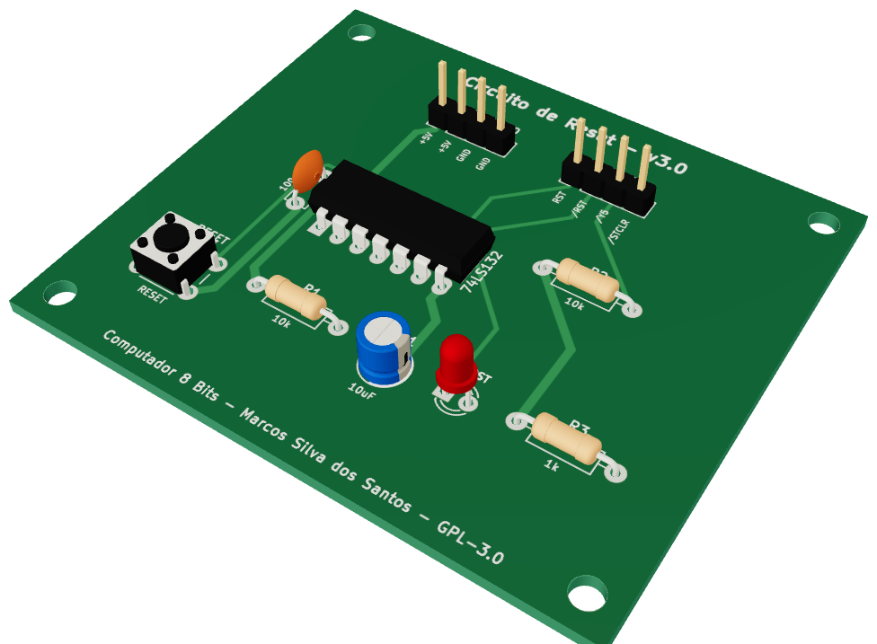
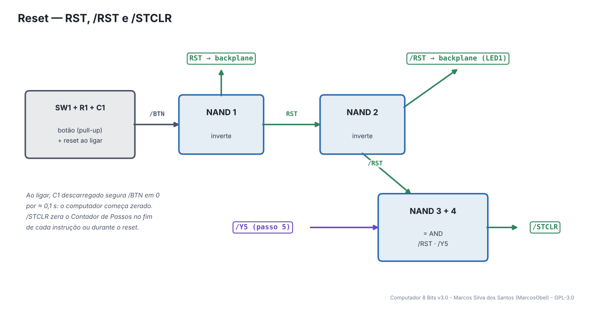
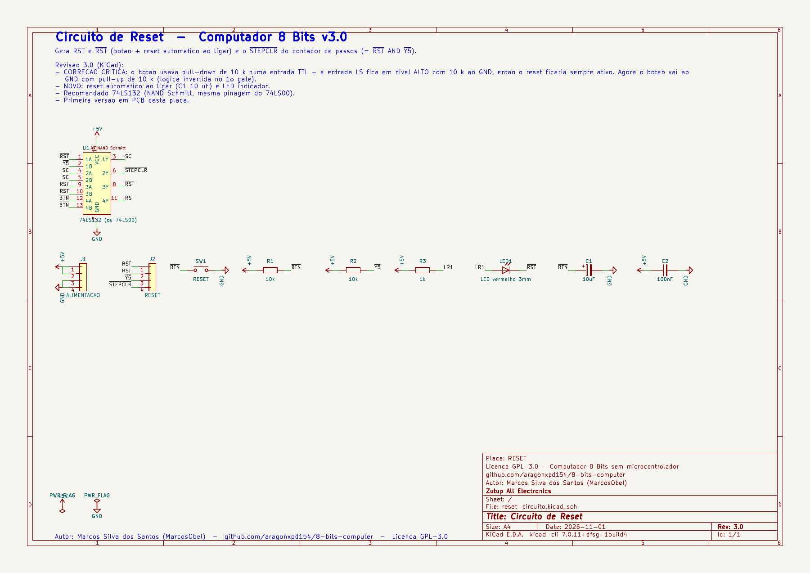
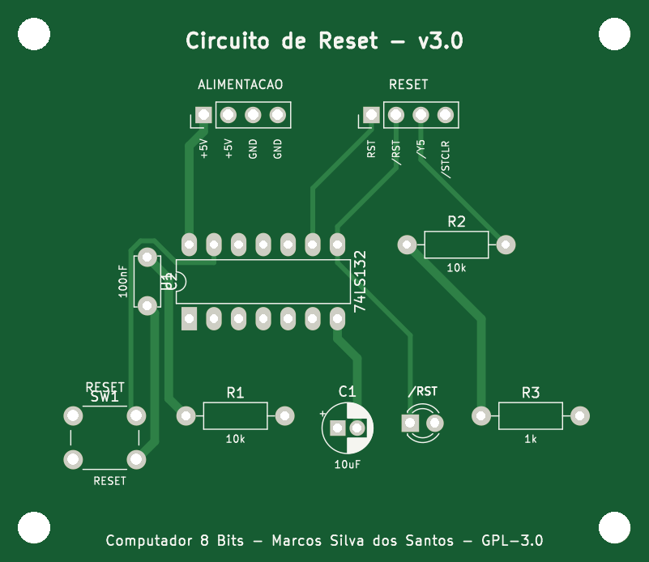
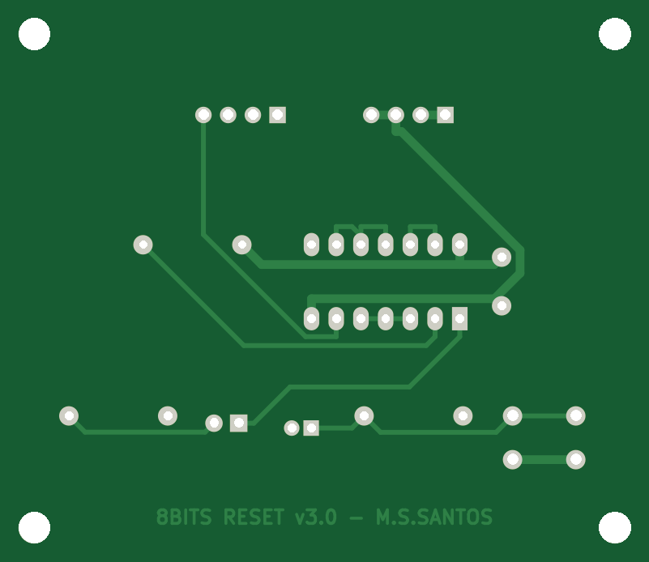
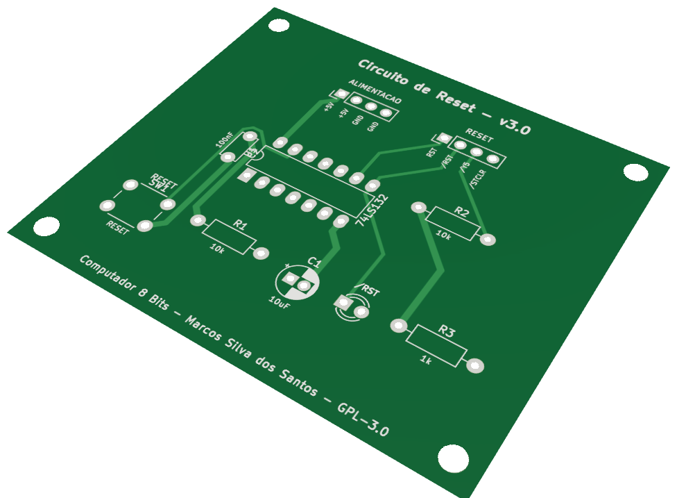

# 03 · Reset

> Placa do **Computador 8 Bits v3.0** — projeto de **Marcos Silva dos Santos** (MarcosObel) — GPL-3.0.

**Reinicia o computador pelo botão ou ao ligar, e reinicia o contador de passos a cada instrução.**

| | |
|---|---|
| Tamanho | **66,71 × 57,8 mm**, 2 camadas, furo metalizado |
| Componentes | 10 (1 CI) |
| Furos / vias | 42 / 0 |
| Projeto KiCad | [`hardware/kicad/reset-circuito/`](../../hardware/kicad/reset-circuito/) |
| Para a fábrica | [`reset-circuito-gerber.zip`](../../hardware/fabricacao/reset-circuito/reset-circuito-gerber.zip) · [lista de materiais (CSV)](../../hardware/fabricacao/reset-circuito/lista-de-materiais.csv) · [relatório DRC](../../hardware/fabricacao/reset-circuito/relatorio-drc.txt) |
| Esquemático | [PDF](../../hardware/fabricacao/reset-circuito/0-esquematico.pdf) · [imagem](../imagens/esquemas/reset-circuito.png) |
| Modelo 3D | [**3D Viewer** (abre no navegador)](https://aragonxpd154.github.io/8-bits-computer/docs/3d/visualizador.html#reset-circuito) · [STL (abre em 3D no GitHub)](../3d/stl/reset-circuito.stl) · [GLB](../3d/modelos/reset-circuito.glb) · [STEP (FreeCAD/Fusion)](../../hardware/fabricacao/reset-circuito/reset-circuito.step) |

## Função

Gera **RST** (ativo em 1) e **/RST** (ativo em 0) para zerar o Contador de Programa, a MAR e os registradores. Também gera **/STCLR**, que zera o Contador de Passos ao fim de cada instrução (quando chega o sinal /Y5) ou durante o reset.

## Diagrama de funcionamento

Laranja = barramento/dados · roxo = sinais de controle do microcódigo · verde = clock e reset · cinza = sinais internos da placa.

## Como funciona

**Botão com pull-up.** R1 (10 kΩ) mantém /BTN em 1; apertar RESET (SW1) leva /BTN a 0. A primeira porta do 74LS132 inverte: RST = 1 enquanto o botão estiver apertado.

**Reset ao ligar.** C1 (10 µF) começa descarregado, então ao ligar /BTN fica em 0 por cerca de R1·C1 ≈ 0,1 s — o computador sempre começa zerado, sem precisar apertar nada.

**Por que 74LS132?** É um NAND com entrada **Schmitt-trigger**: a subida lenta da tensão de C1 vira uma borda limpa. O 74LS00 tem a mesma pinagem e funciona, mas o 132 é recomendado.

**/RST.** A segunda porta inverte RST. O LED1 vermelho acende enquanto o reset está ativo.

**/STCLR = /RST AND /Y5.** As duas últimas portas fazem um AND: o Contador de Passos é zerado quando chega o passo 5 (fim da instrução, /Y5 = 0) **ou** durante o reset. R2 mantém /Y5 em 1 se o cabo estiver solto.

## O que cada parte faz

| Componente | Papel no circuito |
|---|---|
| **U1 74LS132** | 4 portas NAND Schmitt: inverte o botão, gera /RST e o AND de /STCLR |
| **R1 + C1** | pull-up do botão e atraso do reset ao ligar |
| **R2** | pull-up de /Y5 |
| **SW1** | botão RESET |

## O que os LEDs mostram

| LED | Significado |
|---|---|
| **LED1 (vermelho)** | reset ativo |

## Chaves e ajustes

| Controle | O que faz |
|---|---|
| **SW1 RESET** | zera o computador (PC, MAR, registradores e passo) |

## Esquemático

Clique para abrir o PDF em alta resolução. Sinais com barra (ex.: /RST) são ativos em nível baixo.

## A placa como sai da fábrica

| Face de cima (componentes) | Face de baixo (solda) |
|---|---|
|  |  |

Imagens geradas das camadas reais (cobre, máscara verde, serigrafia branca e furos). A face de baixo aparece como você a vê com a placa virada.

## Conectores

Todos os conectores são barras de pinos de 2,54 mm. Os nomes dos sinais estão impressos na serigrafia, embaixo de cada pino. Cabos de 4 vias **retos** (pino 1 com pino 1).

| Conector | Nome | Pino 1 | Pino 2 | Pino 3 | Pino 4 | Liga em |
|---|---|---|---|---|---|---|
| **J1** | ALIMENTACAO | `+5V` | `+5V` | `GND` | `GND` | backplane J13 (P_RESET) |
| **J2** | RESET | `RST` | `/RST` | `/Y5` | `/STCLR` | backplane J46 (C_RESET) |

## Lista de componentes

| Tipo | Valor / peça | Qtd. | Referências |
|---|---|---:|---|
| Circuitos integrados | 74LS132 (ou 74LS00) | 1 | U1 |
| Resistores | 10k | 2 | R1, R2 |
| Resistores | 1k | 1 | R3 |
| Capacitores | 10uF | 1 | C1 |
| Capacitores | 100nF | 1 | C2 |
| LEDs | LED vermelho 3mm | 1 | LED1 |
| Chaves e botões | RESET | 1 | SW1 |
| Conectores | Barra de pinos 1×4, 2,54 mm (macho, 90° ou reta) | 2 | J1, J2 |

## Como testar

1. Ligue a placa: o LED pisca rapidamente ao energizar (reset automático) e apaga.
2. Segurando RESET o LED fica aceso; meça RST ≈ 5 V e /RST ≈ 0 V em J2.
3. Solto o botão: RST ≈ 0 V, /RST ≈ 5 V e /STCLR ≈ 5 V.
4. Ligue /Y5 (J2-3) ao GND com um fio: /STCLR vai a 0 V.

## Atenção

- C1 é eletrolítico: a faixa "−" vai para o GND (lado indicado na serigrafia).
- Esta placa não tinha PCB na versão antiga — é nova na v3.0.

## O que mudou na v3.0

- CORRECAO CRITICA: o botao usava pull-down de 10 k numa entrada TTL - a entrada LS fica em nivel ALTO com 10 k ao GND, entao o reset ficaria sempre ativo. Agora o botao vai ao GND com pull-up de 10 k (logica invertida no 1o gate).
- NOVO: reset automatico ao ligar (C1 10 uF) e LED indicador.
- Recomendado 74LS132 (NAND Schmitt, mesma pinagem do 74LS00).
- Primeira versao em PCB desta placa.

---
← [Clock](clock-astavel-monoestavel.md) · [todas as placas](README.md) · [Contador de Programa (PC)](pc-contador-programa.md) →
