# Hardware — Computador 8 Bits v3.0

> Projeto e PCBs de **Marcos Silva dos Santos** (MarcosObel) — GPL-3.0. Gerado por `tools/gerar_docs.py`.

- `kicad/<placa>/` — projeto KiCad (abra o `.kicad_pro`). Formato KiCad 7 (abre no 7, 8 e 9).
- `fabricacao/<placa>/` — **Gerber para a fábrica**, guia de montagem 1:1, esquemático, BOM, relatório DRC.
- [`esquema-eletrico-completo.pdf`](esquema-eletrico-completo.pdf) — todos os esquemáticos num único PDF.
- `fabricacao/<placa>/<placa>.step` — modelo 3D mecânico; modelos para visualizar em [`docs/3d/`](../docs/3d/README.md).
- **Explicação detalhada de cada placa:** [docs/placas](../docs/placas/README.md).

Todas: 2 camadas, furo metalizado, trilha 0,5 mm (alimentação 0,9 mm), isolação 0,4 mm, vias 1,6/0,8 mm, 4 furos M3 nos cantos, serigrafia didática. Como pedir: [docs/03-fabricacao-das-placas.md](../docs/03-fabricacao-das-placas.md).

| Placa | Tamanho (mm) | Vias | Trilhas na face de cima | Esquema | Fabricação |
|---|---|---:|---:|---|---|
| **Clock Astavel / Monoestavel** | 105 × 86 | 4 | 96 segmentos | [PDF](fabricacao/clock-astavel-monoestavel/0-esquematico.pdf) | [arquivos](fabricacao/clock-astavel-monoestavel/) |
| **Circuito de Reset** | 67 × 58 | 0 | 33 segmentos | [PDF](fabricacao/reset-circuito/0-esquematico.pdf) | [arquivos](fabricacao/reset-circuito/) |
| **Contador de Programa (PC)** | 92 × 69 | 5 | 93 segmentos | [PDF](fabricacao/pc-contador-programa/0-esquematico.pdf) | [arquivos](fabricacao/pc-contador-programa/) |
| **Memoria RAM e MAR** | 145 × 139 | 151 | 866 segmentos | [PDF](fabricacao/ram-mar-memoria/0-esquematico.pdf) | [arquivos](fabricacao/ram-mar-memoria/) |
| **Registrador de Instrucao (IR)** | 102 × 69 | 6 | 125 segmentos | [PDF](fabricacao/ir-registrador-instrucao/0-esquematico.pdf) | [arquivos](fabricacao/ir-registrador-instrucao/) |
| **Decodificador de Controle (microcodigo)** | 161 × 61 | 6 | 144 segmentos | [PDF](fabricacao/cd-decodificador-controle/0-esquematico.pdf) | [arquivos](fabricacao/cd-decodificador-controle/) |
| **Palavra de Controle (18 LEDs)** | 145 × 82 | 25 | 289 segmentos | [PDF](fabricacao/cw-palavra-de-controle/0-esquematico.pdf) | [arquivos](fabricacao/cw-palavra-de-controle/) |
| **Contador de Passos (Fetch/Execute)** | 70 × 69 | 2 | 86 segmentos | [PDF](fabricacao/fetch-contador-passos/0-esquematico.pdf) | [arquivos](fabricacao/fetch-contador-passos/) |
| **Registrador A (Acumulador)** | 110 × 69 | 4 | 174 segmentos | [PDF](fabricacao/acc-registrador-a/0-esquematico.pdf) | [arquivos](fabricacao/acc-registrador-a/) |
| **Registrador B** | 110 × 69 | 8 | 160 segmentos | [PDF](fabricacao/b-registrador-b/0-esquematico.pdf) | [arquivos](fabricacao/b-registrador-b/) |
| **Unidade Logica e Aritmetica (ULA)** | 218 × 128 | 145 | 837 segmentos | [PDF](fabricacao/alu-unidade-logica-aritmetica/0-esquematico.pdf) | [arquivos](fabricacao/alu-unidade-logica-aritmetica/) |
| **Registrador de Saida (OUT)** | 110 × 69 | 0 | 95 segmentos | [PDF](fabricacao/out-registrador-saida/0-esquematico.pdf) | [arquivos](fabricacao/out-registrador-saida/) |
| **Display Decimal** | 134 × 112 | 11 | 174 segmentos | [PDF](fabricacao/display-decimal/0-esquematico.pdf) | [arquivos](fabricacao/display-decimal/) |
| **Backplane / Barramento (Assembly Layout)** | 204 × 153 | 14 | 202 segmentos | [PDF](fabricacao/backplane-barramento/0-esquematico.pdf) | [arquivos](fabricacao/backplane-barramento/) |

Vermelho = cobre da face de cima (componentes) · azul = cobre da face de baixo (solda) · amarelo = serigrafia.

## Clock Astavel / Monoestavel

NE556: metade astavel (clock automatico ajustavel) e metade monoestavel (passo manual sem repique). Chave AUTO/MANUAL, entrada HLT.

🧊 **[Página completa da placa](../docs/placas/clock-astavel-monoestavel.md)** (função, funcionamento, esquema, conectores, teste) · [3D (STL)](../docs/3d/stl/clock-astavel-monoestavel.stl) · [STEP](fabricacao/clock-astavel-monoestavel/clock-astavel-monoestavel.step)

| Em 3D | Cobre e serigrafia |
|---|---|
| 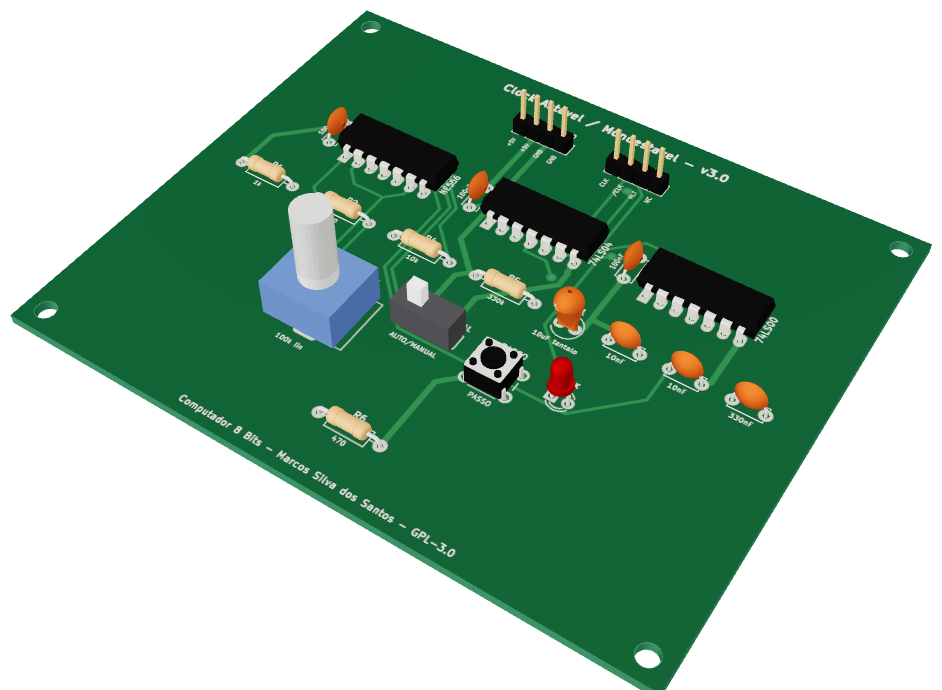 | 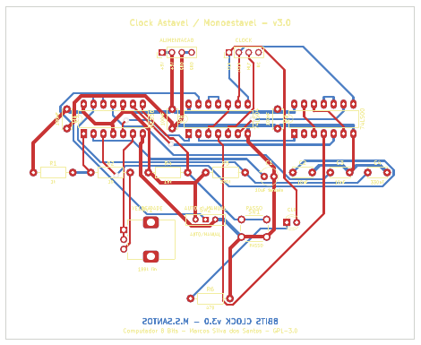 |

## Circuito de Reset

Gera RST e ~{RST} (botao + reset automatico ao ligar) e o ~{STEPCLR} do contador de passos (= ~{RST} AND ~{Y5}).

🧊 **[Página completa da placa](../docs/placas/reset-circuito.md)** (função, funcionamento, esquema, conectores, teste) · [3D (STL)](../docs/3d/stl/reset-circuito.stl) · [STEP](fabricacao/reset-circuito/reset-circuito.step)

| Em 3D | Cobre e serigrafia |
|---|---|
| 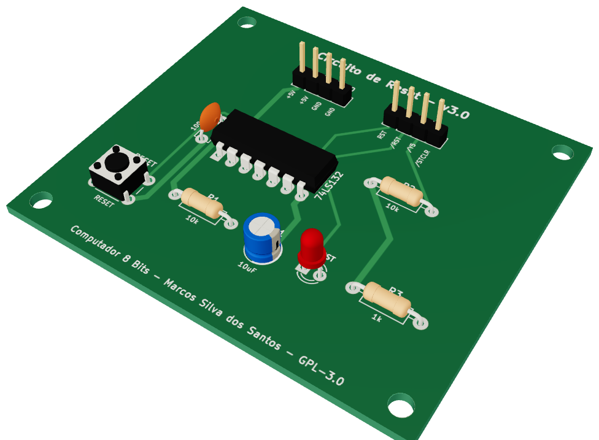 | 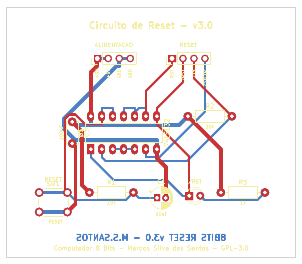 |

## Contador de Programa (PC)

Contador de 4 bits (74LS161) com carga (JMP) e saida para o barramento (74LS245).

🧊 **[Página completa da placa](../docs/placas/pc-contador-programa.md)** (função, funcionamento, esquema, conectores, teste) · [3D (STL)](../docs/3d/stl/pc-contador-programa.stl) · [STEP](fabricacao/pc-contador-programa/pc-contador-programa.step)

| Em 3D | Cobre e serigrafia |
|---|---|
| 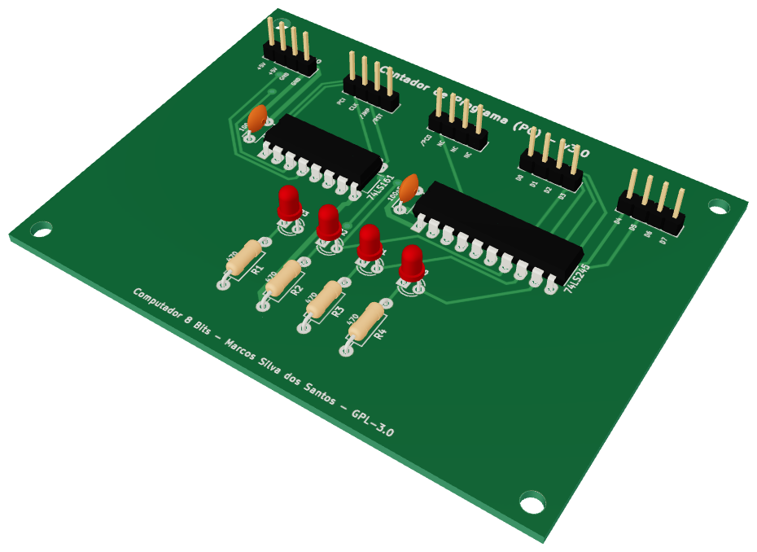 | 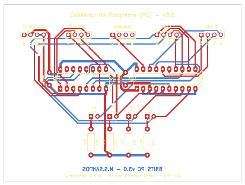 |

## Memoria RAM e MAR

MAR (74LS173), RAM 16x8 (2x 74S189), multiplexadores PROG/RUN (74LS157), gravacao manual por chaves DIP e pulso de escrita sincronizado ao clock.

🧊 **[Página completa da placa](../docs/placas/ram-mar-memoria.md)** (função, funcionamento, esquema, conectores, teste) · [3D (STL)](../docs/3d/stl/ram-mar-memoria.stl) · [STEP](fabricacao/ram-mar-memoria/ram-mar-memoria.step)

| Em 3D | Cobre e serigrafia |
|---|---|
| 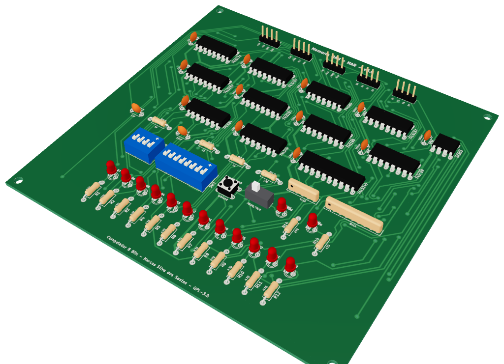 | 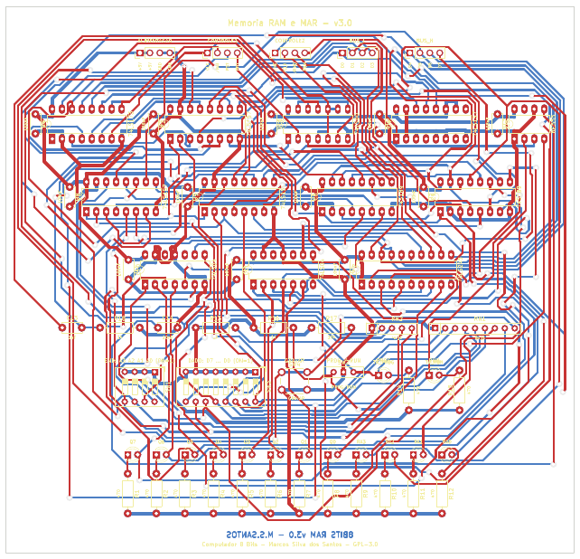 |

## Registrador de Instrucao (IR)

Guarda a instrucao: nibble alto = opcode (para o decodificador), nibble baixo = operando (volta ao barramento por ~{IRO}).

🧊 **[Página completa da placa](../docs/placas/ir-registrador-instrucao.md)** (função, funcionamento, esquema, conectores, teste) · [3D (STL)](../docs/3d/stl/ir-registrador-instrucao.stl) · [STEP](fabricacao/ir-registrador-instrucao/ir-registrador-instrucao.step)

| Em 3D | Cobre e serigrafia |
|---|---|
| 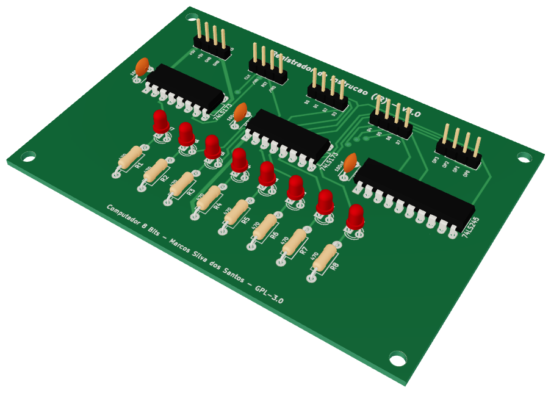 | 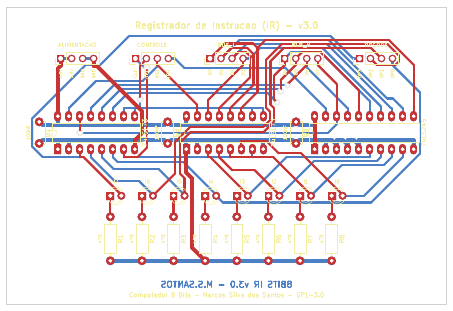 |

## Decodificador de Controle (microcodigo)

3 EEPROMs 28C16 com o microcodigo: endereco = FLAGS(A8:A7) OPCODE(A6:A3) PASSO(A2:A0).

🧊 **[Página completa da placa](../docs/placas/cd-decodificador-controle.md)** (função, funcionamento, esquema, conectores, teste) · [3D (STL)](../docs/3d/stl/cd-decodificador-controle.stl) · [STEP](fabricacao/cd-decodificador-controle/cd-decodificador-controle.step)

| Em 3D | Cobre e serigrafia |
|---|---|
| 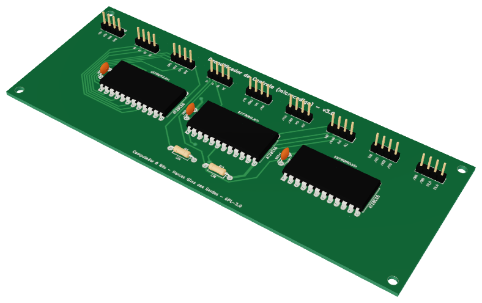 | 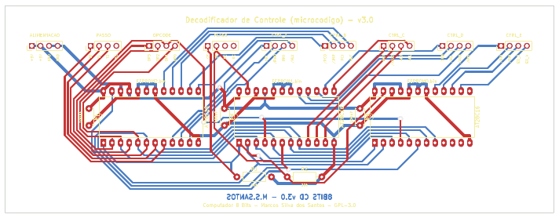 |

## Palavra de Controle (18 LEDs)

Fica entre o Decodificador de Controle e o backplane (que nao muda): recebe os 5 V do conector P_CD e repassa ao Decodificador por J12. 3x 74HCT541 repetem os 20 sinais das EEPROMs (reforcam a saida das EEPROMs) e 18 LEDs mostram cada sinal de controle: LED aceso = sinal ATIVO, inclusive nos sinais com barra (ativos em 0). Opcional: sem ela, os cabos do Decodificador vao direto ao backplane.

🧊 **[Página completa da placa](../docs/placas/cw-palavra-de-controle.md)** (função, funcionamento, esquema, conectores, teste) · [3D (STL)](../docs/3d/stl/cw-palavra-de-controle.stl) · [STEP](fabricacao/cw-palavra-de-controle/cw-palavra-de-controle.step)

| Em 3D | Cobre e serigrafia |
|---|---|
| 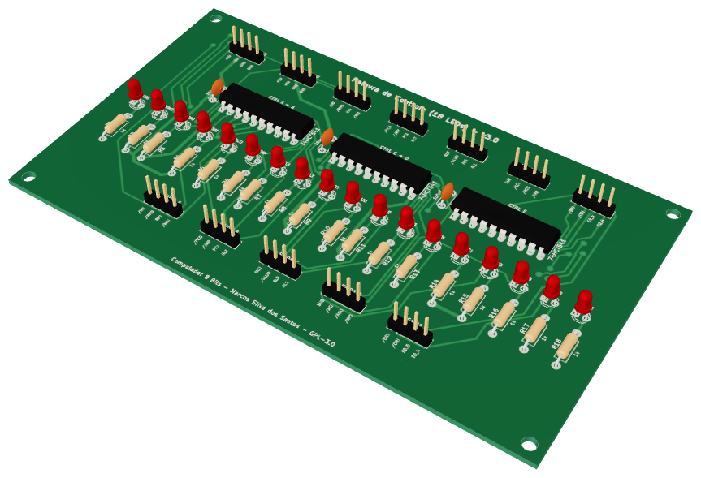 | 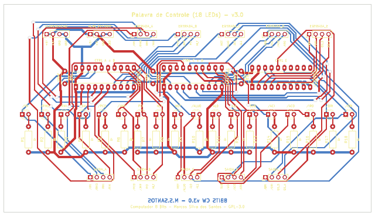 |

## Contador de Passos (Fetch/Execute)

Contador de passos T0..T4 (74LS161 + 74LS138). ~{Y5} reinicia o contador via placa de Reset.

🧊 **[Página completa da placa](../docs/placas/fetch-contador-passos.md)** (função, funcionamento, esquema, conectores, teste) · [3D (STL)](../docs/3d/stl/fetch-contador-passos.stl) · [STEP](fabricacao/fetch-contador-passos/fetch-contador-passos.step)

| Em 3D | Cobre e serigrafia |
|---|---|
| 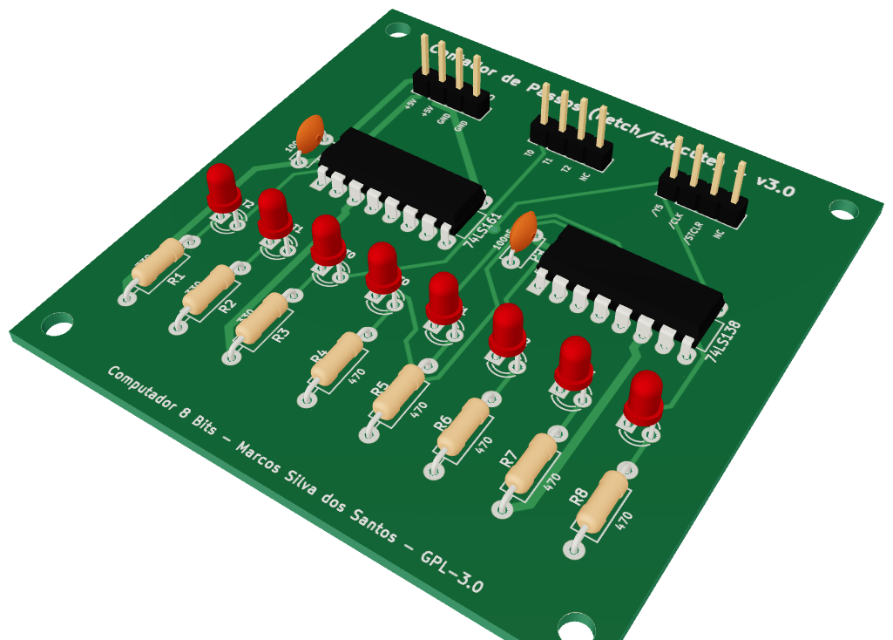 | 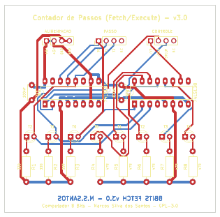 |

## Registrador A (Acumulador)

Registrador A de 8 bits (2x 74LS173) com saida para o barramento (74LS245) e saida permanente para a ULA.

🧊 **[Página completa da placa](../docs/placas/acc-registrador-a.md)** (função, funcionamento, esquema, conectores, teste) · [3D (STL)](../docs/3d/stl/acc-registrador-a.stl) · [STEP](fabricacao/acc-registrador-a/acc-registrador-a.step)

| Em 3D | Cobre e serigrafia |
|---|---|
|  | 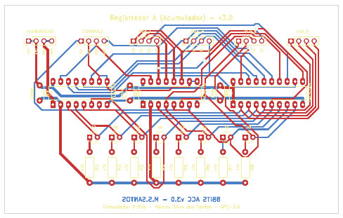 |

## Registrador B

Registrador B de 8 bits; alimenta a entrada B da ULA.

🧊 **[Página completa da placa](../docs/placas/b-registrador-b.md)** (função, funcionamento, esquema, conectores, teste) · [3D (STL)](../docs/3d/stl/b-registrador-b.stl) · [STEP](fabricacao/b-registrador-b/b-registrador-b.step)

| Em 3D | Cobre e serigrafia |
|---|---|
| 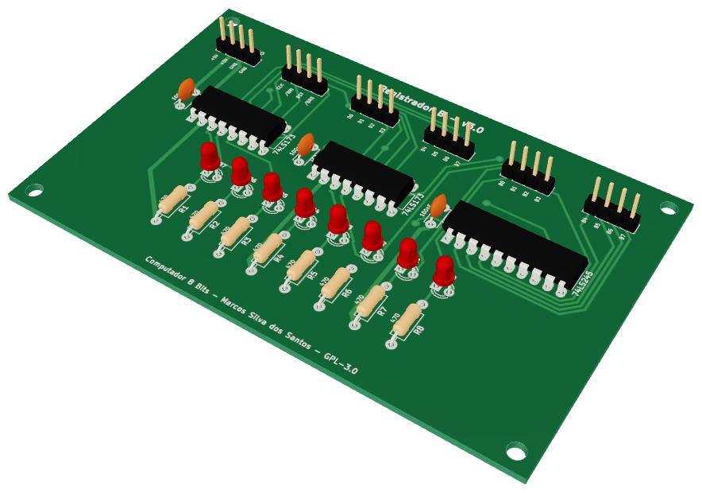 | 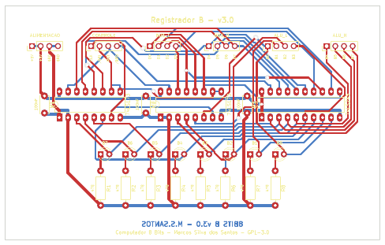 |

## Unidade Logica e Aritmetica (ULA)

Soma/subtracao (2x 74LS283 + 74LS86), AND, OR, XOR e NOT, selecionados por AL1:AL0 em 4x 74LS153.

🧊 **[Página completa da placa](../docs/placas/alu-unidade-logica-aritmetica.md)** (função, funcionamento, esquema, conectores, teste) · [3D (STL)](../docs/3d/stl/alu-unidade-logica-aritmetica.stl) · [STEP](fabricacao/alu-unidade-logica-aritmetica/alu-unidade-logica-aritmetica.step)

| Em 3D | Cobre e serigrafia |
|---|---|
| 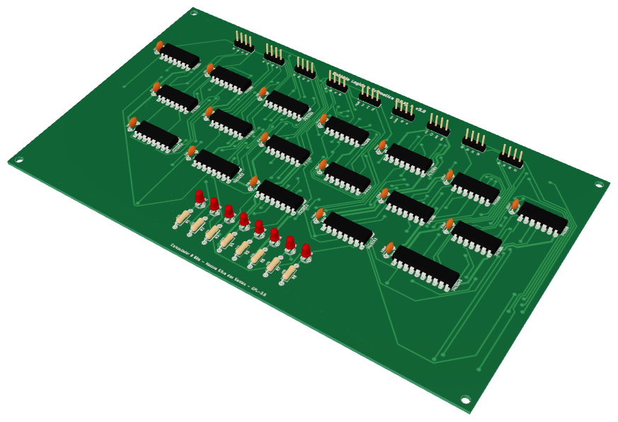 | 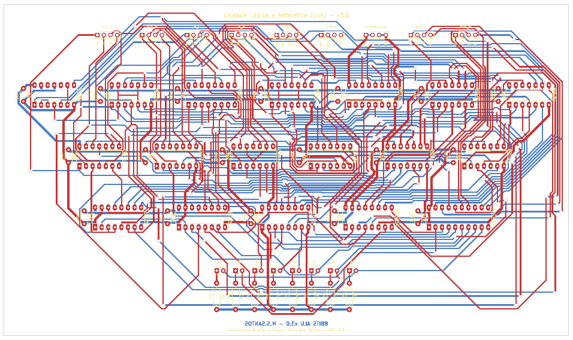 |

## Registrador de Saida (OUT)

Registrador de saida: guarda o valor exibido pelo display decimal.

🧊 **[Página completa da placa](../docs/placas/out-registrador-saida.md)** (função, funcionamento, esquema, conectores, teste) · [3D (STL)](../docs/3d/stl/out-registrador-saida.stl) · [STEP](fabricacao/out-registrador-saida/out-registrador-saida.step)

| Em 3D | Cobre e serigrafia |
|---|---|
| 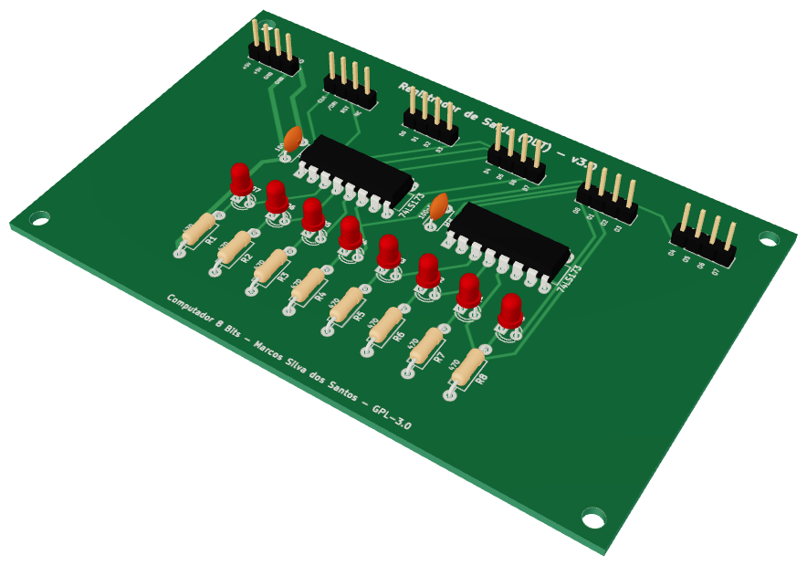 | 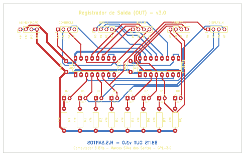 |

## Display Decimal

Converte o valor de 8 bits do registrador OUT em decimal (0..255 ou -128..127) por EEPROM 28C16 e varredura de 4 digitos (555 + 74LS161 + 74LS139).

🧊 **[Página completa da placa](../docs/placas/display-decimal.md)** (função, funcionamento, esquema, conectores, teste) · [3D (STL)](../docs/3d/stl/display-decimal.stl) · [STEP](fabricacao/display-decimal/display-decimal.step)

| Em 3D | Cobre e serigrafia |
|---|---|
| 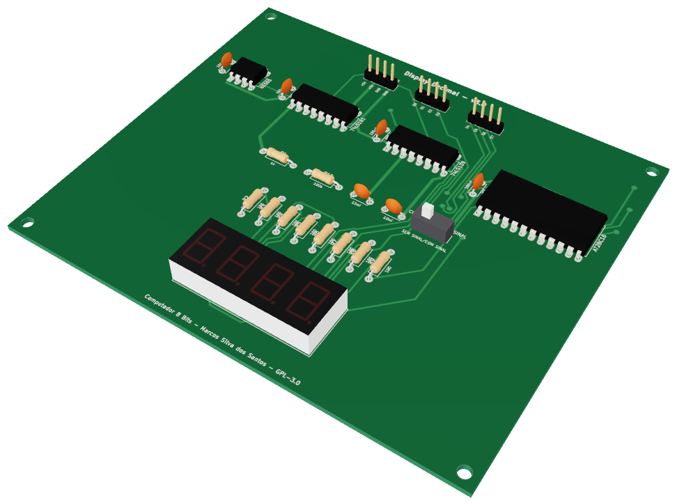 | 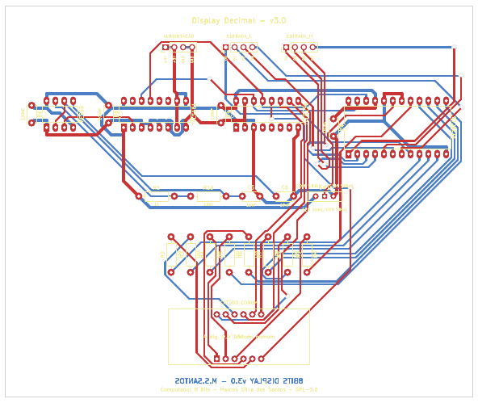 |

## Backplane / Barramento (Assembly Layout)

Placa-mae de interligacao: entrada de 5 V protegida, distribuicao de alimentacao, barramento de dados D0..D7 com LEDs, e roteamento de todos os sinais de controle entre os modulos. Cada conector tem a mesma pinagem do conector correspondente no modulo: use cabos de 4 vias RETOS (pino 1 com pino 1).

🧊 **[Página completa da placa](../docs/placas/backplane-barramento.md)** (função, funcionamento, esquema, conectores, teste) · [3D (STL)](../docs/3d/stl/backplane-barramento.stl) · [STEP](fabricacao/backplane-barramento/backplane-barramento.step)

| Em 3D | Cobre e serigrafia |
|---|---|
| 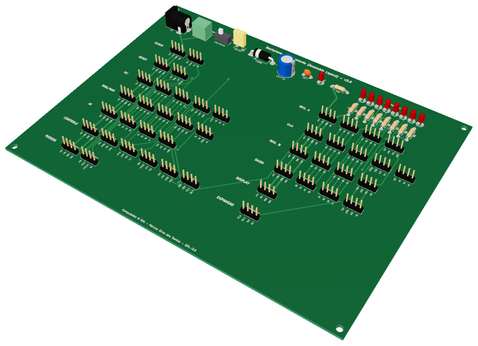 | 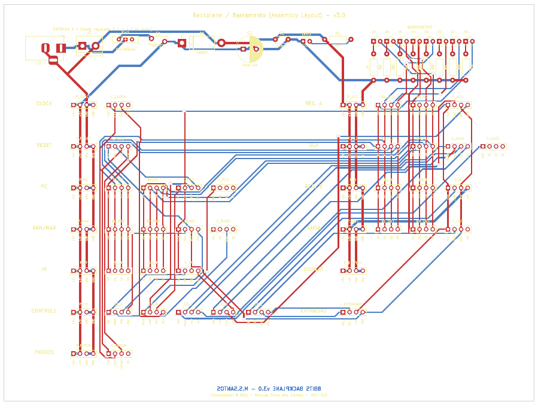 |

